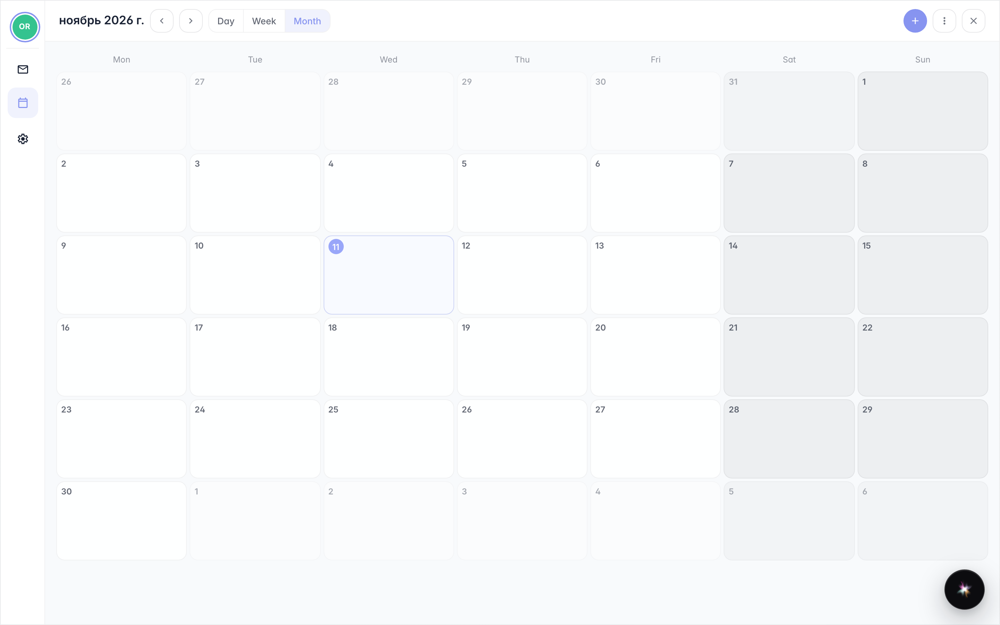

# Календарь из меню пользователя

**Для чего:** проверять встречи и сроки, не меняя приложение: календарь открывается из меню пользователя в один клик.

**Какие проблемы решает:** во время работы нужен быстрый взгляд на день или неделю без потери открытой страницы.

**Результат:** календарь открыт поверх работы, готов к просмотру и закрытию.

## Шаг 1. В меню пользователя откройте «Календарь»

Нажмите на своё имя справа вверху и выберите «Календарь»: окно открывается поверх работы без смены страницы. Текущий месяц показывает встречи недели.

## Шаг 2. Посмотрите и закройте

**Демонстрация результата.** Календарь общий с почтой компании: события из писем и встречи появляются здесь. Когда закончили — закройте окно и вернитесь туда, где были.

**Итог.** Повестка всегда в одном клике, без лишних окон.

