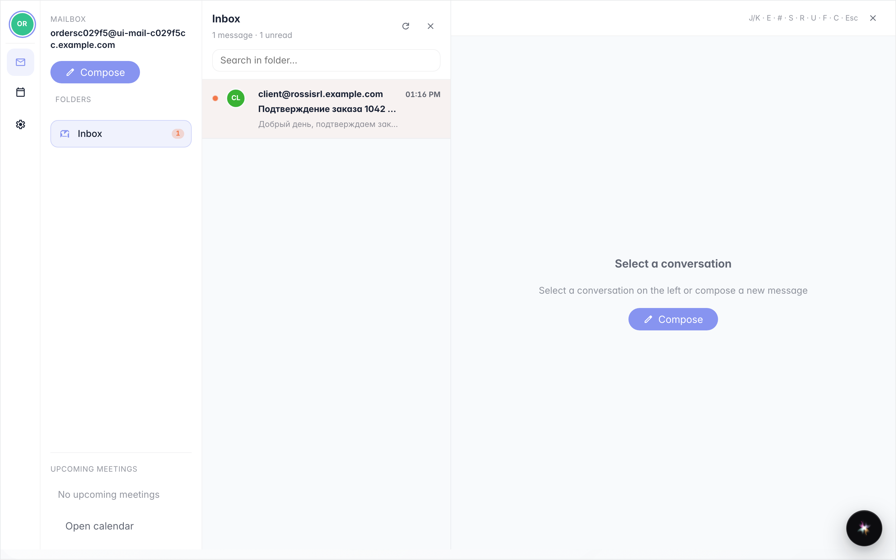
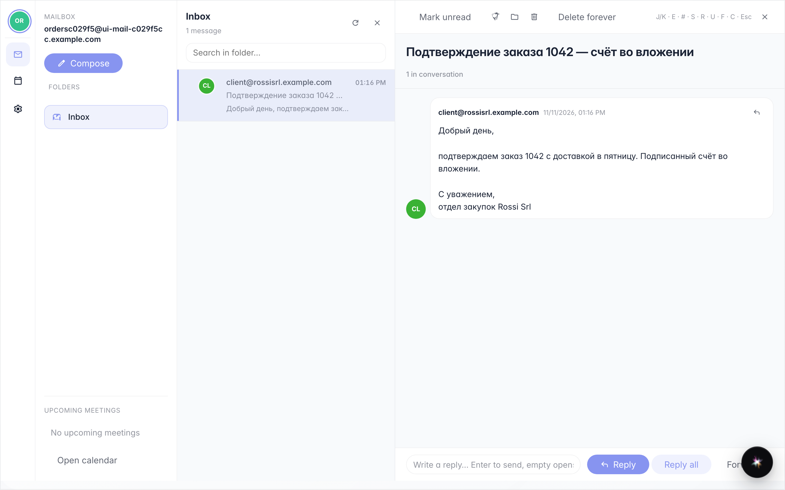

# Company mail from the user menu

**Purpose:** read company mail without opening another program: the «Mail» window shows folders, messages, and lets you reply.

**Problems solved:** work mail arrives on a company address; from the user menu you read it where you already work.

**Result:** the mailbox open with incoming messages and a message read in the reading pane.

## Step 1. From the user menu open «Mail»

Click your name at the top right, then «Mail»: folders on the left (inbox, sent, drafts, trash), the message list in the middle. Bold messages are unread.

## Step 2. Click the message to read it

**Result demonstration.** One click opens the message on the right: sender, subject and full body. From here you reply or forward; the folder updates itself when new mail arrives.

**Summary.** Company mail is read and managed inside the platform, in the same window as the other tools.

