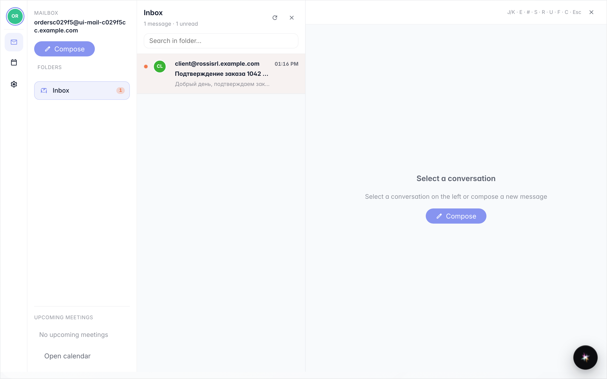
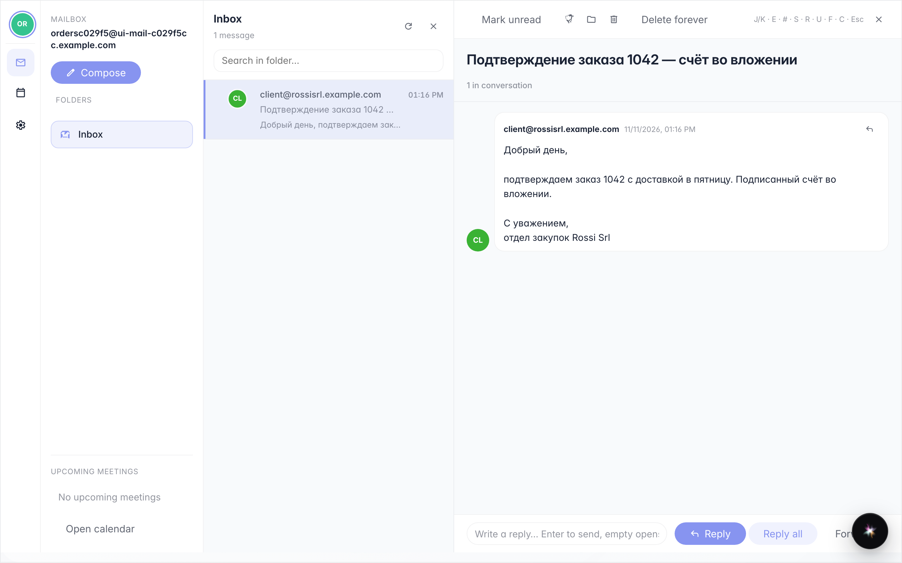

# Почта компании в меню пользователя

**Для чего:** читать почту компании, не открывая другую программу: окно «Почта» показывает папки, письма и позволяет ответить.

**Какие проблемы решает:** рабочие письма приходят на адрес компании; из меню пользователя их можно читать там же, где работаете.

**Результат:** ящик открыт, входящие письма видны, письмо прочитано в области чтения.

## Шаг 1. В меню пользователя откройте «Почту»

Нажмите на своё имя справа вверху и выберите «Почта»: слева папки (входящие, отправленные, черновики, корзина), в центре — список писем. Жирным выделено ещё не прочитанное.

## Шаг 2. Нажмите на письмо, чтобы прочитать

**Демонстрация результата.** Один клик открывает письмо справа: отправитель, тема и полный текст. Отсюда можно ответить или переслать; папка обновляется сама, когда приходит новая почта.

**Итог.** Почта компании читается и обрабатывается внутри платформы, в том же окне, что и другие инструменты.

