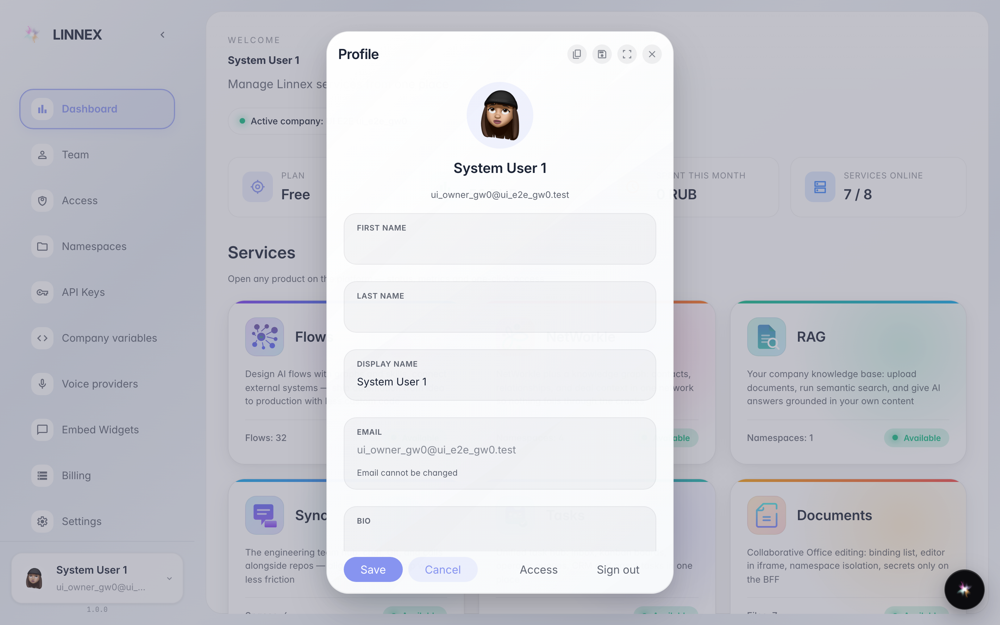
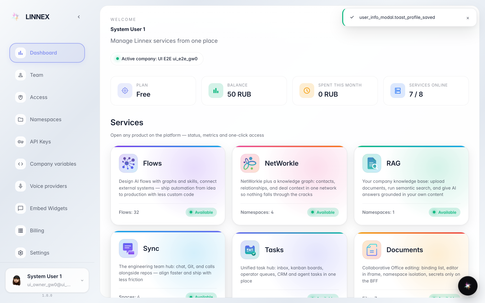
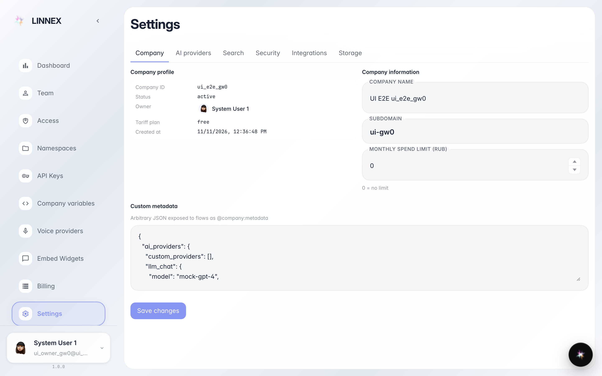

# Your profile and company settings

**Purpose:** view and fix your details (name, language) and find the company settings in one place.

**Problems solved:** the name shown to colleagues is wrong or incomplete, or you need the subscription plan and status.

**Result:** profile saved and the settings page open on the company tab.

## Step 1. From the user menu open «Profile»

Click your name at the top right, then «Profile»: the window shows first name, last name, email and language. This is the card colleagues see next to your name.

## Step 2. Fix and press «Save»

If something is off (shortened name, wrong language) fix the field and press «Save»: the message confirms the profile is updated and colleagues immediately see the new name.

## Step 3. Company settings: the «Company» tab

**Result demonstration.** The «Settings» page has tabs on top; «Company» shows identifier, status, owner and tariff plan. The other tabs (security, integrations, storage) are for the administrator.

**Summary.** You know where to fix your profile and where to read the company subscription details.

