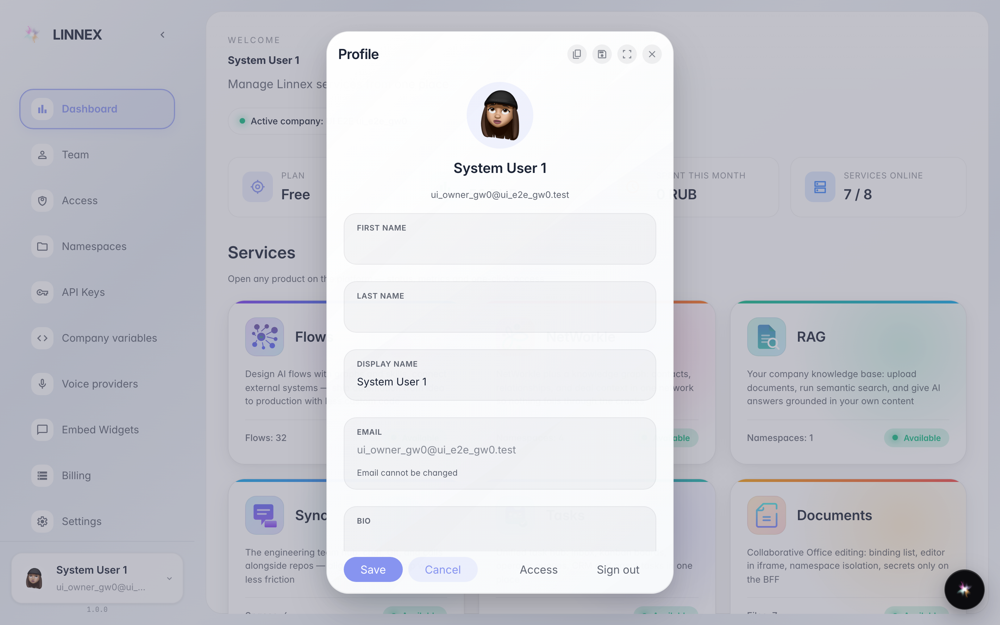
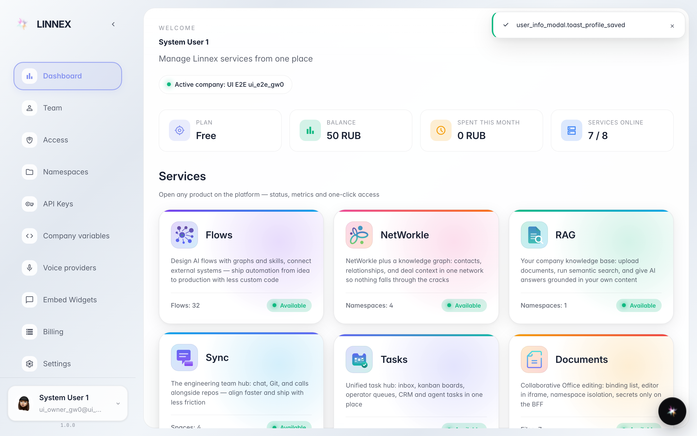
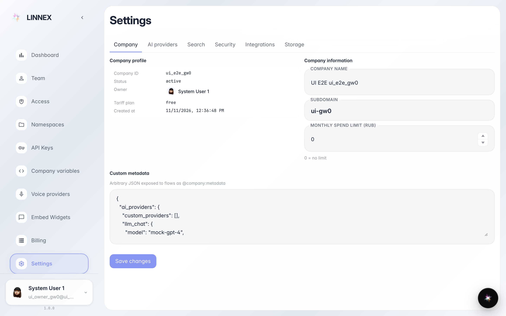

# Ваш профиль и настройки компании

**Для чего:** посмотреть и исправить свои данные (имя, язык) и найти настройки компании в одном месте.

**Какие проблемы решает:** имя, которое видят коллеги, неправильное или неполное; либо нужно узнать тариф и статус подписки.

**Результат:** профиль сохранён, страница настроек открыта на вкладке компании.

## Шаг 1. В меню пользователя откройте «Профиль»

Нажмите на своё имя справа вверху и выберите «Профиль»: окно показывает имя, фамилию, email и язык. Это карточка, которую коллеги видят рядом с вашим именем.

## Шаг 2. Исправьте и нажмите «Сохранить»

Если что-то не так (имя сокращено, язык не тот) — исправьте поле и нажмите «Сохранить»: сообщение подтверждает, что профиль обновлён, и коллеги сразу видят новое имя.

## Шаг 3. Настройки компании: вкладка «Компания»

**Демонстрация результата.** На странице «Настройки» вверху вкладки; «Компания» показывает идентификатор, статус, владельца и тариф. Остальные вкладки (безопасность, интеграции, хранилища) нужны администратору.

**Итог.** Теперь вы знаете, где исправить свой профиль и где прочитать данные подписки компании.

