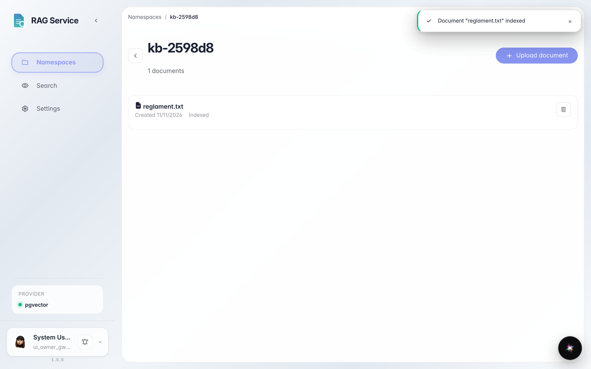
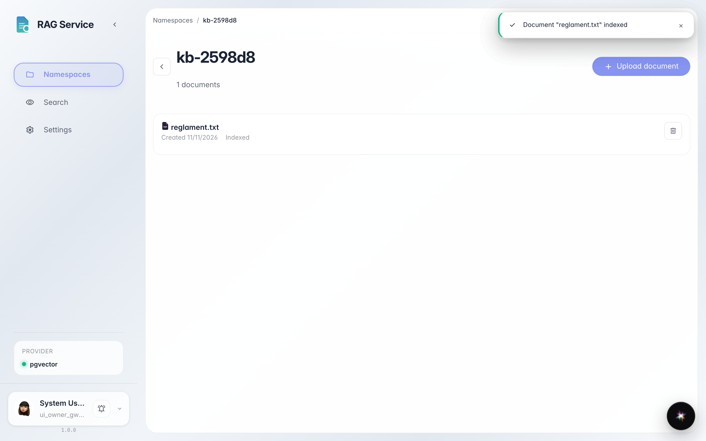

# Upload a document and wait for it to be indexed

**Purpose:** add a file to a knowledge space and see when search over it is ready.

**Problems solved:** after upload it is unclear whether the document is indexed. Here is where to check the status.

**Result:** the document card shows «Indexed» status — the file is searchable.

## Step 1. Wait for the document to be indexed

Open the space and upload a file with the «Upload» button or drag it into the dashed zone. Under the file name a status appears: first «Indexing…», then «Indexed» — from that moment the document is searchable.

## Step 2. Delete the document if needed

Each card has a trash button on the right: it removes the document from the space and from search. No need to click it now — just know where it is.

**Summary.** You can upload files and tell from the «Indexed» status that a document is ready for search.

