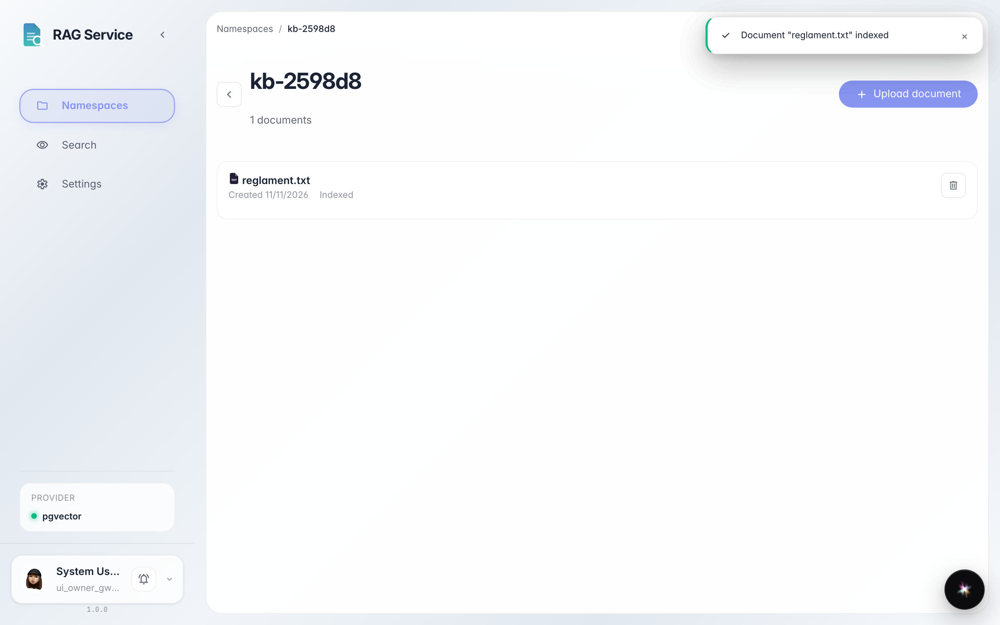
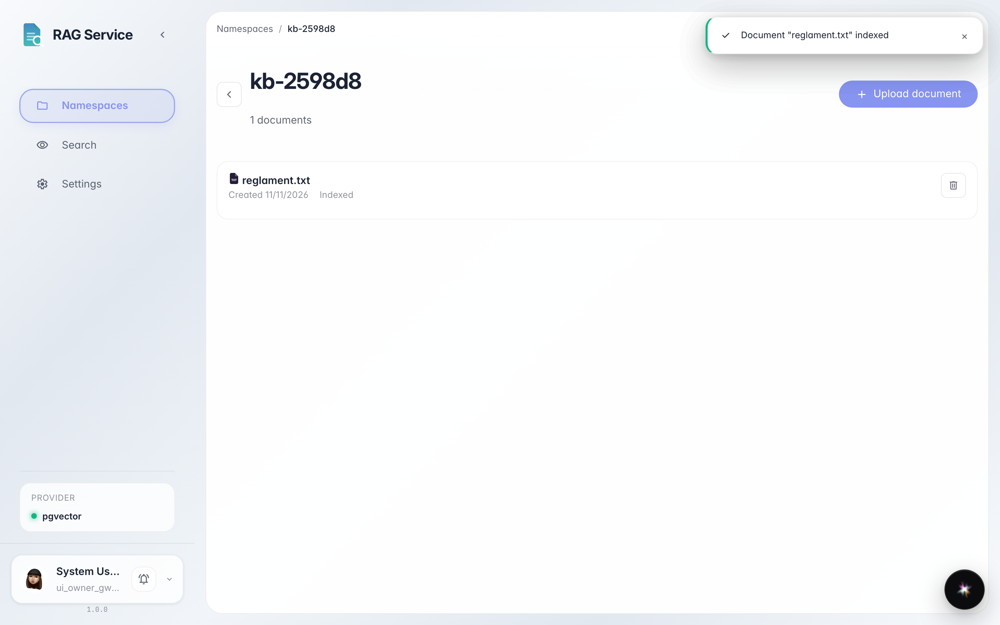

# Загружаем документ и ждём, пока он проиндексируется

**Для чего:** добавить файл в пространство знаний и понять, когда поиск по нему уже работает.

**Какие проблемы решает:** после загрузки непонятно, готов ли документ к умному поиску. Здесь показано, где смотреть статус.

**Результат:** карточка документа показывает статус «Проиндексирован» — файл участвует в поиске.

## Шаг 1. Дождитесь индексации документа

Откройте пространство и загрузите файл кнопкой «Загрузить» или перетащите его в пунктирную зону. Под именем файла появится статус: сначала «Индексируется…», затем «Проиндексирован» — с этого момента документ участвует в поиске.

## Шаг 2. При необходимости удалите документ

У каждой карточки есть кнопка корзины справа: она убирает документ из пространства и из поиска. Нажимать её сейчас не нужно — просто знайте, где она.

**Итог.** Вы умеете загружать файлы и понимать по статусу «Проиндексирован», что документ готов к поиску.

