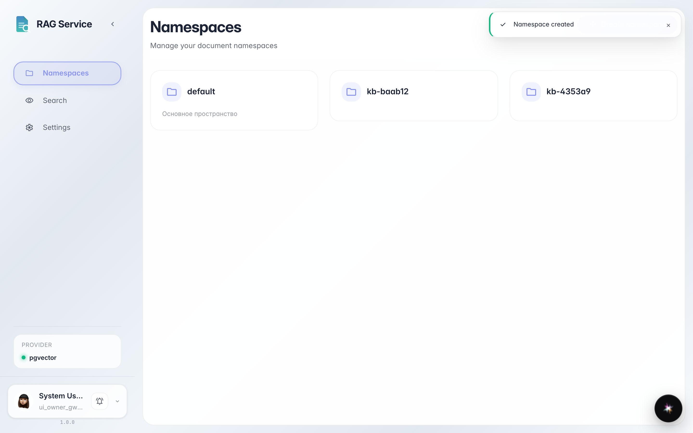
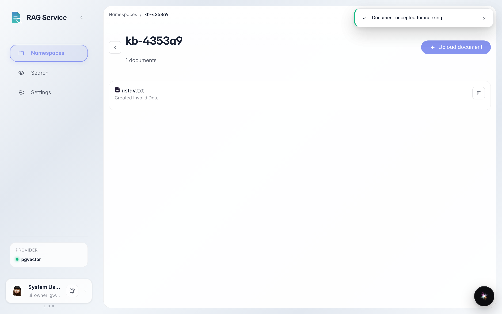
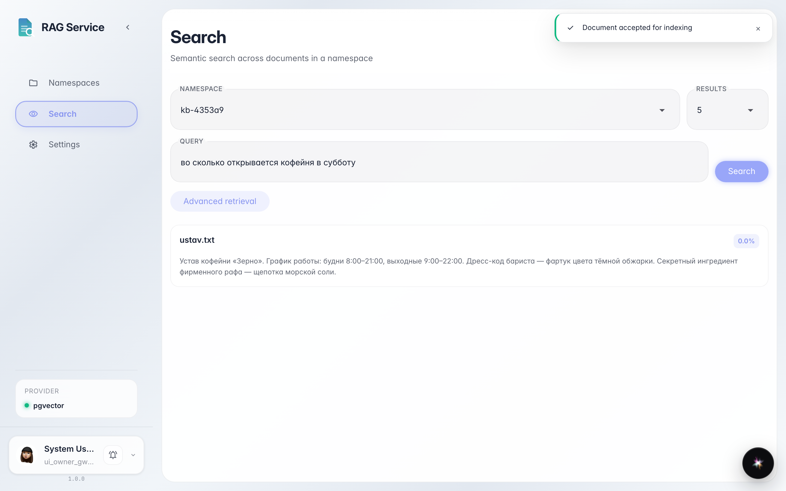

# First knowledge space: upload and smart search

**Purpose:** teach the platform to answer from your documents — create a knowledge space, upload a file, and find it by meaning rather than exact words.

**Problems solved:** scattered documents are hard to find. Here you will see how to build a knowledge base in minutes and ask it a question in plain words.

**Result:** the uploaded document is found by semantic search — a query without the exact words still returns the right card.

## Step 1. Create a knowledge space

On the «Namespaces» page click «Create» and give the space a latin name — e.g. `kb-docs` (a technical name: English letters, digits and dashes only). A namespace is a separate shelf for documents: charters here, manuals there.

## Step 2. Upload a document into the space

Open the space and click «Upload» — or simply drag the file into the window. The document appears in the list: the system starts indexing it right away — parsing it by meaning for smart search.

## Step 3. Ask search in your own words

**Result demonstration.** Open «Search», pick the space and write the question as you would ask a colleague: «when does the coffee shop open on Saturday». The exact words «weekends 9:00–22:00» are not in the query — yet search found them in the document and returned a card with a match score.

**Summary.** You built a knowledge space: created a shelf, uploaded a document and confirmed smart search finds things by meaning.

