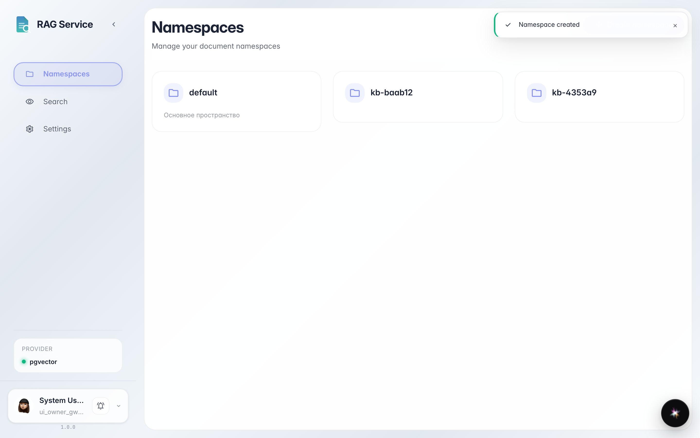
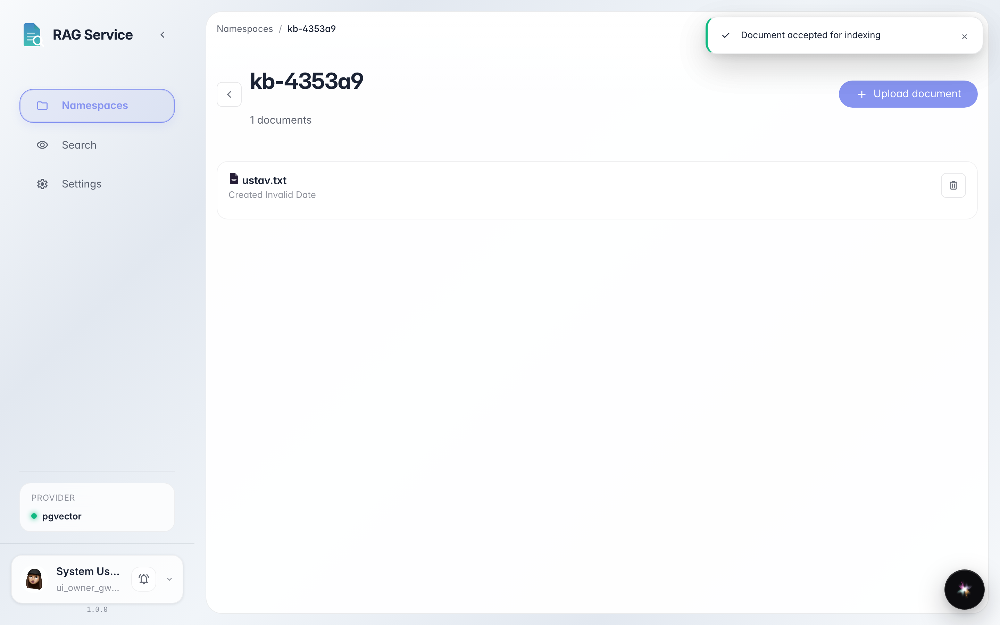
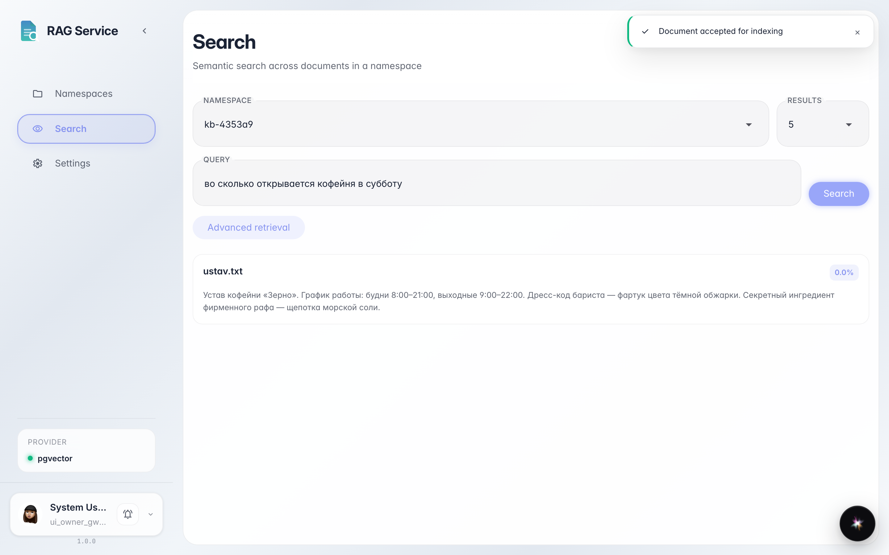

# Первое пространство знаний: загрузка и умный поиск

**Для чего:** научить платформу отвечать по вашим документам — создать пространство знаний, загрузить файл и найти нужное по смыслу, а не по точным словам.

**Какие проблемы решает:** документы разбросаны и ничего не найти. Здесь вы увидите, как за пару минут собрать базу знаний и задать ей вопрос обычной фразой.

**Результат:** загруженный документ найден поиском по смыслу — запрос без точных слов из текста выдаёт нужную карточку.

## Шаг 1. Создайте пространство знаний

На странице «Пространства» нажмите «Создать» и дайте пространству имя латиницей — например, `kb-docs` (это техническое имя: только английские буквы, цифры и дефис). Пространство — это отдельная полка для документов: уставы отдельно, инструкции отдельно.

## Шаг 2. Загрузите документ в пространство

Откройте пространство и нажмите «Загрузить» — или просто перетащите файл в окно. Документ появится в списке: система сразу начинает его индексировать — разбирать по смыслу для умного поиска.

## Шаг 3. Спросите поиск своими словами

**Демонстрация результата.** Откройте «Поиск», выберите пространство и напишите вопрос как спросили бы коллегу: «во сколько открывается кофейня в субботу». Точных слов «выходные 9:00–22:00» в запросе нет — но поиск нашёл их в документе и выдал карточку с оценкой совпадения.

**Итог.** Вы собрали пространство знаний: создали полку, загрузили документ и убедились, что умный поиск находит нужное по смыслу.

