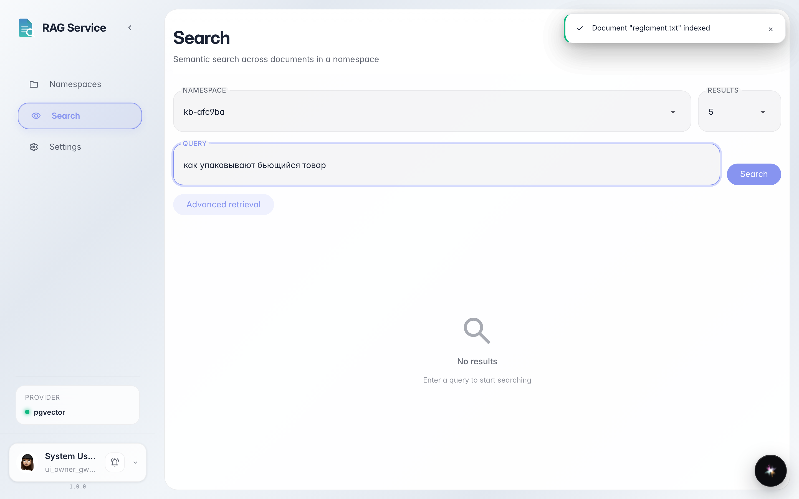
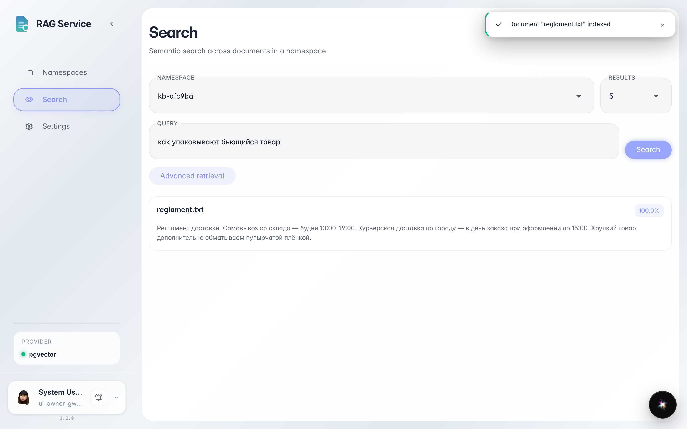

# Find a document by meaning: match score and excerpt

**Purpose:** find things in documents with a plain phrase and see how well each result fits.

**Problems solved:** you rarely remember the exact wording. Semantic search finds the right passage and honestly shows a match percentage.

**Result:** a result card with a match percentage and the document excerpt.

## Step 1. Ask in your own words

Open «Search» in the left menu, pick the space and type the question as you would ask a colleague — e.g. «how do they pack fragile goods». The exact words «bubble wrap» are not in the query — semantic search works by meaning.

## Step 2. Read the score and the excerpt

**Result demonstration.** Each card shows a match percentage — how well the passage fits the question — and the document excerpt itself. The percentage tells you whether it is worth opening the file.

**Summary.** Meaning-based search finds things without exact words, and the score tells you which result to trust.

