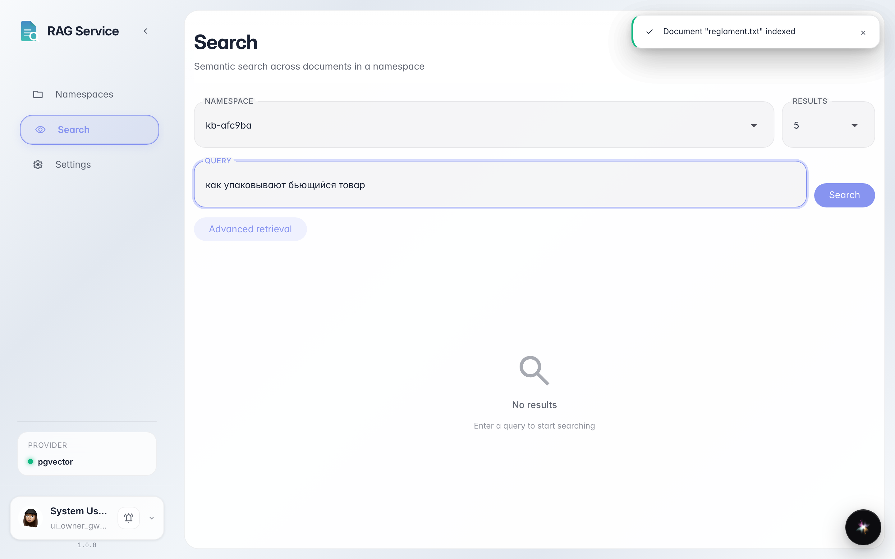
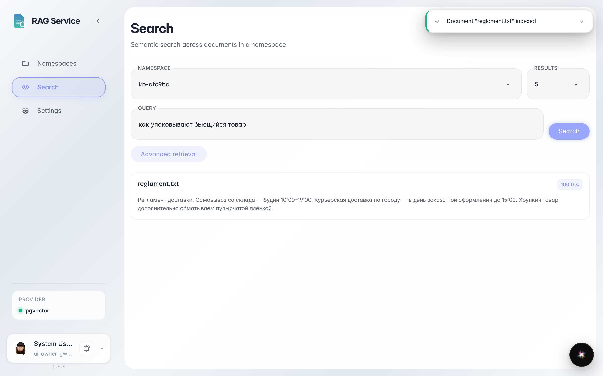

# Ищем документ по смыслу: оценка совпадения и фрагмент

**Для чего:** найти нужное в документах обычной фразой и понять, насколько результат подходит.

**Какие проблемы решает:** точные слова из документа не вспомнить. Поиск по смыслу находит нужный фрагмент и честно показывает процент совпадения.

**Результат:** карточка результата с процентом совпадения и фрагментом текста документа.

## Шаг 1. Задайте вопрос своими словами

Откройте «Поиск» в меню слева, выберите пространство и напишите вопрос как спросили бы коллегу — например, «как упаковывают бьющийся товар». Точных слов «пупырчатая плёнка» в запросе нет — умный поиск ищет по смыслу.

## Шаг 2. Прочитайте оценку и фрагмент

**Демонстрация результата.** Каждая карточка показывает процент совпадения — насколько фрагмент подходит к вопросу — и сам фрагмент из документа. По проценту видно, стоит ли открывать файл целиком.

**Итог.** Поиск по смыслу находит нужное даже без точных слов, а оценка подсказывает, какому результату доверять.

