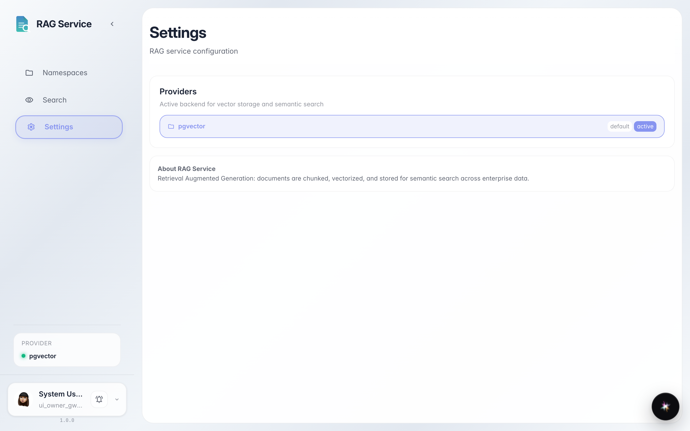

# RAG settings: search providers

**Purpose:** see which engine stores document vectors and powers semantic search.

**Problems solved:** when search behaves unexpectedly, the active provider is the first thing to check — it is shown on the settings page.

**Result:** provider cards with «active» and «default» badges.

## Step 1. Open «Settings» and find the active provider

Choose «Settings» in the left menu. The «Providers» section lists engines that store document vectors. The highlighted card with an «active» badge is the engine currently answering search queries; the «default» badge marks the provider chosen in configuration.

## Step 2. Read how the search works

Below is the «About RAG Service» box: it briefly explains how semantic search works. Documents are split into chunks, turned into vectors and stored — that is why search works by meaning, not exact words.

**Summary.** The settings page shows which provider serves search and how document indexing works.

