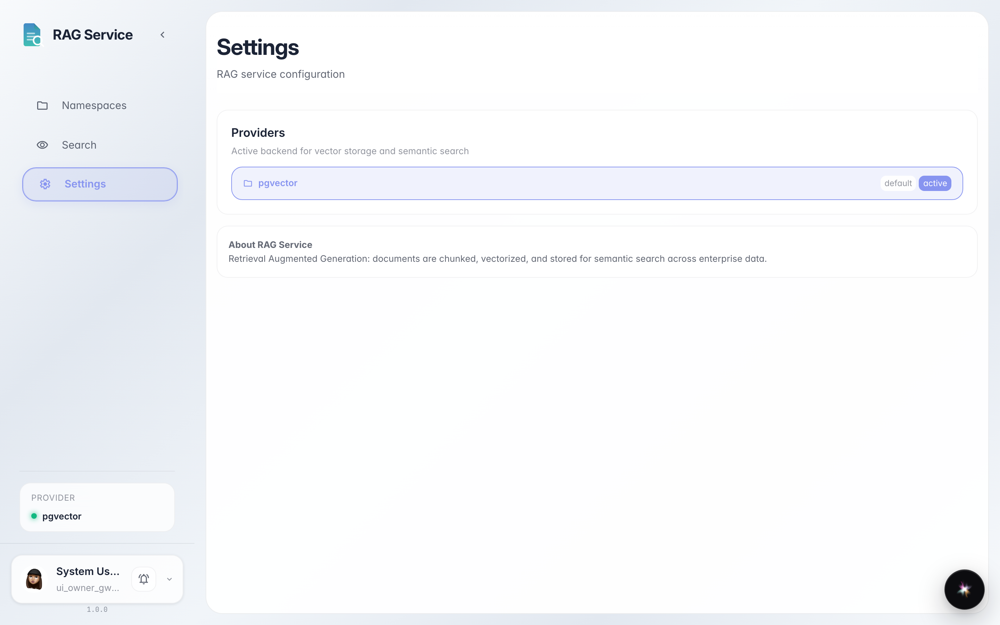

# Настройки RAG: провайдеры поиска

**Для чего:** посмотреть, какой движок хранит векторы документов и используется для умного поиска.

**Какие проблемы решает:** когда поиск работает не так, первым делом проверяют активный провайдер — он показан на странице настроек.

**Результат:** карточки провайдеров с отметками «активен» и «по умолчанию».

## Шаг 1. Откройте «Настройки» и найдите активного провайдера

В меню слева выберите «Настройки». В секции «Провайдеры» карточки показывают движки, которые хранят векторы документов. Подсвеченная карточка с отметкой «активен» — тот движок, который сейчас отвечает на поисковые запросы; отметка «по умолчанию» — провайдер, выбранный в конфигурации.

## Шаг 2. Прочитайте, как работает поиск

Ниже — блок «О RAG Service»: он коротко объясняет устройство умного поиска. Документы разбиваются на фрагменты, превращаются в векторы и сохраняются — поэтому поиск находит по смыслу, а не по точным словам.

**Итог.** На странице настроек видно, какой провайдер обслуживает поиск, и как устроена индексация документов.

