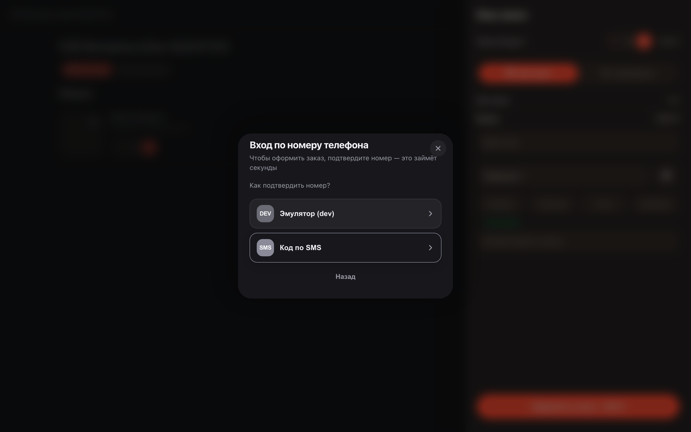
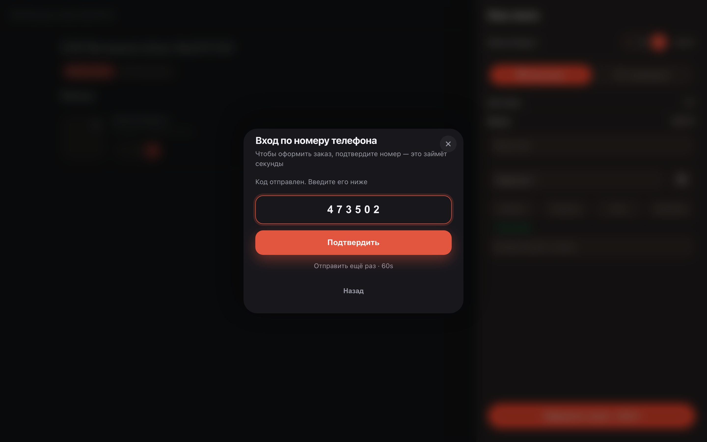

# Customer sign-in by phone number

**Purpose:** customers need no passwords or registration — a phone number and an SMS code unlock orders, addresses and loyalty.

**Problems solved:** sign-in pops up only where needed — at checkout or in the account. The customer fills no forms and memorizes nothing.

**Result:** the customer is signed in — the order is placed and bound to their number.

## Step 1. Enter the phone number

At checkout the storefront asks for a phone number — that is the sign-in. There is no separate registration: the number is your account.

## Step 2. Choose a confirmation method

The storefront offers ways to confirm the number — for example, an SMS code. Pick whichever is convenient: nothing to memorize.

## Step 3. Enter the SMS code

A short code arrives by SMS — type it into the field. The code is one-time and lives for a few minutes.

## Step 4. Signed in — order accepted

After the number is confirmed the order goes to work and gets a number. Next time no sign-in is needed — the storefront remembers you.

**Summary.** The phone is both the account and the confirmation: the customer signs in passwordless and the order is bound to them right away.

