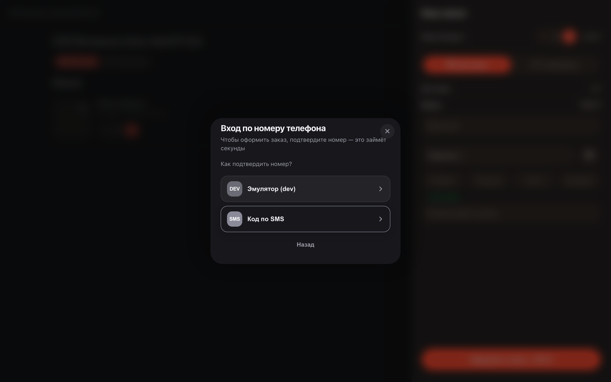
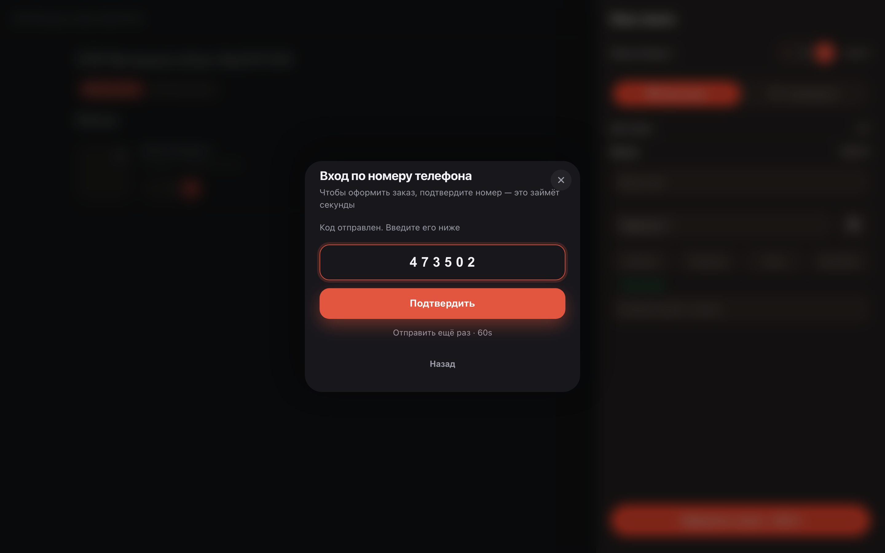

# Вход покупателя по номеру телефона

**Для чего:** покупателю не нужны пароли и регистрация — номер телефона и код из SMS открывают заказы, адреса и лояльность.

**Какие проблемы решает:** вход всплывает только там, где он нужен — при оформлении заказа или в личном кабинете. Покупатель не заполняет анкету и ничего не запоминает.

**Результат:** покупатель вошёл — заказ оформлен и привязан к его номеру.

## Шаг 1. Введите номер телефона

При оформлении заказа витрина просит номер телефона — это и есть вход. Отдельной регистрации нет: номер — ваш аккаунт.

## Шаг 2. Выберите способ подтверждения

Витрина предлагает способы подтверждения номера — например, код по SMS. Выбирайте удобный: ничего запоминать не нужно.

## Шаг 3. Введите код из SMS

На номер приходит короткий код — впишите его в поле. Код одноразовый и живёт несколько минут.

## Шаг 4. Вход выполнен — заказ принят

После подтверждения номера заказ уходит в работу и получает номер. В следующий раз вход уже не понадобится — витрина вас помнит.

**Итог.** Телефон — это и аккаунт, и подтверждение: покупатель заходит без пароля, а заказ сразу привязан к нему.

