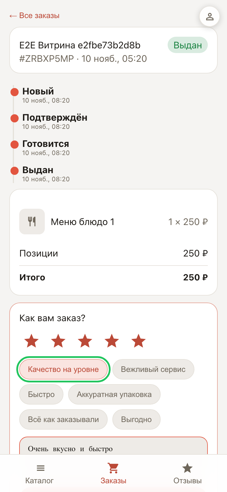
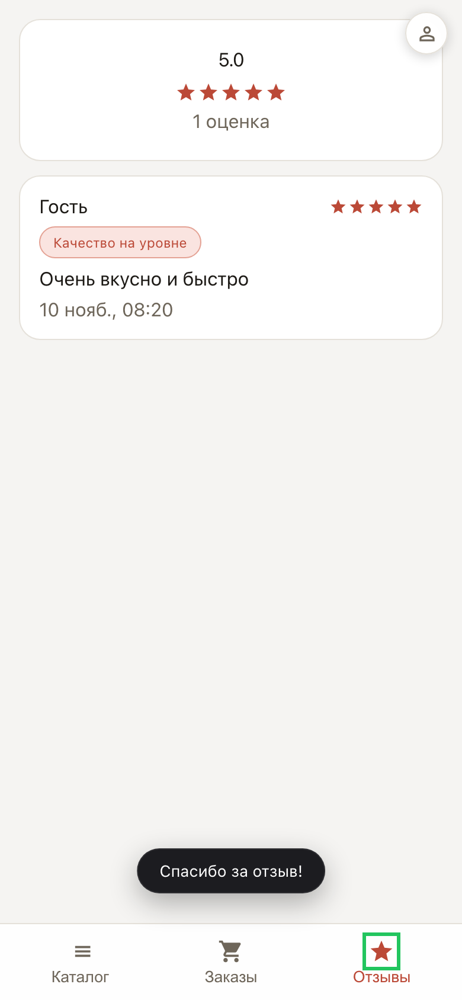

# Customer feedback: rating and the public feed

**Purpose:** after a completed order the customer leaves a rating — reviews collect into the Reviews feed on the storefront and build reputation.

**Problems solved:** no need to ask for a review in a messenger — the rating card appears in the customer's account by itself; quick chips replace long text.

**Result:** rating and comment are visible to all storefront visitors with an aggregate score.

## Step 1. Rating the order

A completed order shows a Rate card in the customer's account: stars, quick chips and a comment field. Three taps are enough.

## Step 2. Reviews feed

The Reviews tab is open to every storefront visitor: an aggregate score and review cards with comments. Honest ratings sell better than any copy.

