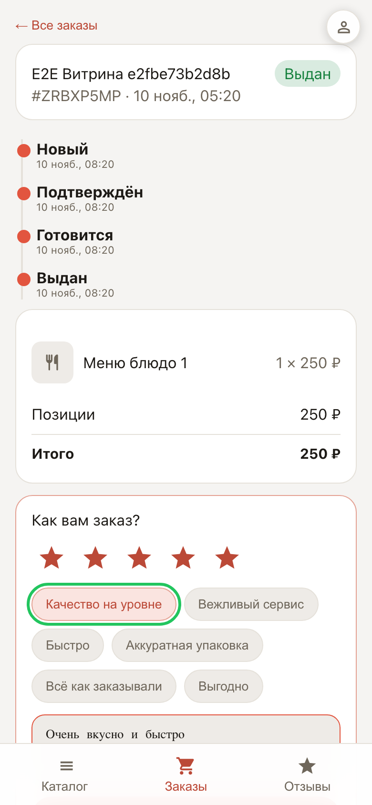
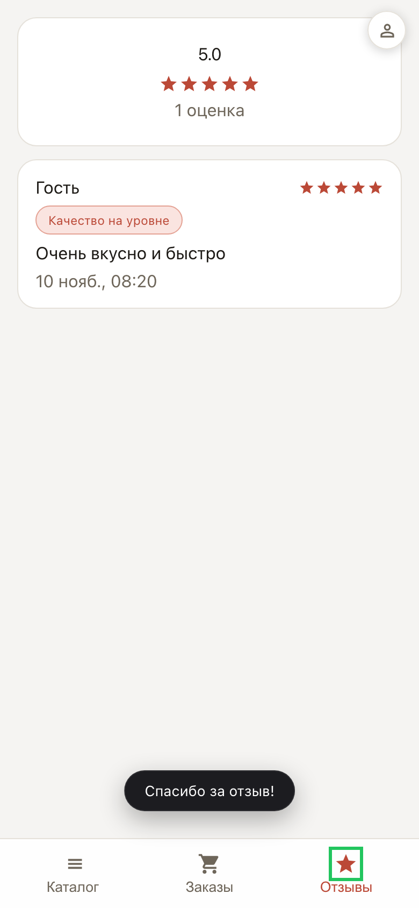

# Отзывы покупателей: оценка и публичная лента

**Для чего:** после выполненного заказа покупатель ставит оценку — отзывы собираются в ленту «Отзывы» на витрине и работают на репутацию.

**Какие проблемы решает:** не нужно просить отзыв в мессенджере — карточка оценки появляется сама в кабинете покупателя; быстрые чипы («вкусно», «быстро») заменяют длинный текст.

**Результат:** оценка и комментарий видны всем посетителям витрины со сводным рейтингом.

## Шаг 1. Оценка заказа

В кабинете покупателя у выполненного заказа появляется карточка «Оценить заказ»: звёзды, быстрые чипы и поле комментария. Достаточно трёх нажатий.

## Шаг 2. Лента отзывов

Вкладка «Отзывы» открыта всем посетителям витрины: сводный рейтинг и карточки отзывов с комментариями. Честные оценки продают лучше любого текста.

