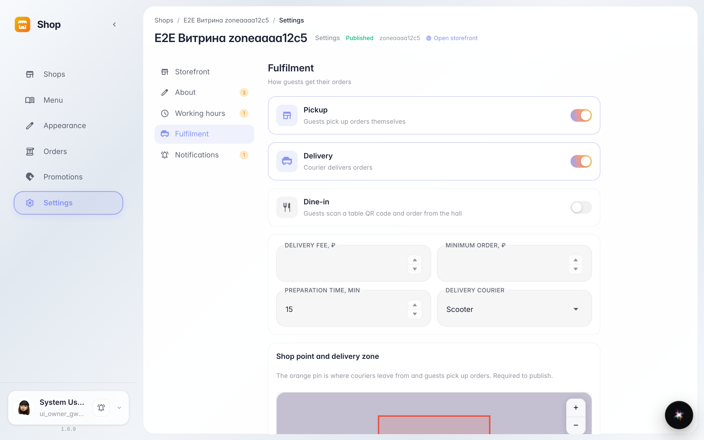
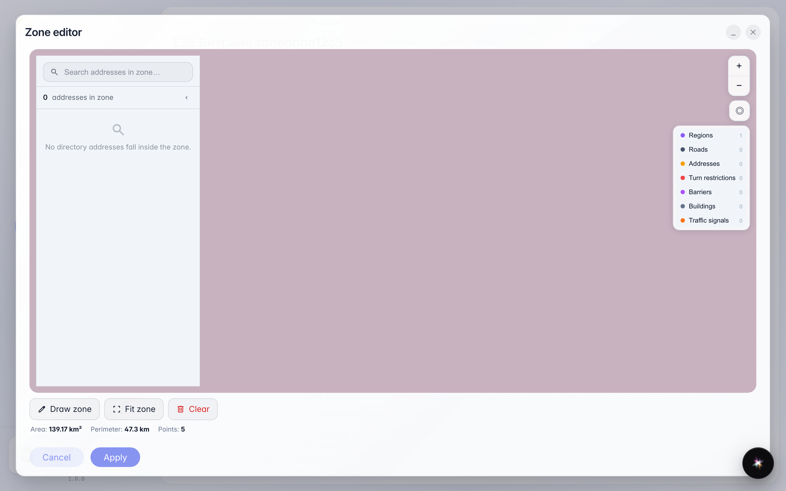
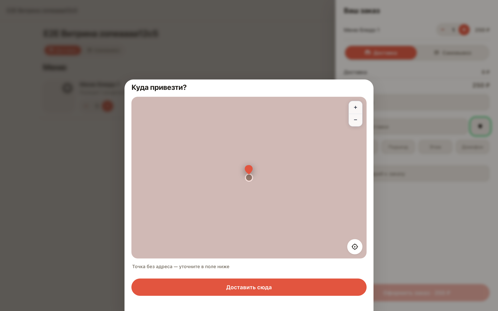
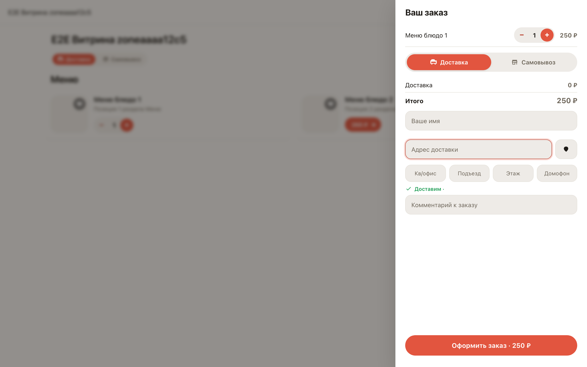

# Delivery zone on the map and the customer's address check

**Purpose:** the delivery zone is a polygon on the map where you deliver. The storefront checks the customer's address against it.

**Problems solved:** orders outside the zone never reach checkout — no manual calls and cancellations. The customer sees the check before paying.

**Result:** the polygon is visible on the settings map and in the zone editor; an address inside the zone gets a green badge on the storefront.

## Step 1. Delivery zone in settings

Settings → Delivery: the map shows the zone polygon — where you deliver. The shop's own point sits on the same map, set with one click.

## Step 2. Zone editor

The Edit zone button opens the editor: the Draw tool places polygon vertices with clicks, Fit frames the map to the zone, Clear starts over. Area and perimeter are computed live.

## Step 3. Picking the point on the map

If the address is not suggested, the customer opens the map next to the address field and moves it under the pin. The zone polygon is visible under the map: inside — Deliver here, outside the button is disabled.

## Step 4. Address checked against the zone

The storefront checked the point against the polygon — the green Deliver badge means the order can be placed and delivered.

