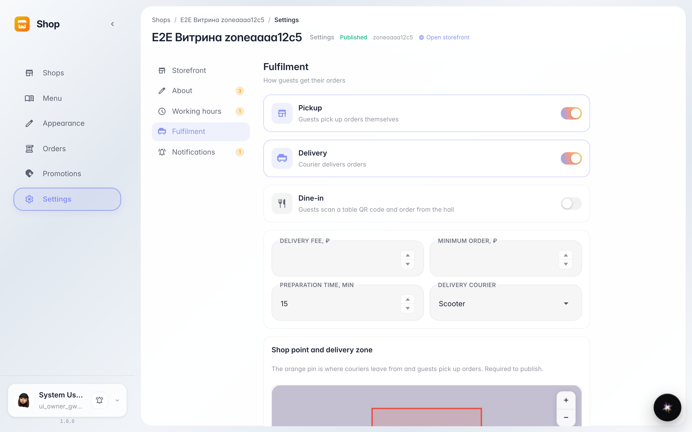
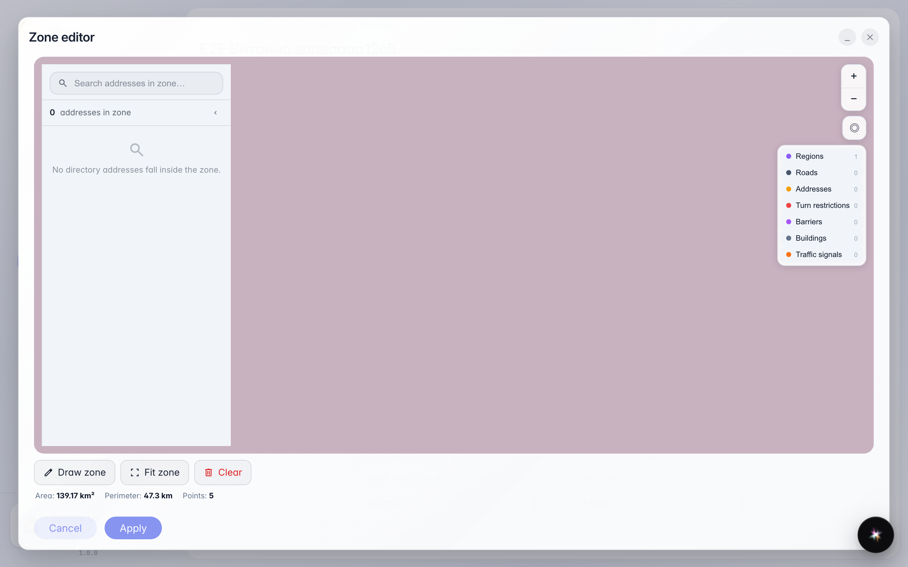
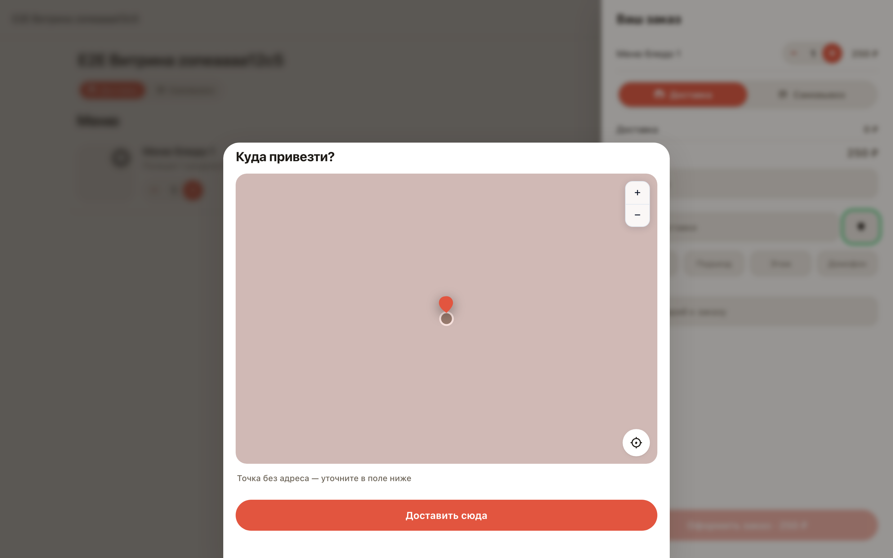
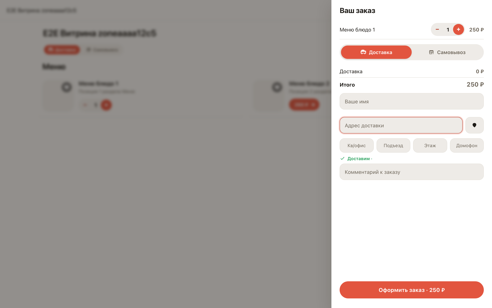

# Зона доставки на карте и проверка адреса покупателя

**Для чего:** зона доставки — полигон на карте, внутри которого вы привозите заказы. Витрина сама проверяет адрес покупателя по этой зоне.

**Какие проблемы решает:** заказы вне зоны не проходят оформление — не придётся звонить и отменять вручную. Покупатель видит проверку сразу, ещё до оплаты.

**Результат:** полигон виден на карте в настройках и в редакторе зоны; на витрине адрес внутри зоны получает зелёную отметку.

## Шаг 1. Зона доставки в настройках

Настройки → «Доставка»: карта показывает полигон зоны — куда вы возите заказы. Точка магазина на той же карте ставится одним кликом.

## Шаг 2. Редактор зоны

Кнопка «Изменить зону» открывает редактор: инструмент «Рисовать» ставит вершины полигона кликами, «Вместить» кадрирует карту по зоне, «Очистить» начинает заново. Площадь и периметр считаются сразу.

## Шаг 3. Выбор точки на карте

Если адрес не подсказывается, покупатель открывает карту кнопкой у поля адреса и двигает её под пином. Полигон зоны виден под картой: внутри — «Доставить сюда», снаружи кнопка неактивна.

## Шаг 4. Адрес проверен по зоне

Витрина проверила точку по полигону — зелёная отметка «Доставим» означает: заказ можно оформить и привезти.

