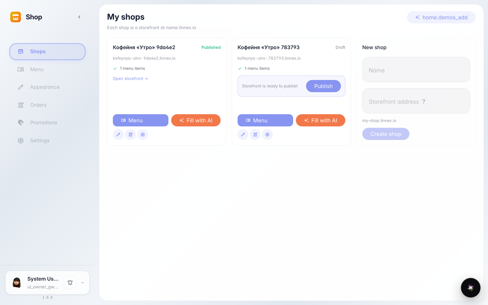
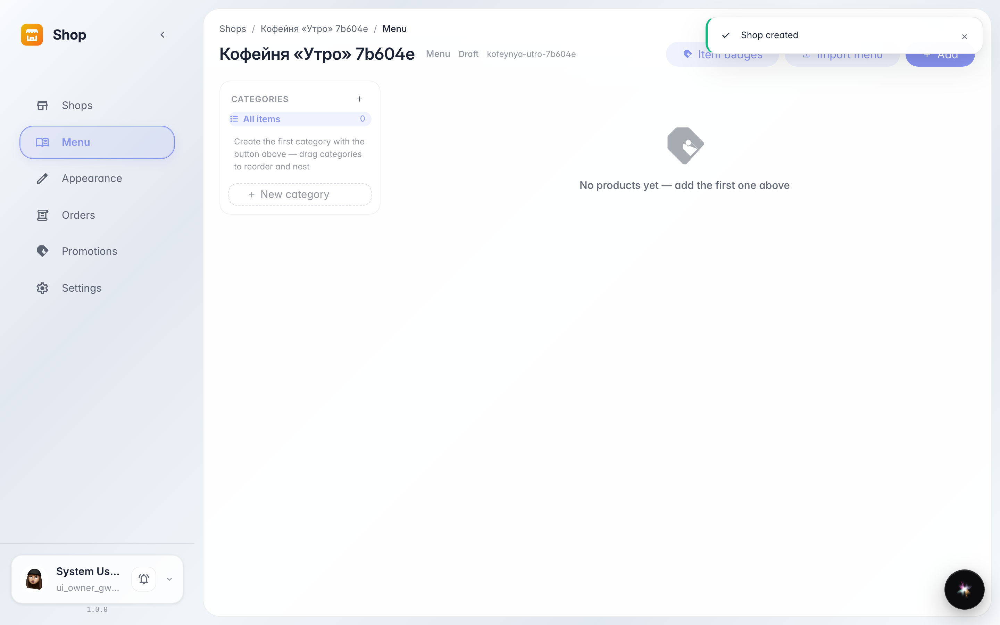
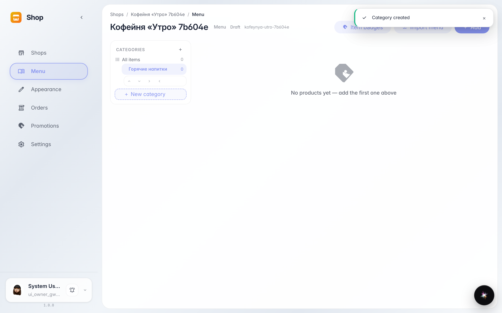
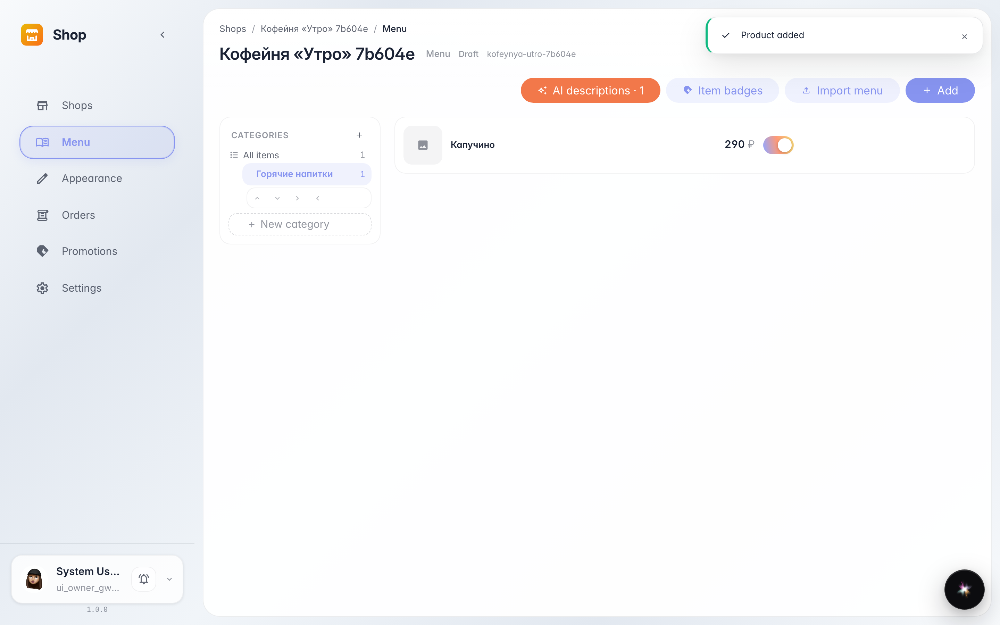
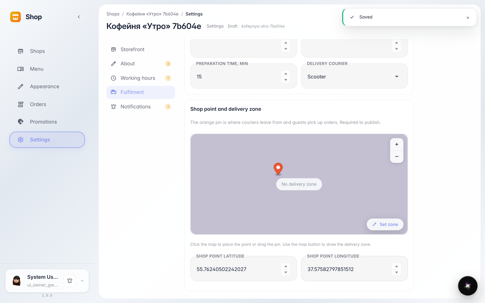
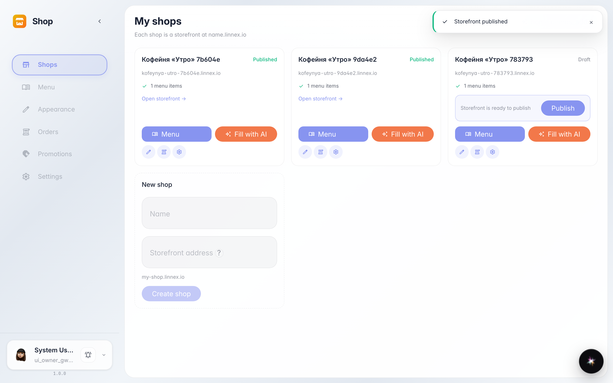
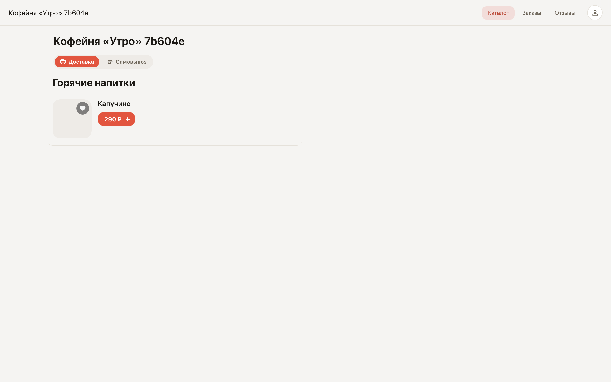

# Create your first store and open the storefront

**Purpose:** this guide helps you create your first store, add a menu section with an item, and open the storefront to customers.

**Problems solved:** you will learn where stores are created, how to fill the menu, and how to verify customers see the storefront.

**Result:** the store is published and the item is visible on the storefront via the public link.

## Step 1. Open the Shop service

Choose «Shop» in the company services list. The home page shows your stores and the «New store» block at the end — setup starts there.

## Step 2. Enter a name and create the store

Type the store name in the «Name» field — the storefront address fills in automatically. Click the create button: the new store's «Menu» section opens.

## Step 3. Add a menu section

The section tree is on the left. Click the add row, type a section name — for example, «Hot drinks» — and press Enter. The section appears in the tree.

## Step 4. Add the first item

Click «+ Item» in the page header. In the window fill in the name and price — the rest can stay empty. Save: the item card appears in the list on the right.

## Step 5. Mark the store point on the map

Open the store «Settings». Click the map where the store is — a pin with the point's coordinates appears, then save. Publishing requires the point: customers could not find the store otherwise.

## Step 6. Publish the storefront

Return to the Shop home page. A ready store shows a publish button — click it. After publishing, the card shows a storefront link.

## Step 7. Open the storefront and find the item

**Result demonstration.** Follow the storefront link — this is what a customer sees. Find your item in the catalog: it is available for ordering.

**Summary.** Now you can create a store, fill the menu, and publish the storefront, checking it through a customer's eyes.

