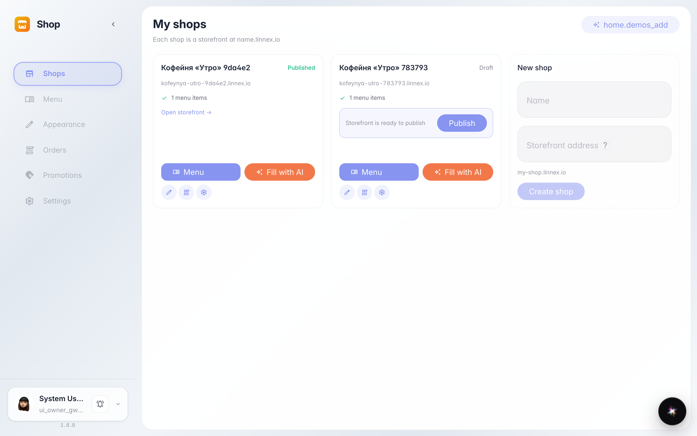
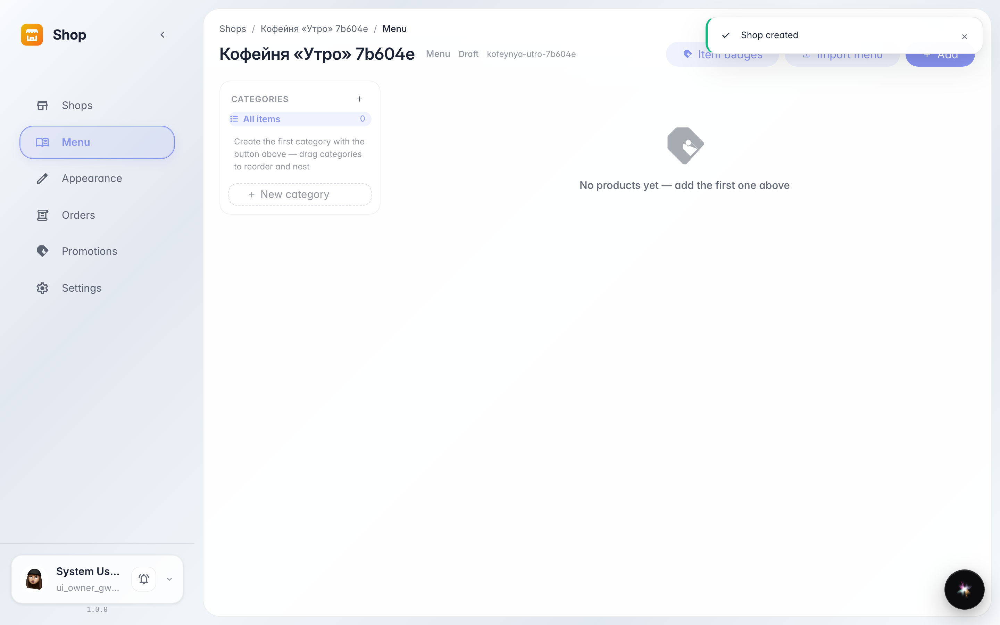
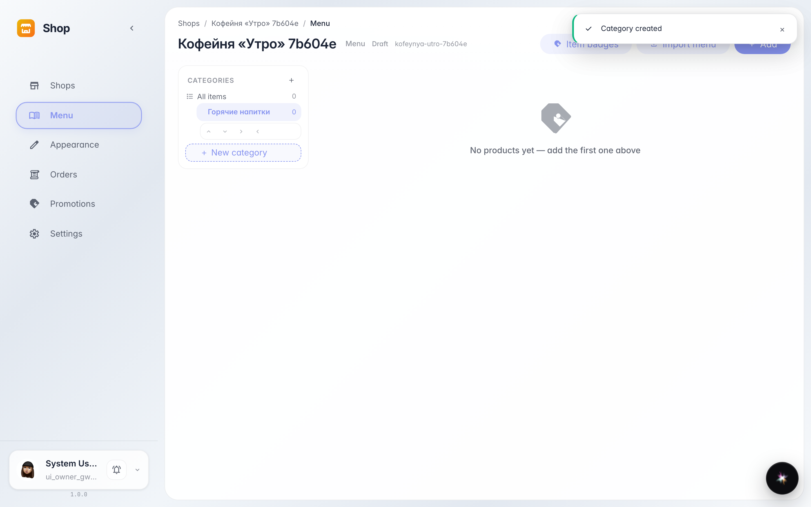
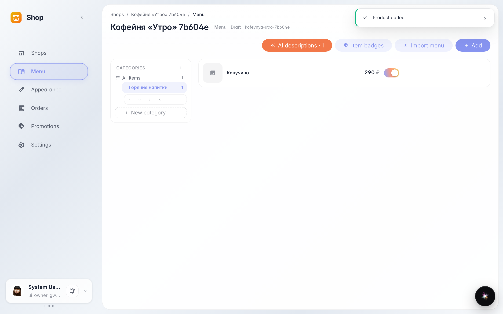
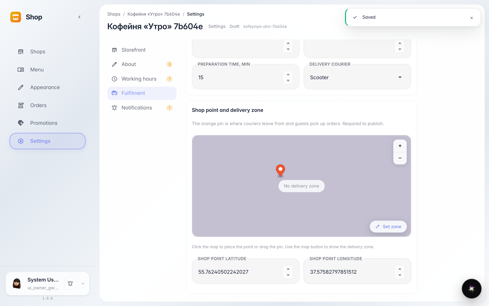
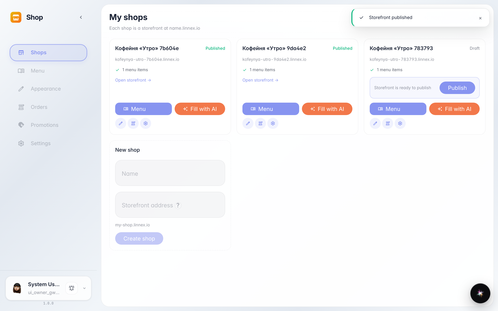
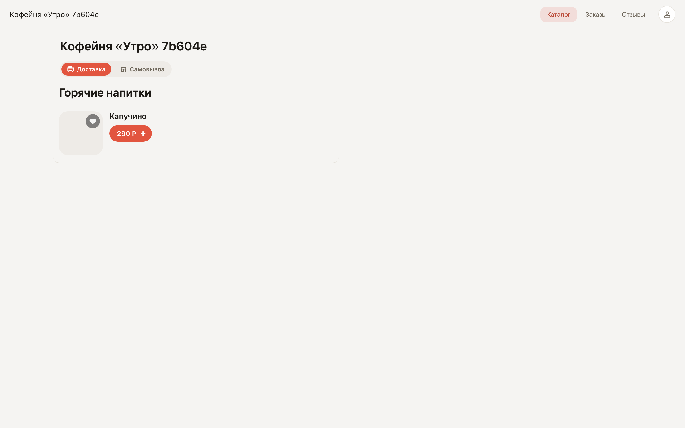

# Создаём первый магазин и открываем витрину

**Для чего:** эта инструкция поможет завести первый магазин, добавить раздел меню с позицией и открыть витрину покупателям.

**Какие проблемы решает:** вы узнаете, где создаётся магазин, как заполнить меню и как убедиться, что покупатели видят витрину.

**Результат:** магазин опубликован, а позиция видна на витрине по публичной ссылке.

## Шаг 1. Откройте сервис «Магазин»

В списке сервисов компании выберите «Магазин». На главной странице показаны ваши магазины и блок «Новый магазин» в конце списка — с него начинается настройка.

## Шаг 2. Введите название и создайте магазин

В поле «Название» впишите имя магазина — адрес витрины подставится автоматически. Нажмите кнопку создания: откроется раздел «Меню» нового магазина.

## Шаг 3. Добавьте раздел меню

Слева находится дерево разделов. Нажмите строку добавления, впишите название раздела — например, «Горячие напитки» — и подтвердите клавишей Enter. Раздел появится в дереве.

## Шаг 4. Добавьте первую позицию

Нажмите «+ Позиция» в шапке страницы. В окне заполните название и цену — остальное можно оставить пустым. Сохраните: карточка позиции появится в списке справа.

## Шаг 5. Отметьте точку магазина на карте

Откройте «Настройки» магазина. Кликните по карте в нужном месте — появится метка с адресом точки, затем сохраните. Без точки витрину опубликовать нельзя: покупатели не увидят магазин на карте.

## Шаг 6. Опубликуйте витрину

Вернитесь на главную «Магазина». У готового магазина появляется кнопка публикации — нажмите её. После публикации у карточки появляется ссылка на витрину.

## Шаг 7. Откройте витрину и найдите позицию

**Демонстрация результата.** Перейдите по ссылке витрины — так её видит покупатель. Найдите свою позицию в каталоге: она доступна для заказа.

**Итог.** Теперь вы умеете создавать магазин, заполнять меню и публиковать витрину, проверяя её глазами покупателя.

