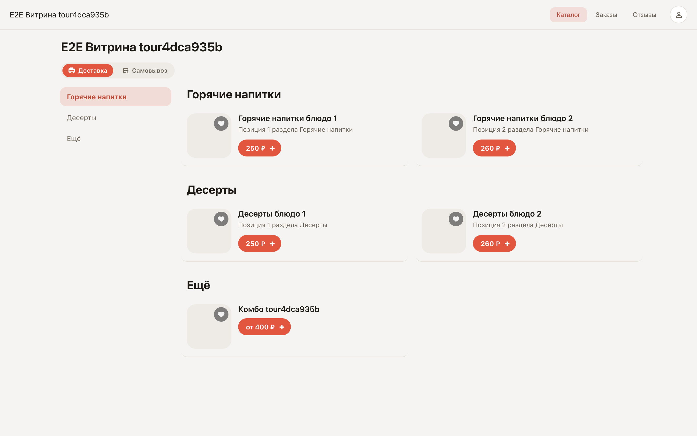
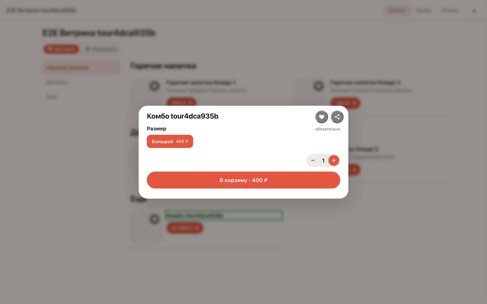
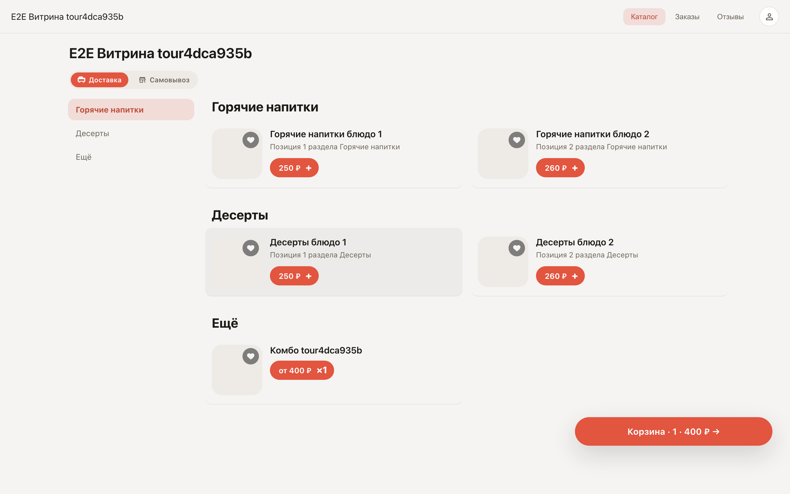

# The storefront through a customer's eyes

**Purpose:** see what a person opening your storefront link sees — the catalog, a dish card with options, and the cart.

**Problems solved:** before sharing the link it is worth walking the customer's path yourself — making sure the menu reads well, options select, and the cart counts the total.

**Result:** you know what ordering looks like from the customer's side.

## Step 1. Open the storefront

You share the storefront link with customers — it sits on the store card after publishing. The catalog opens: menu sections on top, item cards with prices and add buttons. No sign-up and nothing to install.

## Step 2. Item card with options

Clicking an item opens its card: photo, description and choice options — for example, portion size. The system won't let an order go through without a required option.

## Step 3. Cart at the bottom of the screen

After adding, a cart appears at the bottom — it always shows the item count and the total. Tapping it opens checkout.

**Summary.** The storefront link is a full-fledged shop: the customer picks items, adds them to the cart and checks out on their own.

