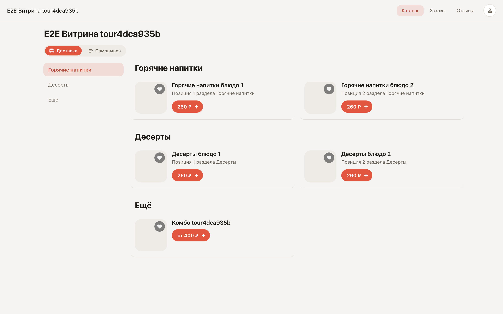
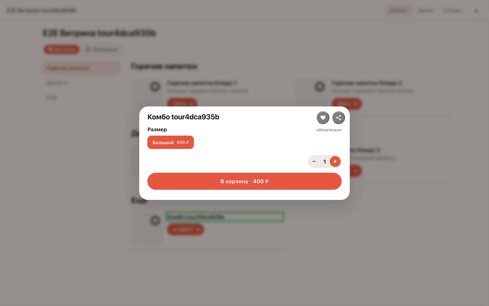
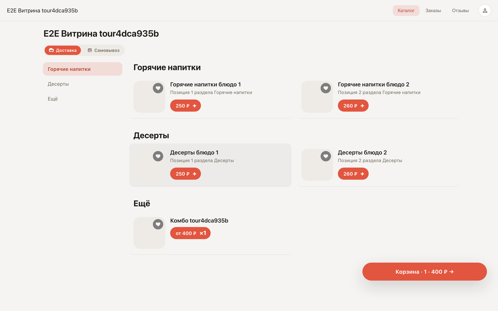

# Витрина глазами покупателя

**Для чего:** посмотреть, что видит человек, который открыл ссылку на вашу витрину, — каталог, карточку блюда с опциями и корзину.

**Какие проблемы решает:** прежде чем делиться ссылкой, полезно пройти путь покупателя самим — и убедиться, что меню читается, опции выбираются, а корзина считает сумму.

**Результат:** вы знаете, как выглядит заказ со стороны клиента.

## Шаг 1. Откройте витрину

Ссылку на витрину вы отправляете покупателям — она есть на карточке магазина после публикации. Открывается каталог: разделы меню сверху, карточки позиций с ценами и кнопками добавления. Регистрироваться и ничего устанавливать не нужно.

## Шаг 2. Карточка позиции с опциями

Клик по позиции открывает её карточку: фото, описание и опции выбора — например, размер порции. Система сама не даст отправить заказ без обязательной опции.

## Шаг 3. Корзина внизу экрана

После добавления внизу появляется корзина — она всегда показывает количество позиций и итоговую сумму. Нажатие открывает оформление заказа.

**Итог.** Ссылка на витрину — это полноценный магазин: покупатель сам выбирает, добавляет в корзину и оформляет заказ без вашего участия.

