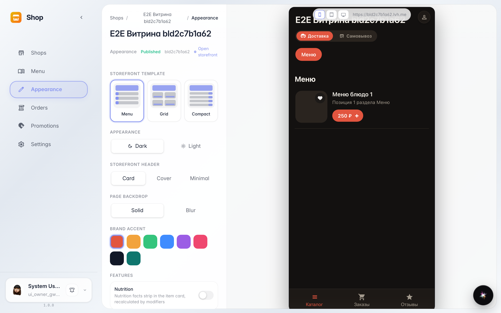
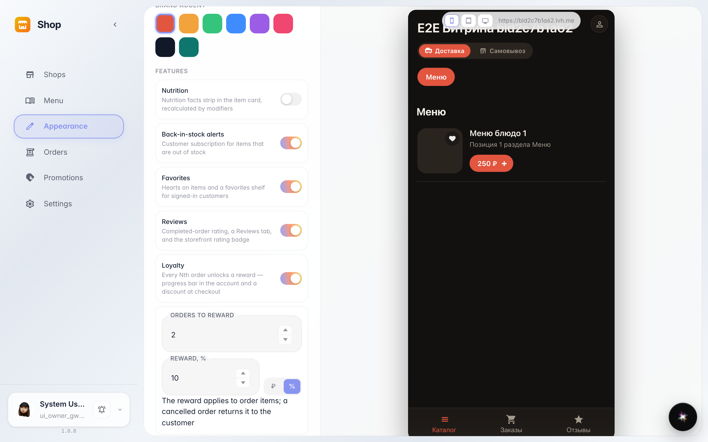
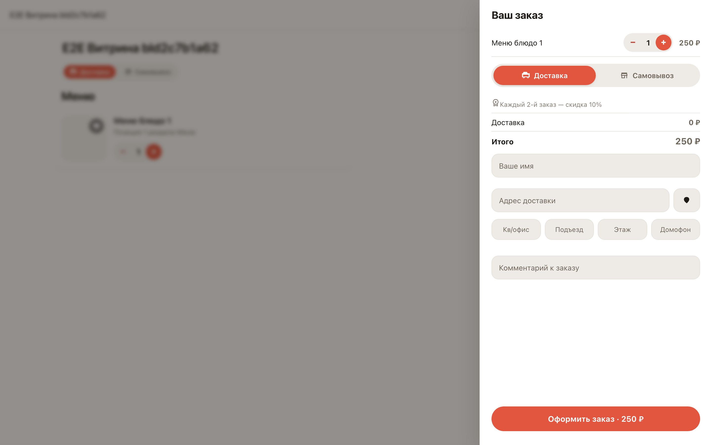

# Storefront builder: the loyalty program

**Purpose:** the builder assembles the storefront — enabled features appear to customers at once. The loyalty program brings guests back with a discount reward for repeat orders.

**Problems solved:** the regular gets the reward by themselves — the storefront counts orders and shows the condition right in the cart, while the owner configures it with one switch.

**Result:** the program is saved; the storefront cart tells the customer "Every Nth order — a discount".

## Step 1. Storefront builder

The builder is a list of storefront features with switches: nutrition facts, back-in-stock, favorites, reviews and loyalty. Everything enabled appears to the customer right after saving.

## Step 2. Loyalty program editor

Switching Loyalty on opens the editor: every 2nd order earns a reward. The reward is a percent discount or a fixed amount of your choice.

## Step 3. Reward condition in the cart

The customer opens the cart and sees the program condition: "Every 2nd order — a 10% discount". Once the reward is earned, the storefront offers to apply it with a switch.

