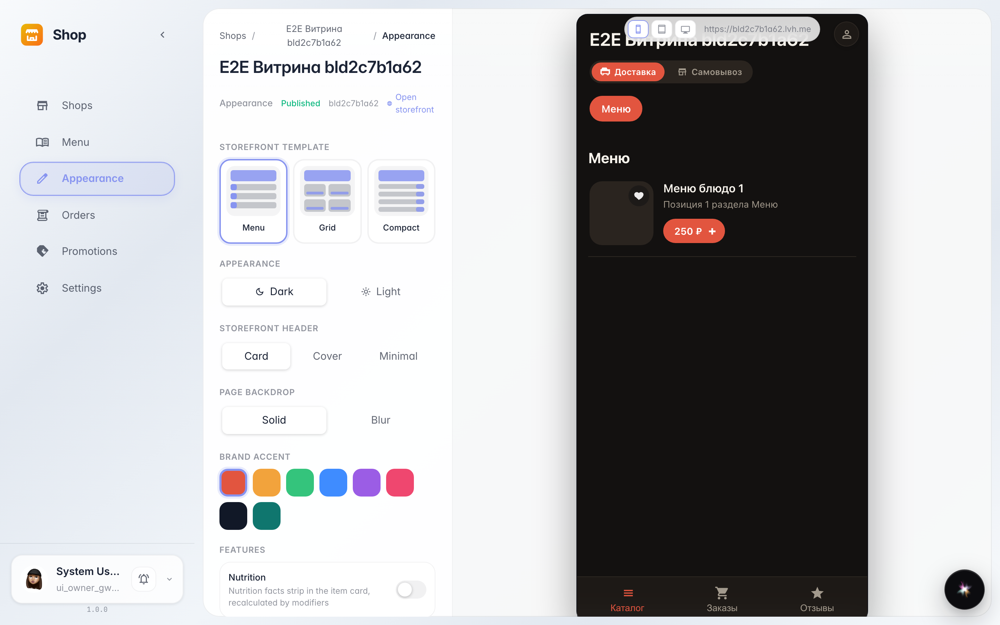
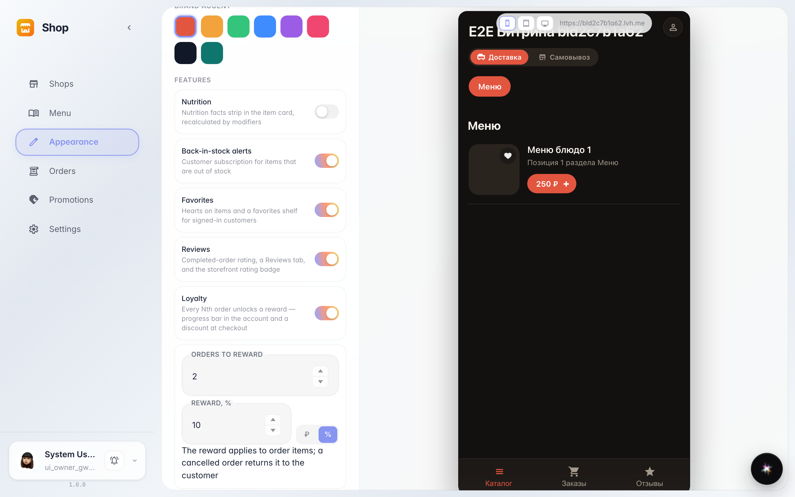
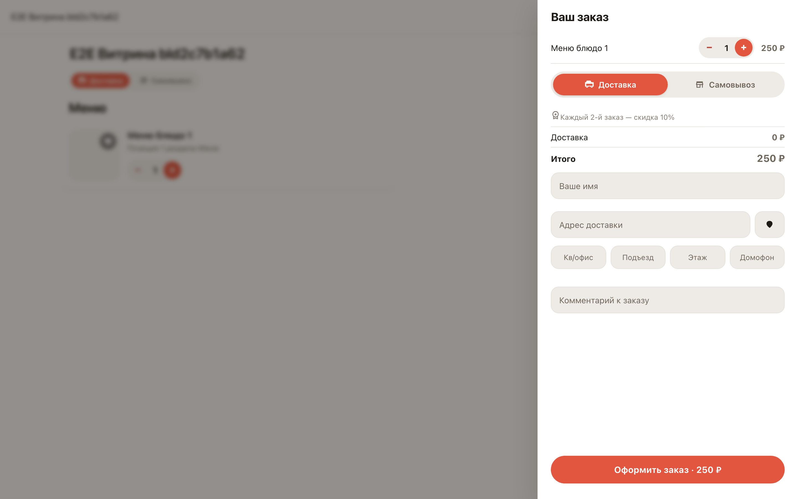

# Конструктор витрины: программа лояльности

**Для чего:** конструктор собирает витрину — включённые функции сразу появляются у покупателя. Программа лояльности возвращает гостей подарком-скидкой за повторные заказы.

**Какие проблемы решает:** постоянный покупатель получает награду сам — витрина считает заказы и показывает условие прямо в корзине, а владелец настраивает всё одним тумблером.

**Результат:** программа сохранена; в корзине витрины покупатель видит «Каждый N-й заказ — скидка».

## Шаг 1. Конструктор витрины

Конструктор — это список функций витрины с переключателями: КБЖУ, «Сообщить о поступлении», избранное, отзывы и лояльность. Включённое появляется у покупателя сразу после сохранения.

## Шаг 2. Программа лояльности

Включаем «Лояльность» — открывается редактор: каждый 2-й заказ даёт награду. Награда — процент скидки или фиксированная сумма на выбор.

## Шаг 3. Условие награды в корзине

Покупатель открывает корзину и видит условие программы: «Каждый 2-й заказ — скидка 10%». Когда награда накопится, витрина сама предложит применить её тумблером.

