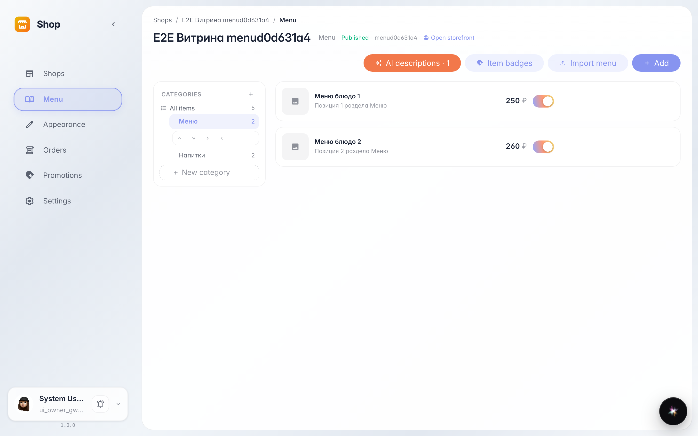
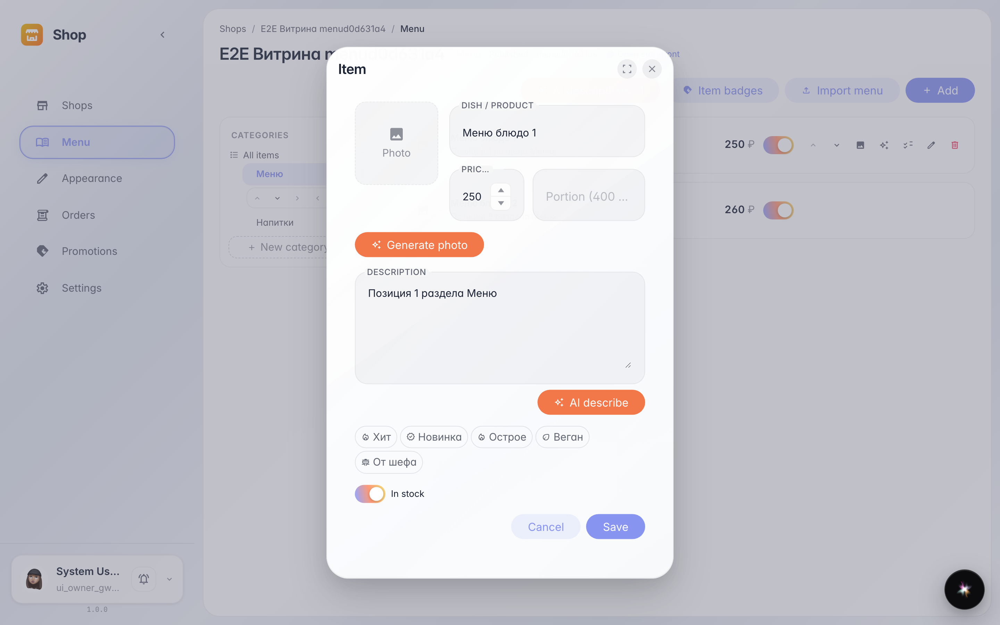
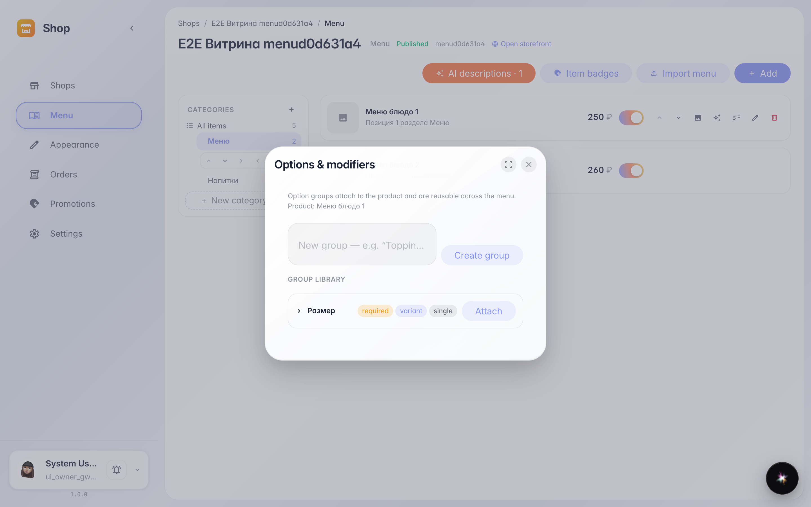

# Menu: items, prices and modifiers

**Purpose:** the menu is everything the customer sees on the storefront: sections, items, prices and extras (size, add-ons).

**Problems solved:** the item card keeps everything in one place — name, price, portion, photo and badges; modifiers give size/add-on choice without duplicate items.

**Result:** sections on the left, items on the right; every item has edit and a Modifiers button.

## Step 1. Menu sections and items

Sections tree on the left, items of the selected section with prices on the right. Everything here lands on the storefront.

## Step 2. Item card

Name, price, portion, description, photo and badges — all editable in one window. Sparkle buttons fill description and photo with AI.

## Step 3. Item modifiers

Modifiers are option groups on an item: size, add-ons, dough. The customer picks them right in the storefront card, the price recalculates itself.

