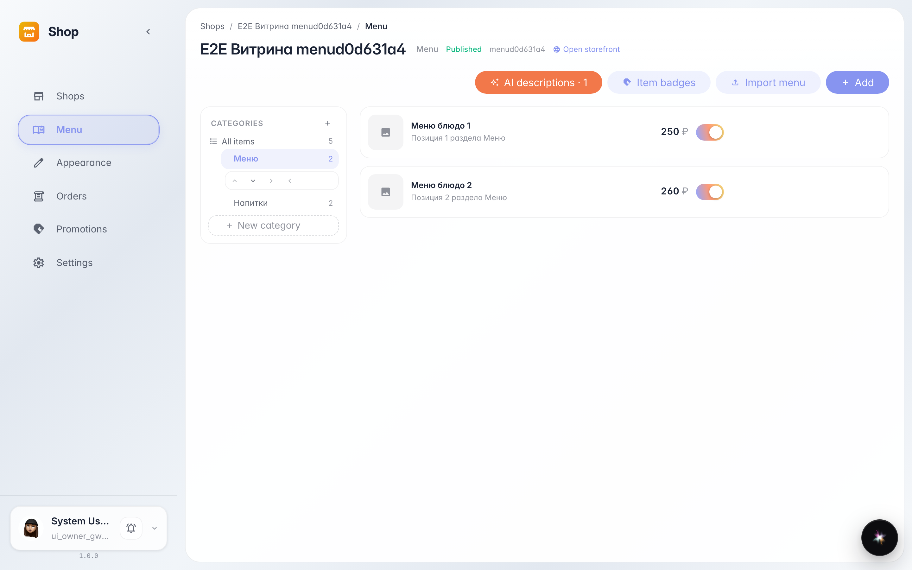
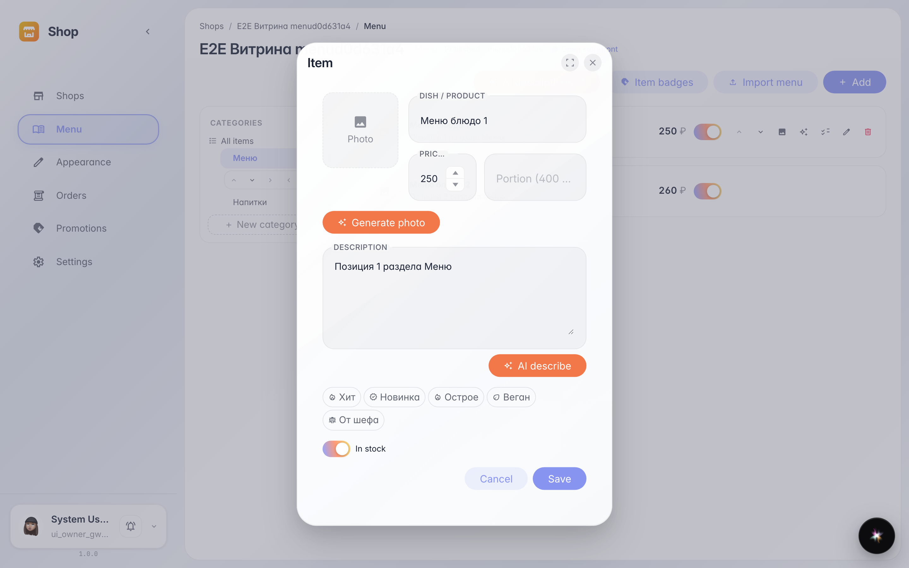
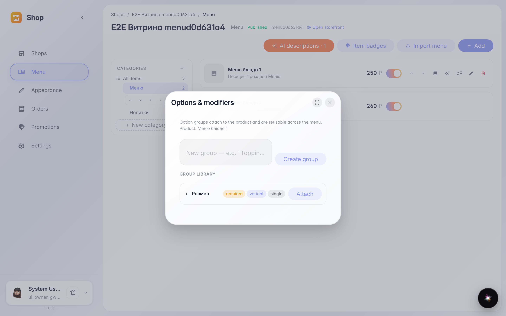

# Меню: позиции, цены и модификаторы

**Для чего:** меню — это всё, что видит покупатель на витрине: разделы, позиции, цены и допы (размер, добавки).

**Какие проблемы решает:** карточка позиции собирает всё в одном месте — название, цену, порцию, фото и бейджи; модификаторы дают выбор «размер/добавка» без отдельных позиций-дублей.

**Результат:** разделы слева, позиции справа; у каждой позиции — редактирование и кнопка «Модификаторы».

## Шаг 1. Разделы и позиции меню

Слева — дерево разделов (категорий), справа — позиции выбранного раздела с ценами. Всё, что тут есть, попадает на витрину.

## Шаг 2. Карточка позиции

Название, цена, порция, описание, фото и бейджи — всё редактируется в одном окне. Кнопки с искрой заполняют описание и фото через AI.

## Шаг 3. Модификаторы позиции

Модификаторы — группы выбора на позиции: «размер», «добавки», «тесто». Покупатель выбирает их прямо в карточке на витрине, цена пересчитывается сама.

