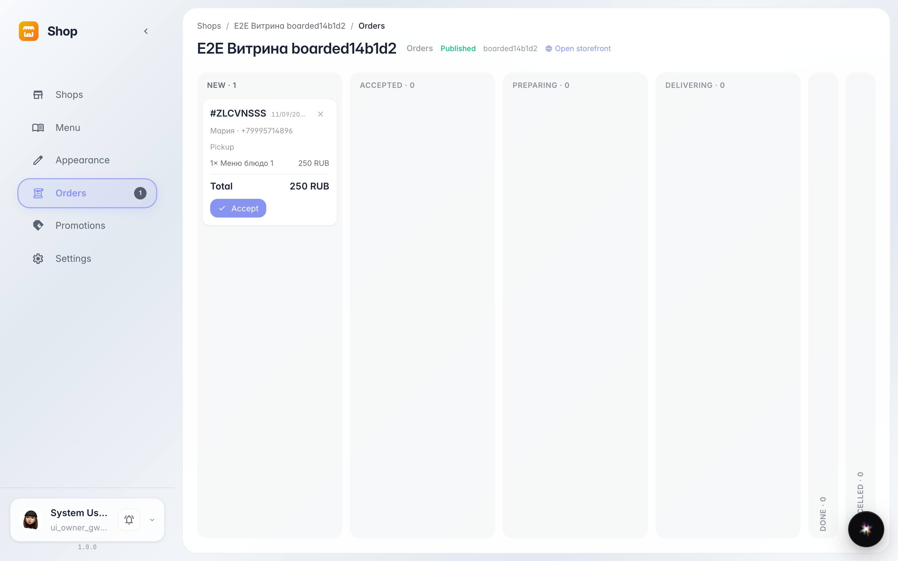
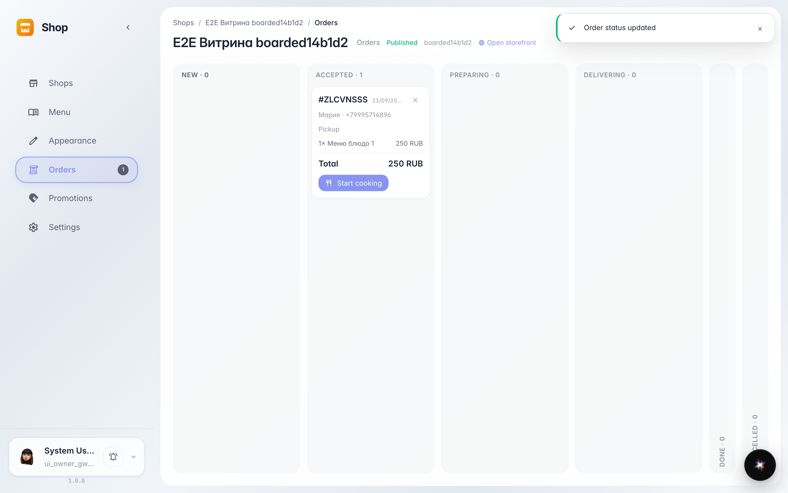

# Incoming orders: the board and taking an order

**Purpose:** never lose an order — they all land on one board with statuses, no phone calls or chats needed.

**Problems solved:** a storefront order is easy to miss. The board shows every order as a card: items, address, contact — and a take-to-work button.

**Result:** the new order is accepted and moved to the In progress column — the customer sees the status in their account.

## Step 1. New order on the board

The customer's order landed in the New column by itself — no refresh needed. The card shows the number, items and customer details.

## Step 2. Order taken to work

The card button moves the order along the chain: New → Accepted → Preparing → Delivering → Done. The customer sees every step.

