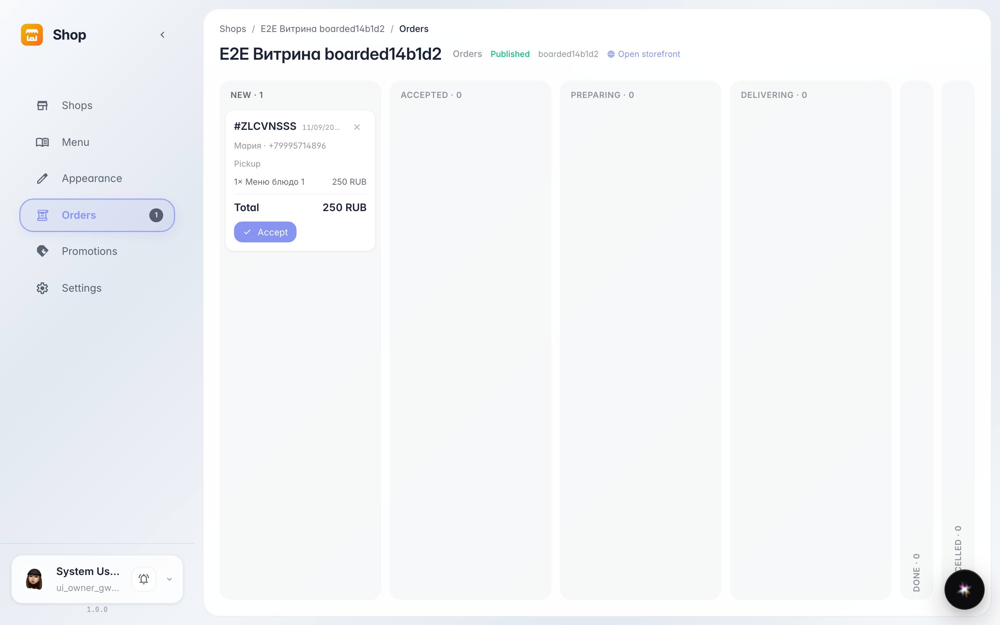
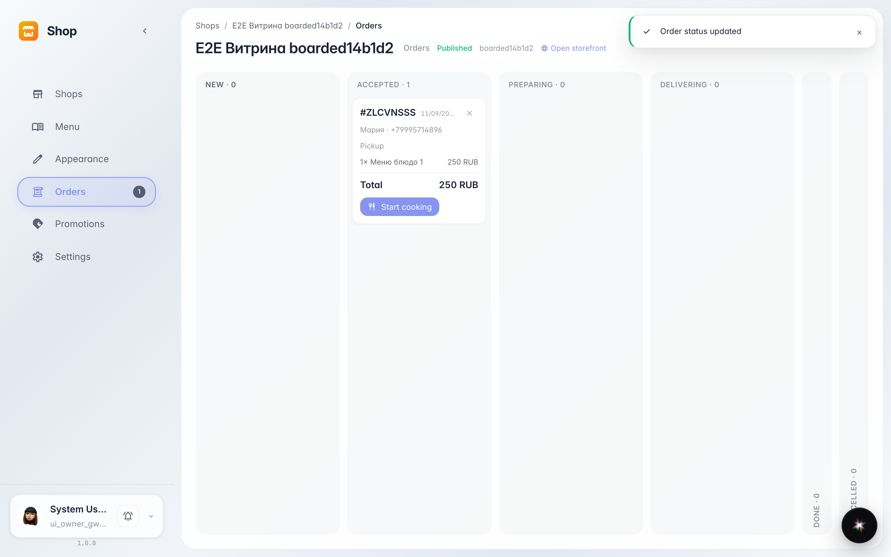

# Входящие заказы: доска и принятие в работу

**Для чего:** не потерять ни один заказ — все они летят на одну доску со статусами, без телефонных звонков и чатов.

**Какие проблемы решает:** заказ из витрины легко пропустить. Доска показывает каждый заказ карточкой: состав, адрес, контакт — и кнопку «принять в работу».

**Результат:** новый заказ принят и переехал в колонку «В работе» — покупатель видит статус у себя в кабинете.

## Шаг 1. Новый заказ на доске

Заказ покупателя упал в колонку «Новые» сам — обновлять страницу не нужно. Карточка показывает номер, состав и данные покупателя.

## Шаг 2. Заказ принят в работу

Кнопка на карточке переводит заказ дальше по цепочке: «Новые» → «Принят» → «Готовится» → «Доставляется» → «Готов». Покупатель видит каждый шаг у себя.

