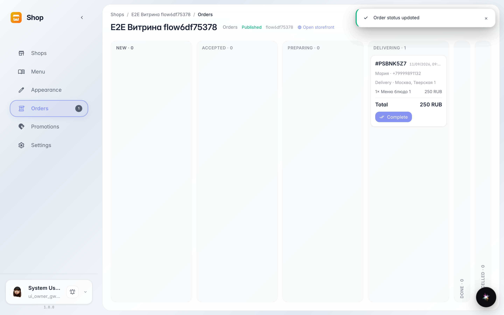
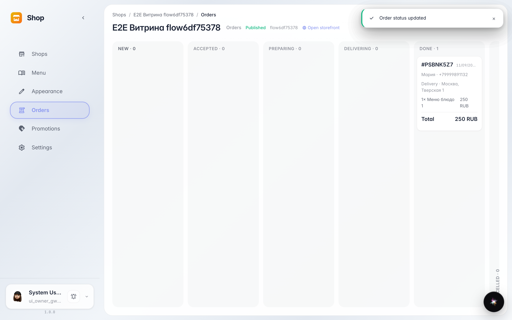

# Order statuses: from acceptance to handout

**Purpose:** kitchen and courier see the same status feed — an order can't be lost between stages.

**Problems solved:** without statuses the customer calls "where is my order?" and the kitchen doesn't know what to cook first. The card walks the order along the chain.

**Result:** the order went Accepted → Preparing → Delivering → Done — the customer saw every step.

## Step 1. Order out for delivery

Each card button press moves the order one step further: Accepted → Preparing → Delivering. Columns show how many orders sit at each stage.

## Step 2. Order handed out

The final step — Done: the order moved to the finished column. It stays collapsed on the right so active orders keep the space.

