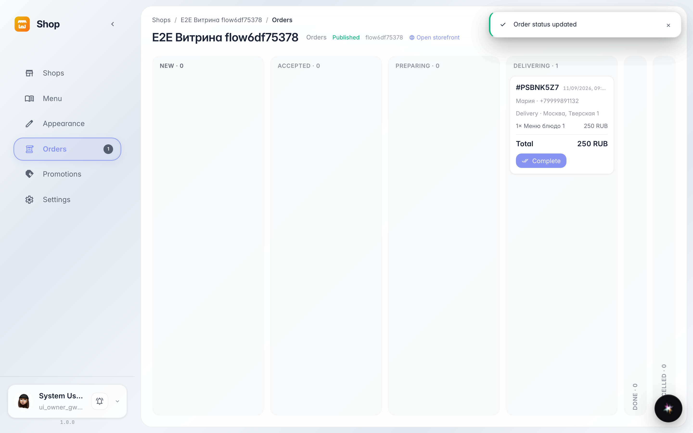
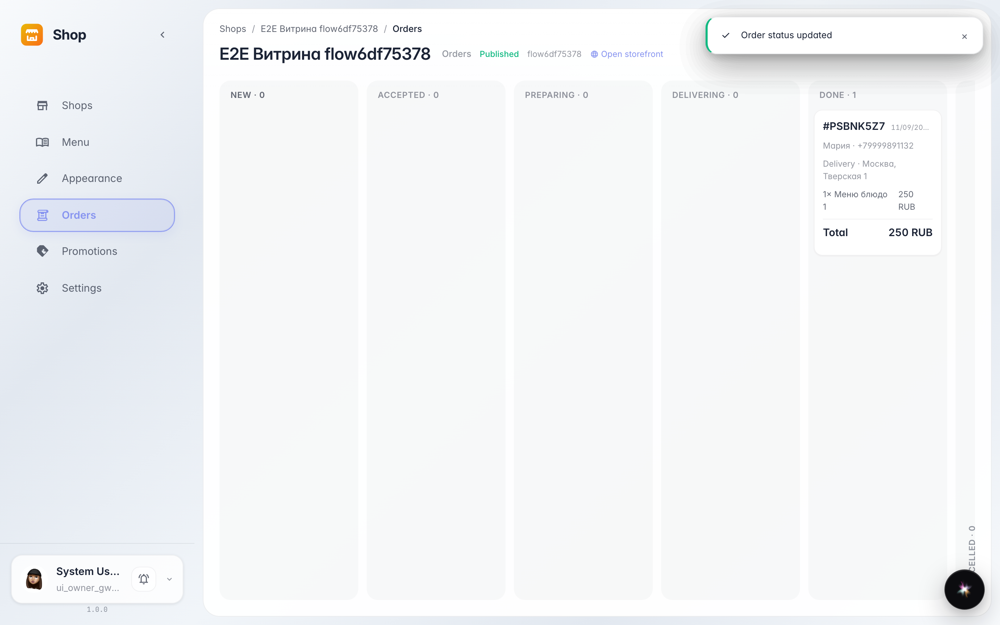

# Статусы заказа: от принятия до выдачи

**Для чего:** вся кухня и курьер видят одну и ту же ленту статусов — заказ нельзя «потерять» между этапами.

**Какие проблемы решает:** без статусов покупатель звонит «а где мой заказ?», а кухня не знает, что готовить первым. Карточка сама ведёт заказ по цепочке.

**Результат:** заказ прошёл «Принят» → «Готовится» → «Доставляется» → «Готов» — покупатель видел каждый шаг.

## Шаг 1. Заказ в доставке

Каждое нажатие кнопки на карточке двигает заказ на шаг дальше: «Принят» → «Готовится» → «Доставляется». Колонки показывают, сколько заказов на каждом этапе.

## Шаг 2. Заказ выдан

Финальный шаг — «Готов»: заказ уехал в завершённую колонку. Она свёрнута справа, чтобы не отнимать место у активных заказов.

