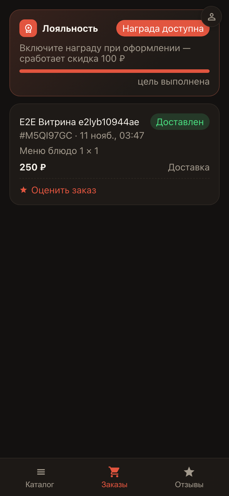
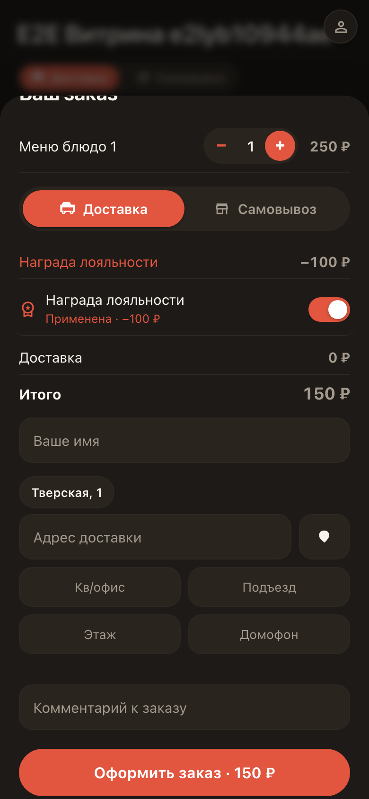
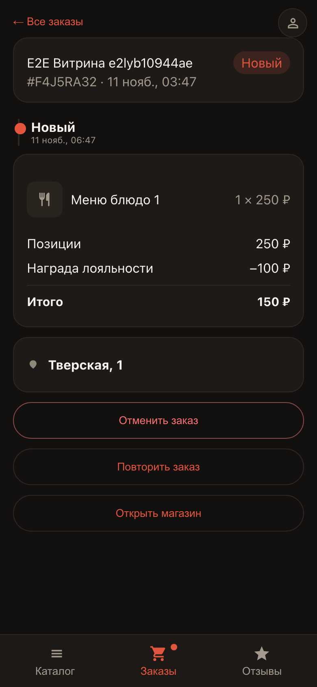

# Customer loyalty rewards

**Purpose:** the customer sees rewards accruing for orders — and spends them on the next order right at checkout.

**Problems solved:** the loyalty program works by itself: progress is visible on the Orders tab, and the reward applies with one tap — no promo codes or paper cards.

**Result:** the reward was spent as a discount — the order details show a «Loyalty reward» line.

## Step 1. Reward on the Orders tab

The customer opens the storefront and sees a loyalty card on the Orders tab: how many orders until the reward and what it will be. Once the goal is reached, a «Reward available» badge appears.

## Step 2. Applying the reward with one tap

At checkout the customer flips the reward toggle — the total instantly recalculates with the discount. No promo codes or cards needed.

## Step 3. Discount in the order details

In the order details the discount shows as a separate «Loyalty reward» line — the customer always knows why they paid less.

**Summary.** Loyalty brings customers back: the reward accrues by itself and is spent in one tap.

