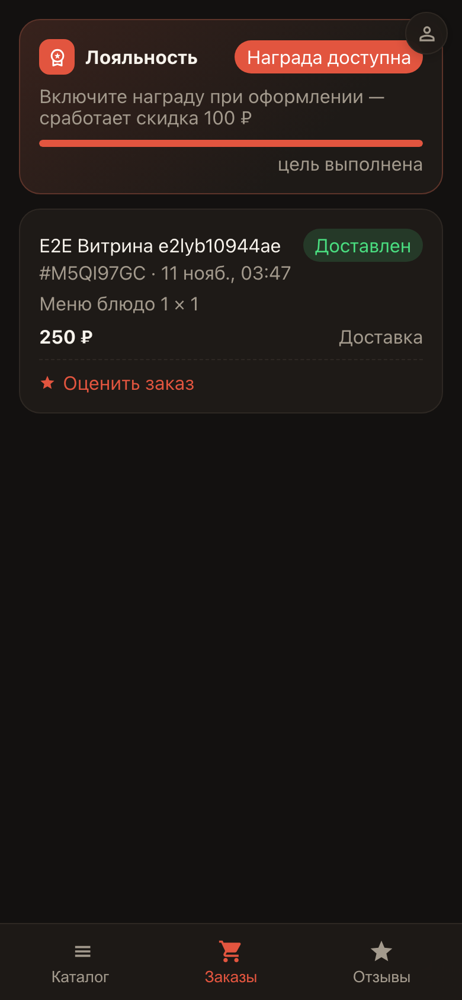
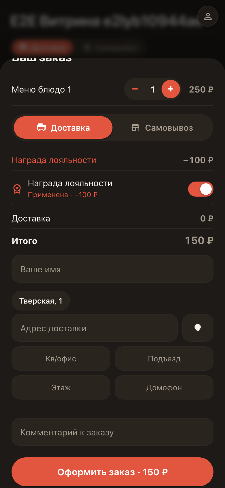
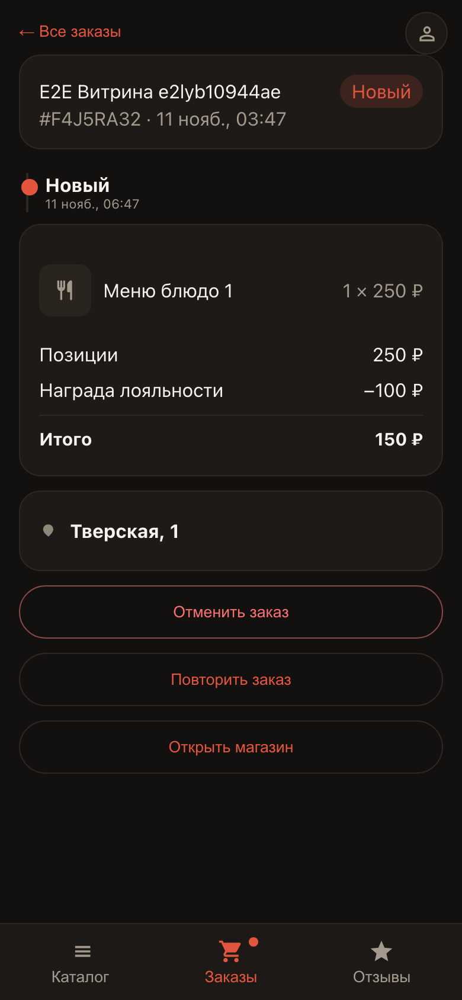

# Награды лояльности у покупателя

**Для чего:** покупатель видит, что за заказы ему начисляют награду — и тратит её на следующий заказ прямо в чекауте.

**Какие проблемы решает:** программа лояльности работает сама: прогресс виден во вкладке «Заказы», а награда применяется одной кнопкой — без промокодов и бумажных карт.

**Результат:** награда списалась скидкой на заказ — в деталях заказа видна строка «Награда лояльности».

## Шаг 1. Награда во вкладке «Заказы»

Покупатель открывает витрину и видит во вкладке «Заказы» карточку лояльности: сколько заказов до награды и что он получит. Как только цель достигнута — появляется бейдж «Награда доступна».

## Шаг 2. Награда применяется одной кнопкой

При оформлении заказа покупатель включает награду тумблером — сумма сразу пересчитывается со скидкой. Промокоды и карты не нужны.

## Шаг 3. Скидка в деталях заказа

В деталях заказа скидка видна отдельной строкой «Награда лояльности» — покупатель всегда понимает, за что заплатил меньше.

**Итог.** Лояльность мотивирует вернуться: награда копится сама и тратится в один клик.

