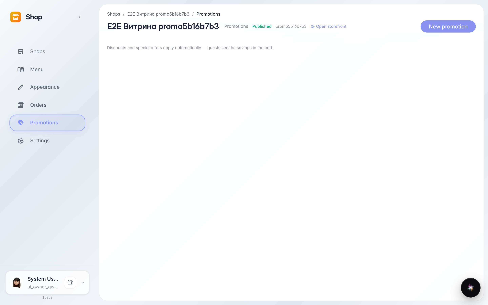
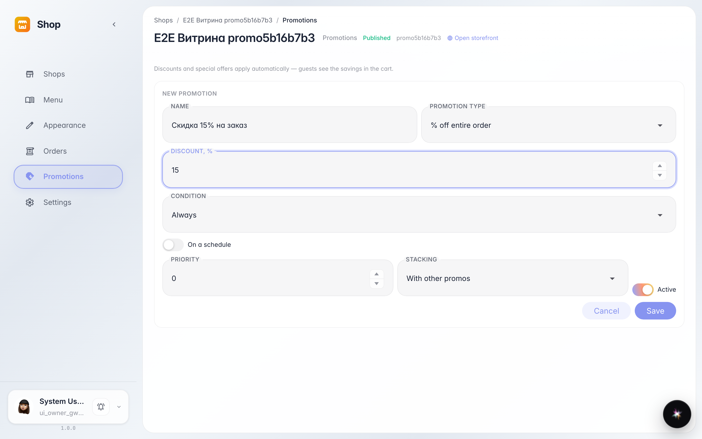
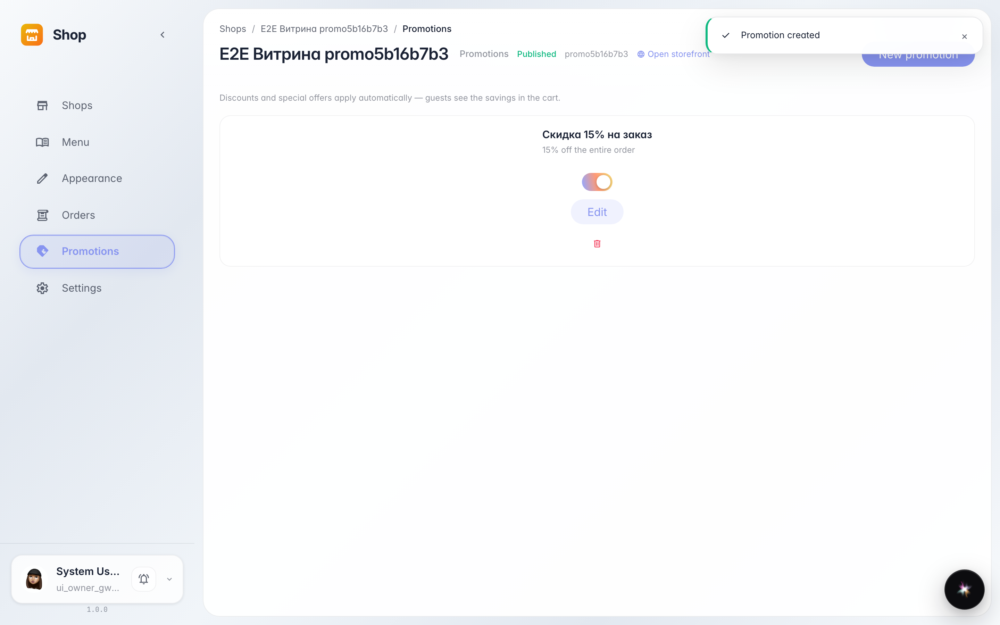
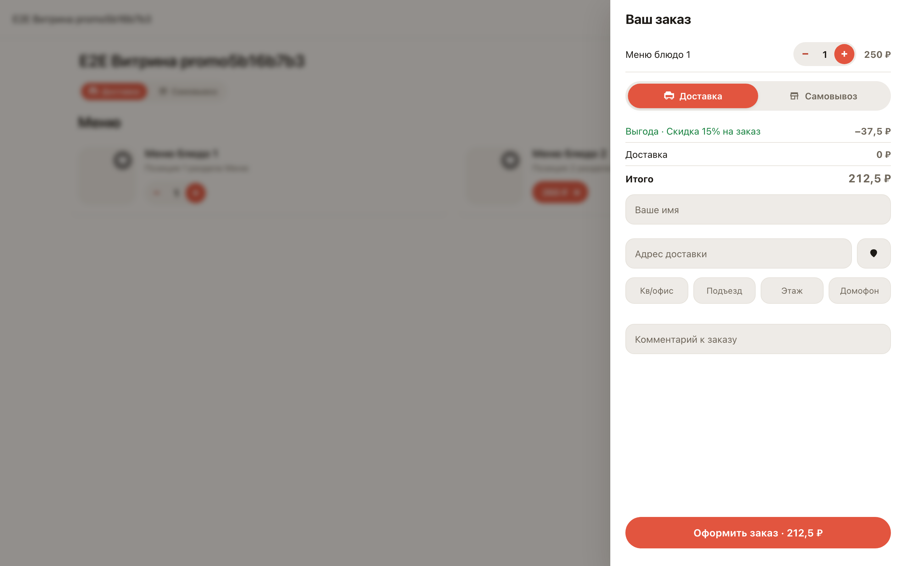

# A discount promo: create it and check the storefront

**Purpose:** promos bring customers and raise the average ticket — a discount takes a minute, no developer needed.

**Problems solved:** no manual price edits — the promo computes the discount in the cart itself and shows it to the customer as a separate Savings line.

**Result:** the promo is listed and active; the storefront cart shows the discount with its name.

## Step 1. Shop Promotions section

The Promotions section lists all shop discounts. The New promo button opens the editor: discount template, conditions, schedule.

## Step 2. Promo editor

Fill in the name and discount size — the order percent template is selected by default. Conditions and schedule are optional: without them the promo always applies.

## Step 3. Promo created and active

The promo appeared in the list with its discount description. The switch on the right pauses it without deleting.

## Step 4. Discount visible to the customer

The customer adds an item — the cart shows a Savings line with the promo name and the new total. Nothing to configure on the storefront.

