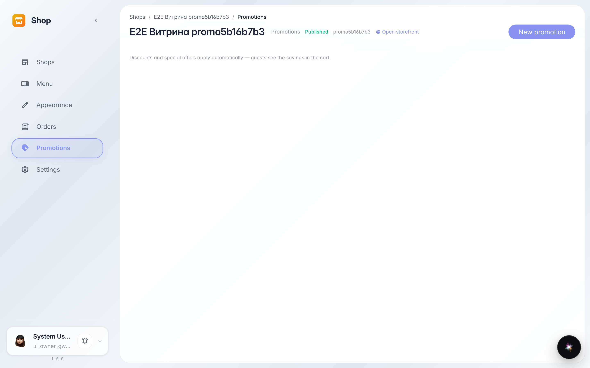
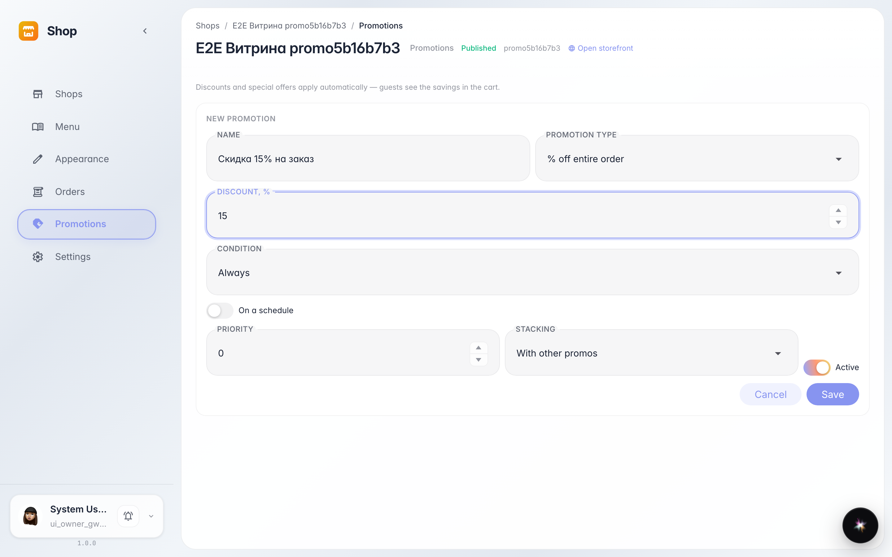
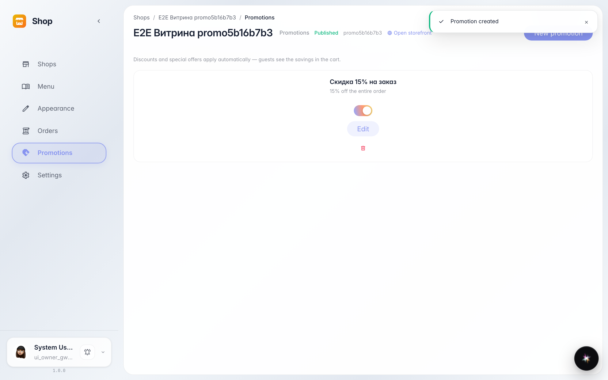
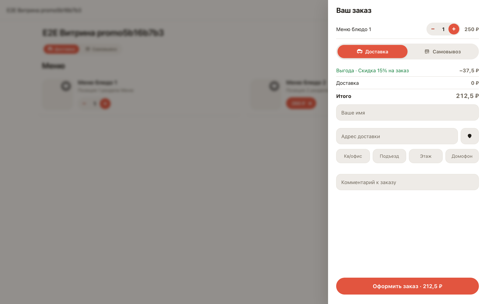

# Акция со скидкой: создаём и проверяем на витрине

**Для чего:** акции приводят покупателей и поднимают средний чек — скидка создаётся за минуту без программиста.

**Какие проблемы решает:** не нужно вручную менять цены — акция сама считает скидку в корзине и показывает её покупателю отдельной строкой «Выгода».

**Результат:** акция в списке и активна; в корзине витрины видна скидка с её названием.

## Шаг 1. Раздел «Акции» магазина

В разделе «Акции» собраны все скидки магазина. Кнопка «Новая акция» открывает редактор: шаблон скидки, условия, расписание.

## Шаг 2. Редактор акции

Заполняем название и размер скидки — шаблон «Процент на заказ» выбран по умолчанию. Условия и расписание необязательны: без них акция работает всегда.

## Шаг 3. Акция создана и активна

Акция появилась в списке с описанием скидки. Переключатель справа позволяет временно выключить её без удаления.

## Шаг 4. Скидка видна покупателю

Покупатель добавляет позицию — в корзине строкой «Выгода» видна скидка с названием акции и новая сумма. Ничего настраивать на витрине не нужно.

