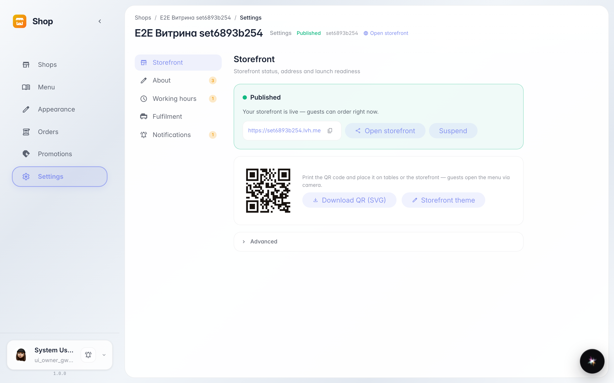
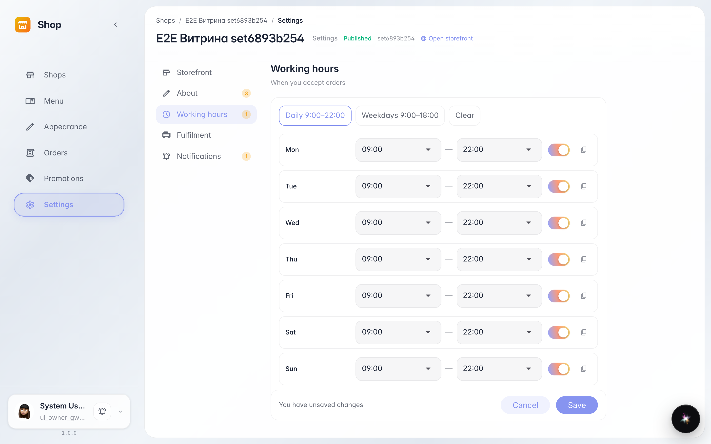
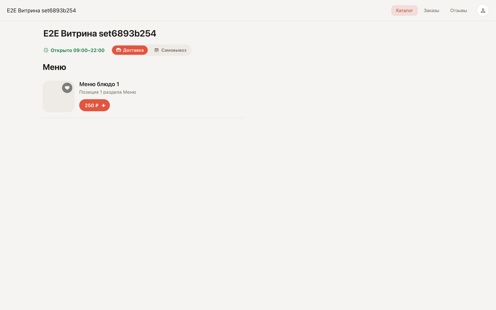

# Shop settings: storefront link and working hours

**Purpose:** shop settings hold the storefront link, profile, working hours and order handover — everything the customer sees on the storefront.

**Problems solved:** the storefront link is copied with one button, and working hours are set with a ready preset — the storefront itself shows Open or Opens later and blocks ordering outside working time.

**Result:** the storefront link is copied; the storefront shows working hours next to the name.

## Step 1. Storefront link

The Storefront section shows Published status and the ready link — copied to socials and ads with the button next to it. Open storefront shows the page as the customer sees it, Suspend temporarily hides it.

## Step 2. Working hours preset

The Working hours section schedules the week. The Every day preset sets 9:00–22:00 for the whole week at once; a single day is changed with the time fields or switched off with its toggle.

## Step 3. Working hours on the storefront

The storefront shows hours next to the name: Open while the shop works, Opens later with the nearest time otherwise. The customer knows at once whether an order will be accepted.

