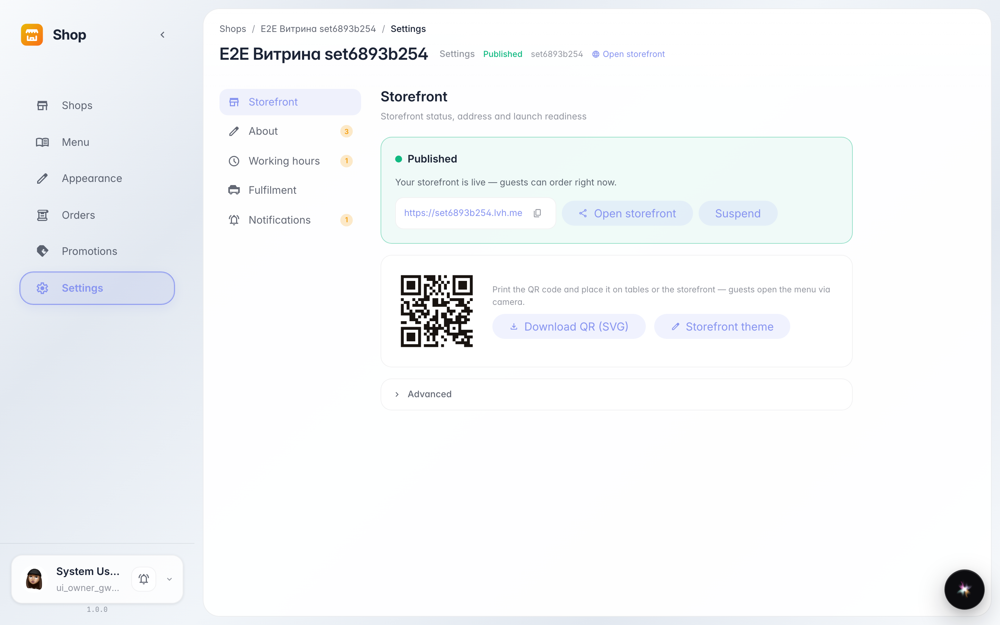
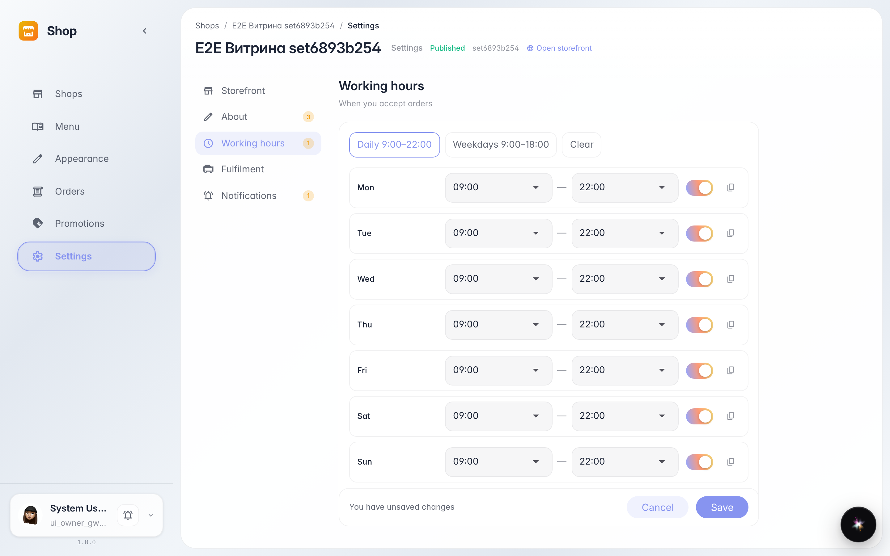
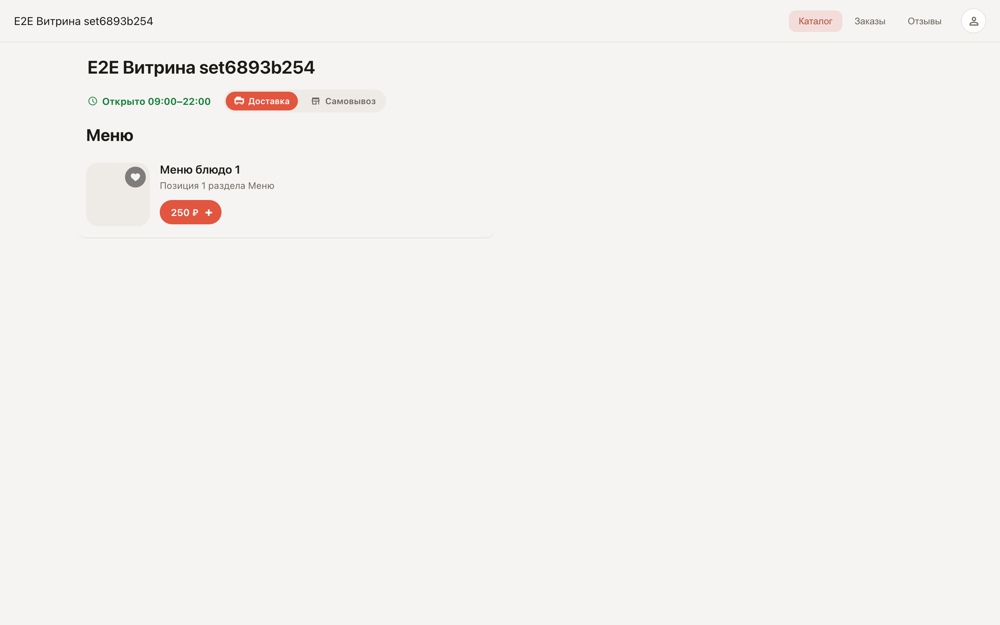

# Настройки магазина: адрес витрины и часы работы

**Для чего:** в настройках собраны адрес витрины, профиль, часы работы и способы выдачи заказов — всё, что видит покупатель на витрине.

**Какие проблемы решает:** ссылка на витрину копируется одной кнопкой, а часы работы задаются готовым пресетом — витрина сама показывает «Открыто» или «Откроемся» и не даёт оформить заказ вне времени работы.

**Результат:** ссылка на витрину скопирована; витрина показывает часы работы рядом с названием.

## Шаг 1. Адрес витрины

Раздел «Витрина» показывает статус «Опубликована» и готовую ссылку — её копируют в соцсети и рекламу кнопкой рядом. «Открыть витрину» показывает страницу глазами покупателя, «Приостановить» временно скрывает её.

## Шаг 2. Часы работы пресетом

Раздел «Часы работы» задаёт расписание недели. Пресет «Каждый день» ставит 9:00–22:00 на всю неделю сразу; отдельный день меняют полями времени или выключают тумблером.

## Шаг 3. Часы работы на витрине

Витрина показывает часы рядом с названием: «Открыто» когда магазин работает, «Откроемся» с ближайшим временем — когда нет. Покупатель сразу понимает, примут ли заказ.

