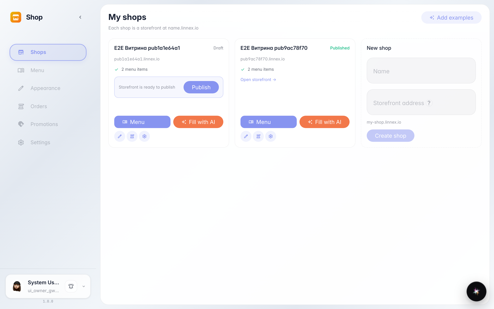
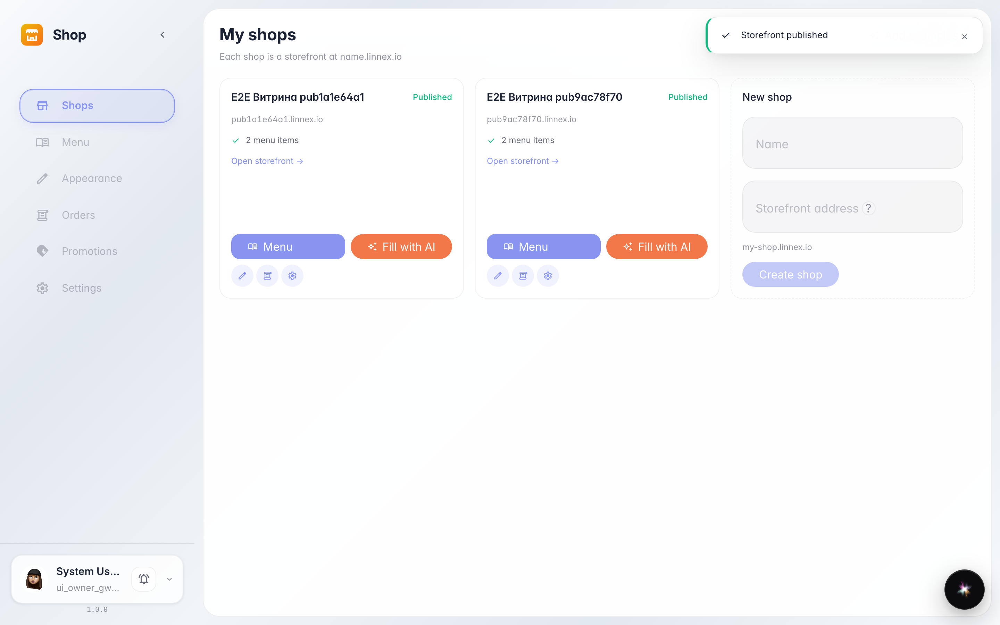
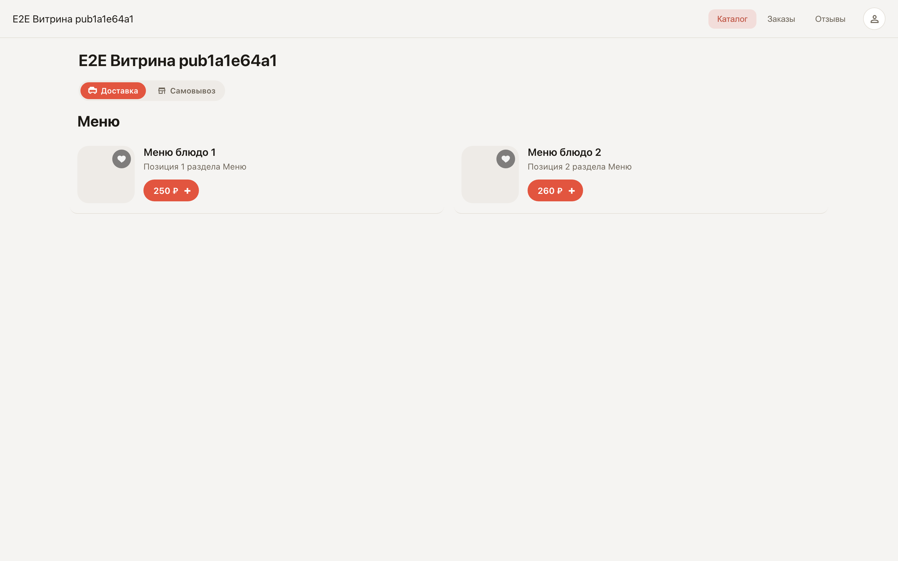

# Publishing the storefront and the public link

**Purpose:** while unpublished, only you see the storefront. One button makes it live at a permanent link.

**Problems solved:** no website or developer needed — send the link to customers, post it on socials, print it as a QR code on tables.

**Result:** the shop card is marked Published and the link opens the menu for customers.

## Step 1. Ready to publish

Once the menu and design are set, the shop card shows the publish button. Before you press it, only you can see the storefront.

## Step 2. Storefront published

Published — the permanent public link appeared. Send it to customers or print it as a QR code.

## Step 3. Storefront is live

The link opens a live storefront: menu, cart, checkout — everything the customer sees.

