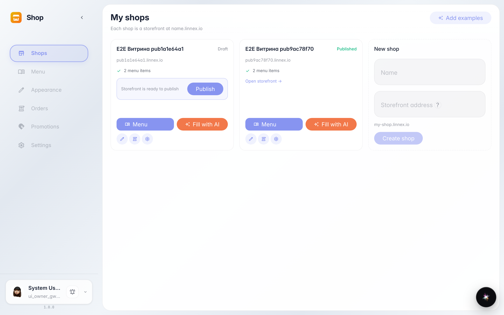
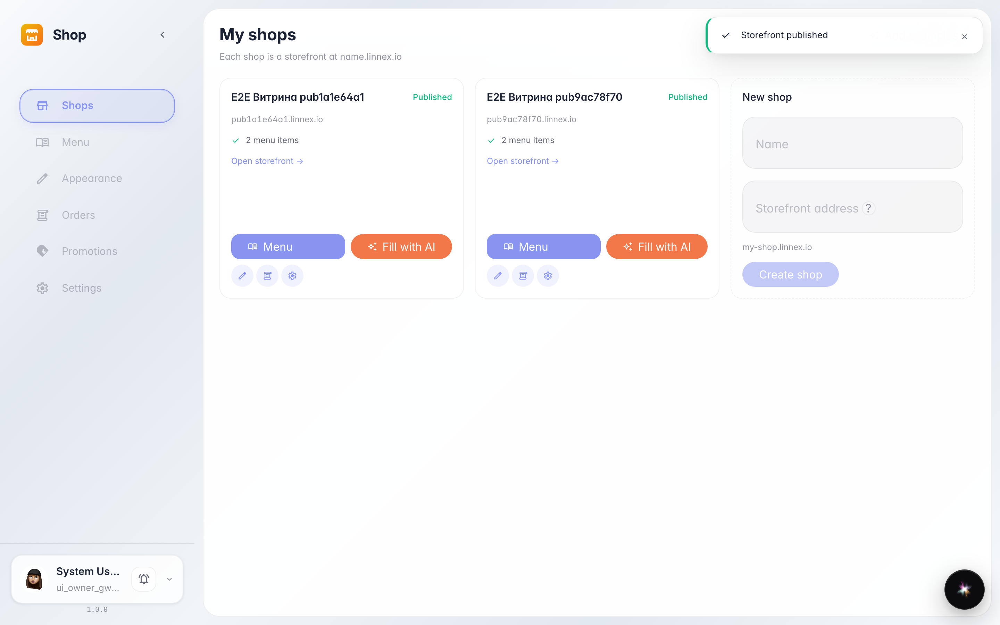
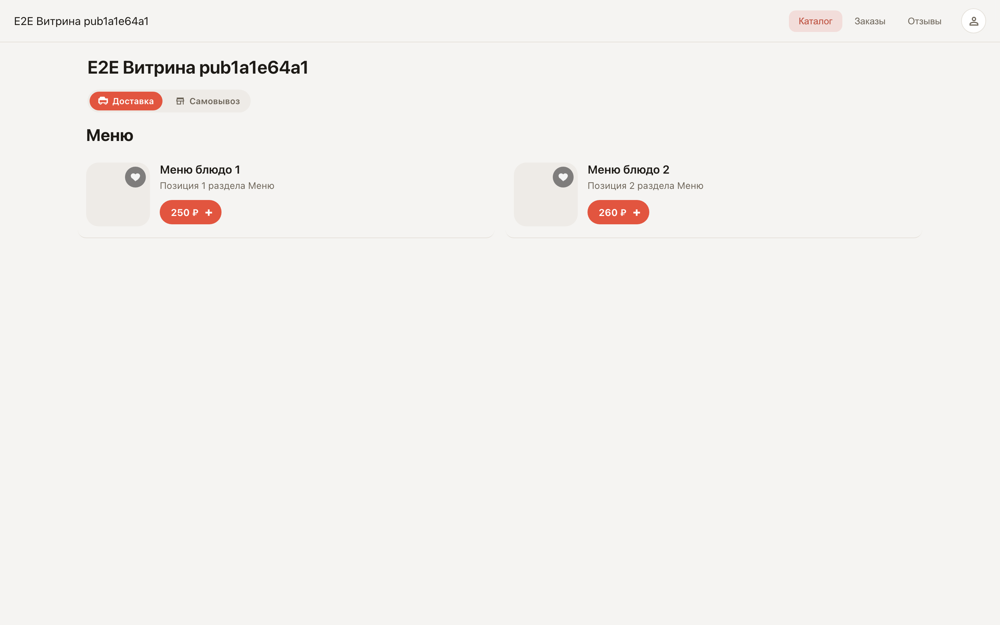

# Публикация витрины и публичная ссылка

**Для чего:** пока витрина не опубликована, её видите только вы. Одна кнопка делает её живой по постоянной ссылке.

**Какие проблемы решает:** не нужен сайт и программист — ссылку на витрину можно сразу отправить покупателям, поставить в соцсети или в QR-код на столе.

**Результат:** карточка магазина помечена «Опубликован», ссылка открывает меню для покупателей.

## Шаг 1. Магазин готов к публикации

Когда меню и оформление собраны, карточка магазина показывает кнопку публикации. До нажатия витрину видите только вы.

## Шаг 2. Витрина опубликована

«Опубликован» — появилась постоянная публичная ссылка. Её можно отправлять покупателям или печатать QR-кодом.

## Шаг 3. Витрина открыта покупателям

По ссылке открывается живая витрина: меню, корзина, оформление заказа — всё, что видит покупатель.

