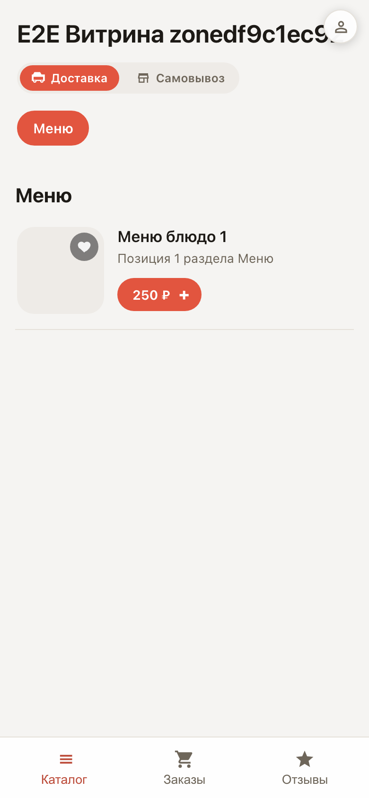
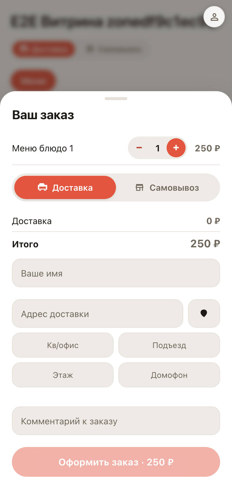
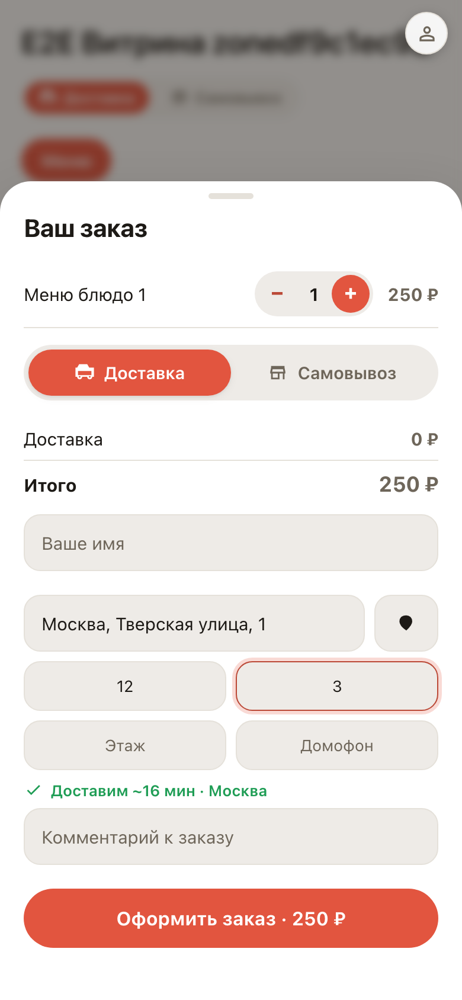
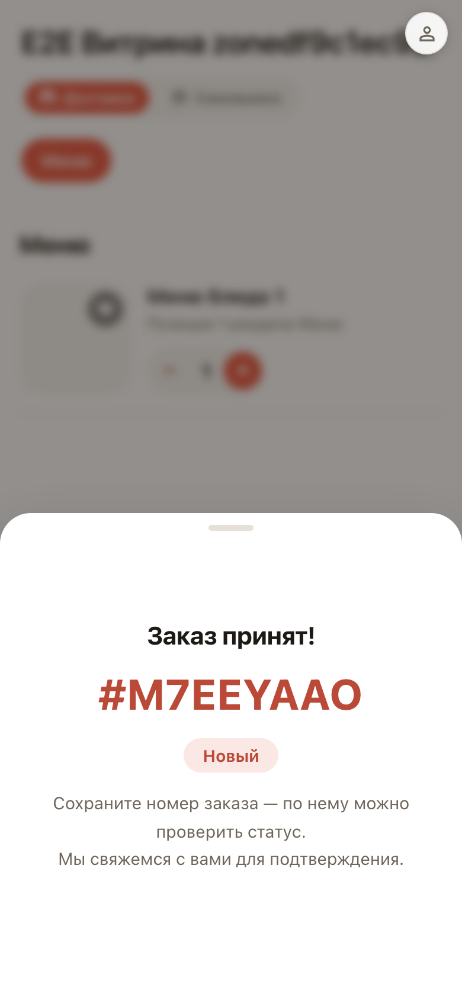
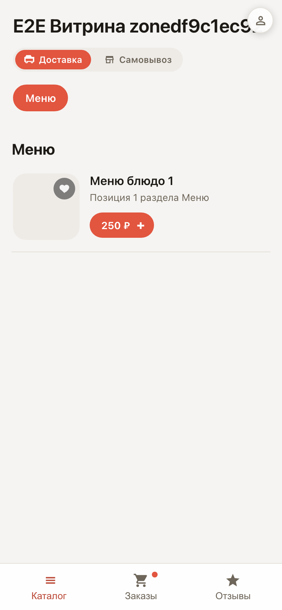

# Ordering on the storefront as a customer

**Purpose:** see what your customer experiences — from opening the menu to the order number, no setup needed.

**Problems solved:** it is unclear whether ordering from you is convenient. Here is the whole path: cart, address suggestions, delivery zone, phone sign-in and a ready order.

**Result:** the order is placed and sits in the customer's account — the Orders tab signals with an active dot.

## Step 1. Storefront on the customer's phone

The customer opens the storefront link and sees the menu with categories and prices. Each item has an add-to-cart button.

## Step 2. Cart and checkout

A cart with the total appeared at the bottom. It opens the checkout sheet: pickup method, address and order details.

## Step 3. Address suggestions and delivery zone

The address is suggested while typing — no need to remember the exact spelling. The system instantly checks whether the point falls in the delivery zone: green badge — we deliver.

## Step 4. Order created

The customer confirms their phone number — no password or registration needed. The order gets a number and goes straight to your orders board.

## Step 5. Order in the account

Back on the storefront, the customer sees a pulsing dot on the Orders tab — that is where the order status lives in real time.

