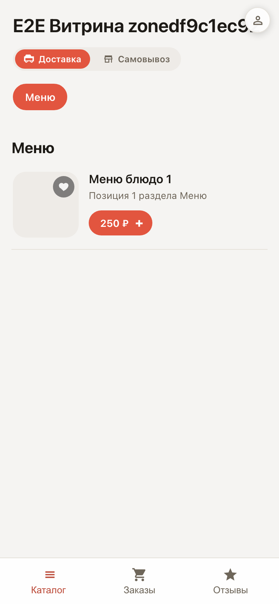
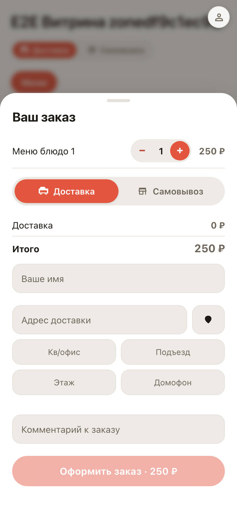
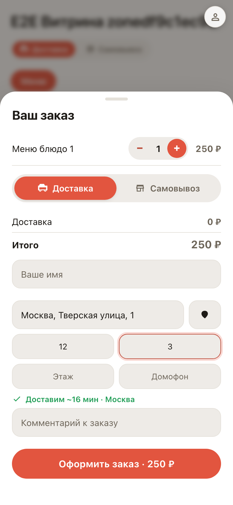
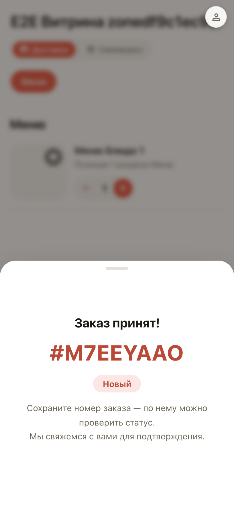
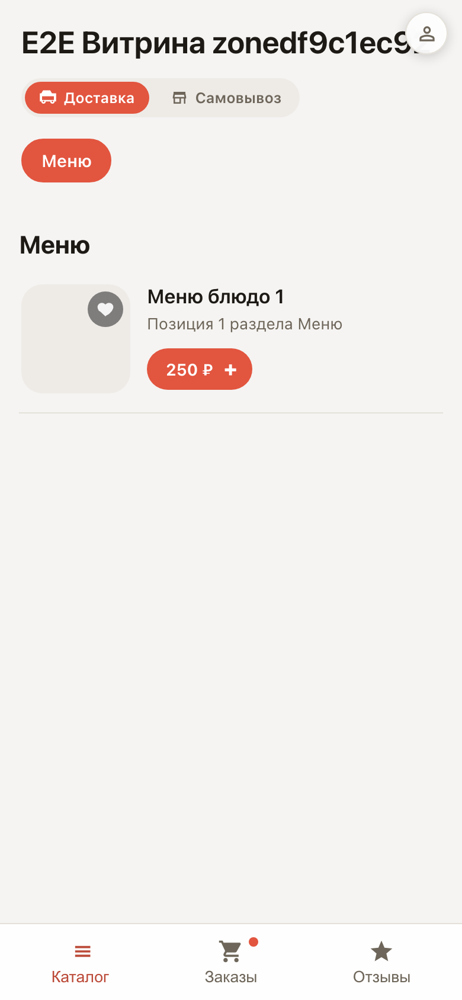

# Заказ на витрине глазами покупателя

**Для чего:** увидеть, что чувствует ваш покупатель — от открытия меню до номера заказа, без всяких установок.

**Какие проблемы решает:** непонятно, удобно ли заказывать у вас. Здесь весь путь: корзина, адрес с подсказками, зона доставки, вход по телефону и готовый заказ.

**Результат:** заказ оформлен и попал в личный кабинет покупателя — вкладка «Заказы» сигналит активной точкой.

## Шаг 1. Витрина на телефоне покупателя

Покупатель открывает ссылку на витрину и видит меню с категориями и ценами. У каждой позиции — кнопка добавления в корзину.

## Шаг 2. Корзина и оформление

Внизу появилась корзина с суммой. Она открывает лист оформления: способ получения, адрес и детали заказа.

## Шаг 3. Адрес с подсказками и зоной доставки

Адрес подсказывается по мере ввода — покупателю не нужно помнить точное написание. Система сразу проверяет, входит ли точка в зону доставки: зелёный бейдж — привезём.

## Шаг 4. Заказ создан

Покупатель подтверждает номер телефона — пароль и регистрация не нужны. Заказ получает номер и сразу уходит в вашу доску заказов.

## Шаг 5. Заказ в личном кабинете

Вернувшись на витрину, покупатель видит пульсирующую точку на вкладке «Заказы» — там статус его заказа в реальном времени.

