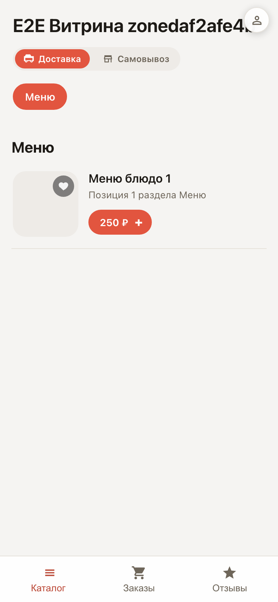
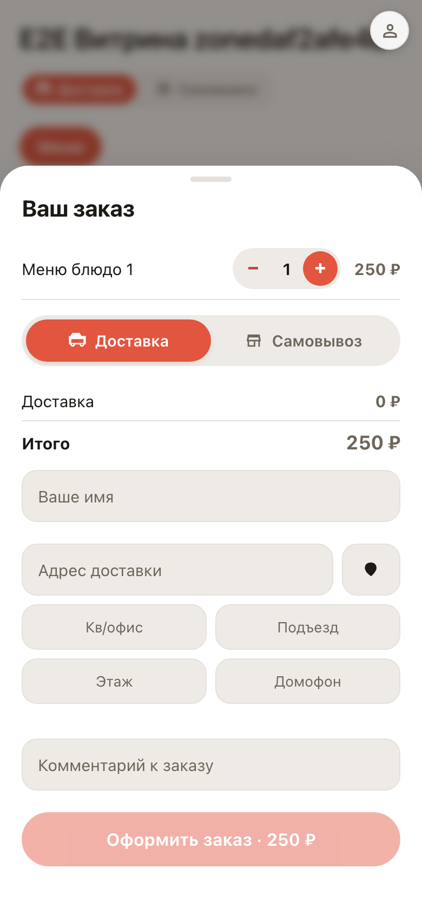

# The storefront on the customer's phone

**Purpose:** most orders come from phones — this shows how your storefront looks and works in a hand.

**Problems solved:** menu, cart and checkout are made for a thumb: large cards, a bottom cart sheet, an account in tabs. Nothing to install.

**Result:** the customer walks the whole path one-handed: menu → cart → order → account.

## Step 1. Menu on the phone

The storefront opens straight from a link — no app needed. Dish cards are large, price and the + button sit under the thumb.

## Step 2. Cart slides from the bottom

The cart is a bottom sheet, like in familiar delivery apps. Total and the checkout button are always visible.

