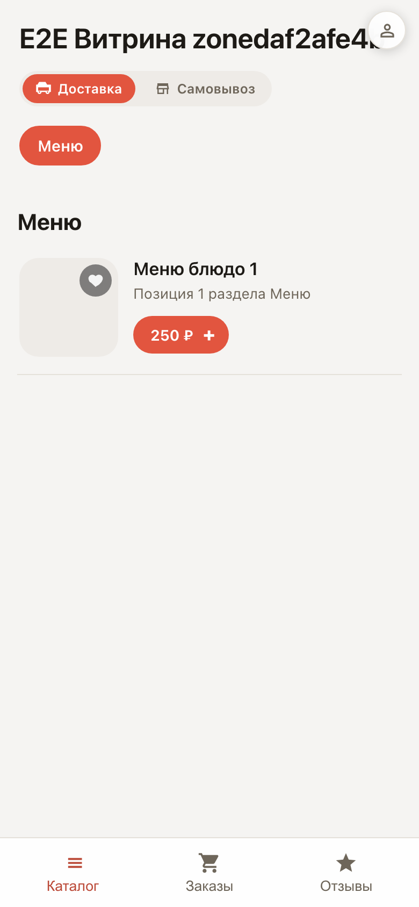
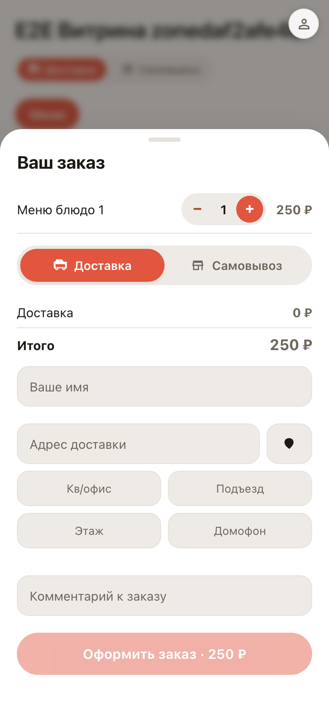

# Витрина на телефоне покупателя

**Для чего:** большинство заказов приходят с телефона — здесь видно, как ваша витрина выглядит и работает в руке.

**Какие проблемы решает:** меню, корзина и оформление сделаны под палец: карточки крупные, корзина выезжает снизу, кабинет — вкладками. Ничего устанавливать не нужно.

**Результат:** покупатель проходит весь путь одной рукой: меню → корзина → заказ → свой кабинет.

## Шаг 1. Меню на телефоне

Витрина открывается прямо по ссылке — приложение не нужно. Карточки блюд крупные, цена и кнопка «+» под большим пальцем.

## Шаг 2. Корзина выезжает снизу

Корзина — выезжающий лист снизу экрана, как в привычных приложениях доставки. Сумма и кнопка оформления всегда на виду.

