# Полный цикл склада: настройка администратором → смена на ТСД

**Для чего:** единая инструкция «с нуля до результата» — от регистрации склада до проведённых операций на терминале.

**Какие проблемы решает:** показывает, что администратору не нужен программист — все справочники заводятся формами; оператору не нужен компьютер — вся работа идёт сканами.

**Результат:** склад с топологией, справочниками и правилами; принятый, перемещённый, пересчитанный и отгруженный товар — всё проведено леджером.

## Шаг 1. Заведите склад — топология соберётся сама

«Настройки → Склады → Создать»: код и название — всё, что нужно ввести. Схема «standard» заодно разворачивает зоны «Приёмка / Хранение / Упаковка / Отгрузка» и типы операций «приход, отгрузка, внутренние» — руками ничего не доклеивается.

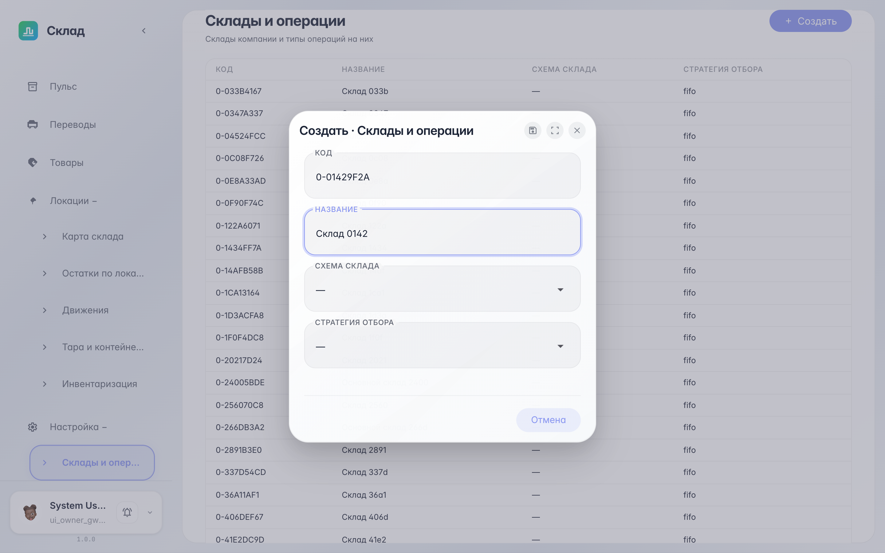

## Шаг 2. Типы операций склада — готовы из коробки

**Демонстрация результата.** Под таблицей складов — типы операций выбранного склада: приход, отгрузка, внутренние перемещения. Тумблер «auto-validate» и поток сканирования «default/pack/ship» правятся прямо в строке — они решают, какие экраны увидит оператор на ТСД.

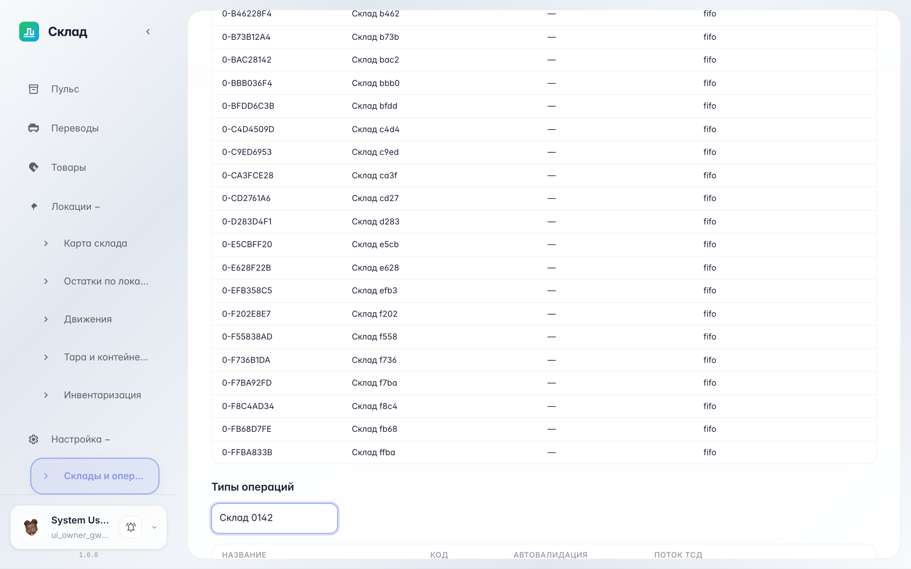

## Шаг 3. Создайте тип хранения

«Типы хранения» — это классы ячеек (стеллаж, пол, холодильник): у типа — лимиты по таре, весу и период инвентаризации. Ячейка потом просто ссылается на тип.

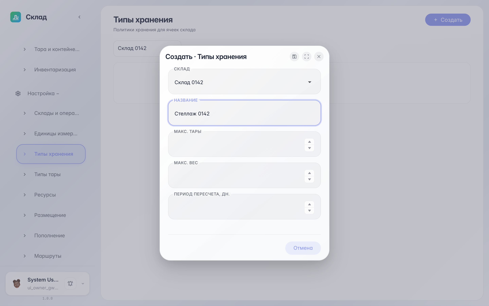

## Шаг 4. Создайте тип тары «паллета»

«Типы тары» — паллеты, короба, тележки. У типа — вид (pallet/box/tote/cart), лимит веса и объёма, признак многоразовости. Паллета позже станет локацией-контейнером и поедет по складу целиком.

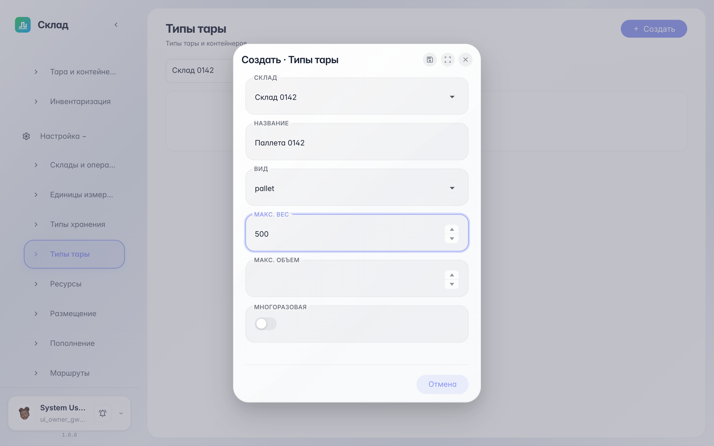

## Шаг 5. Выдайте технике бейдж со штрихкодом

«Ресурсы» — техника и люди-устройства: тележка, погрузчик, пикер. У ресурса есть штрихкод-бейдж: оператор сканирует его на ТСД и техника привязывается к смене — задания фильтруются под её возможности.

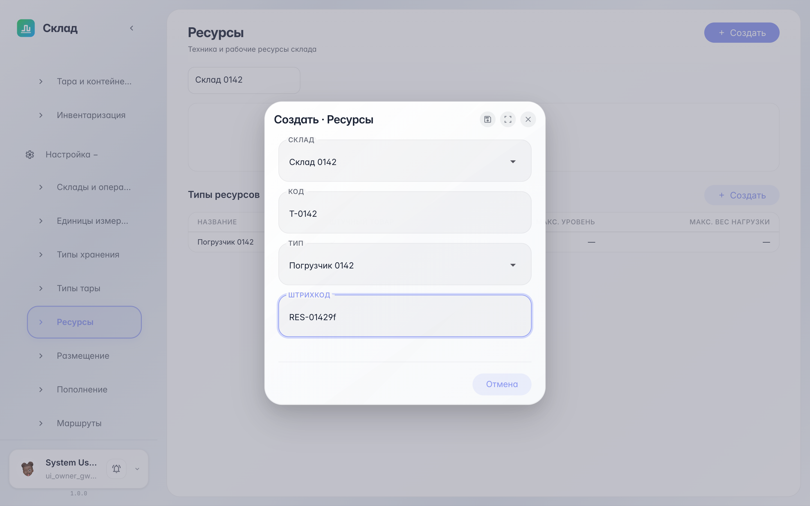

## Шаг 6. Добавьте свою единицу измерения

«ЕИ и упаковки»: своя единица — имя, категория и коэффициент к базовой. «Упаковка ×12» позволит принимать и отгружать коробами, не пересчитывая в штуки.

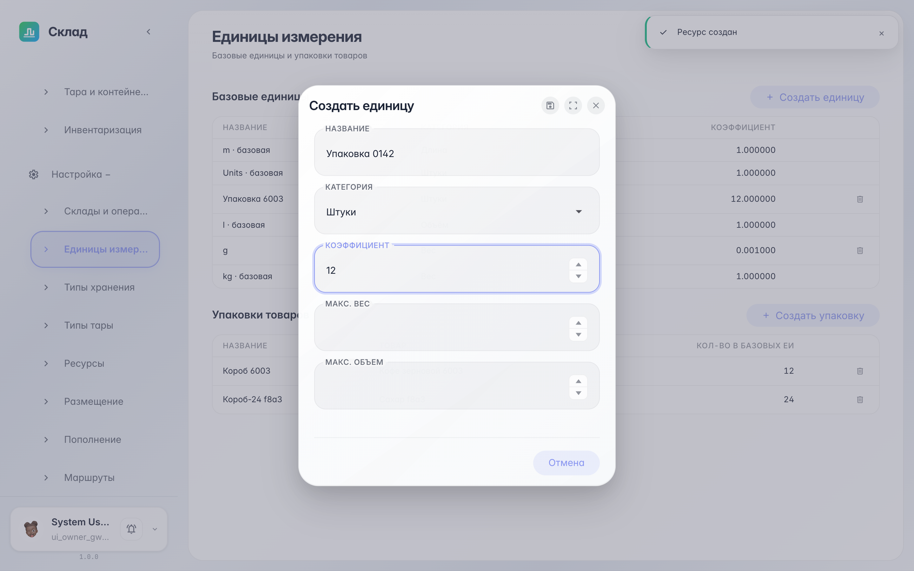

## Шаг 7. Заведите первый товар

«Товары → Создать» открывает каталог-пикер: если товар уже есть в общем каталоге — подключите его одной строкой, если нет — «Создать новый». Артикул, базовая ЕИ и штрихкод — минимум для работы терминала.

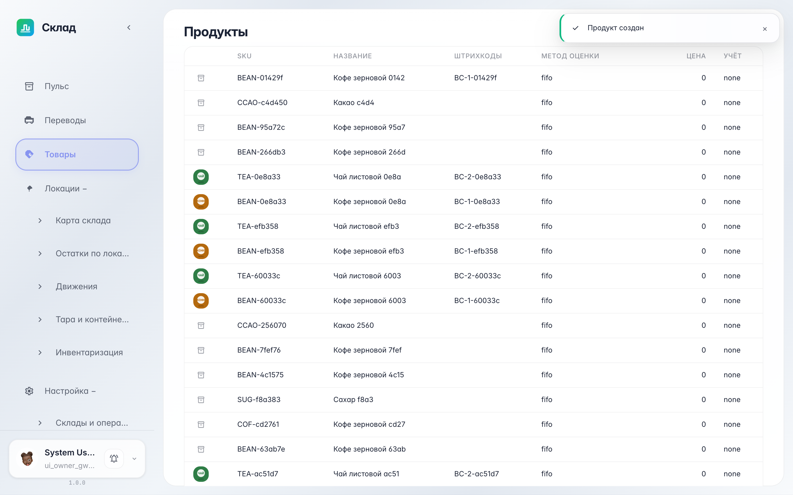

## Шаг 8. Привяжите упаковку к товару

Упаковка — это «короб по 12 шт» со своим штрихкодом: скан упаковки на ТСД сам подставит товар и количество. Отдельный баркод — отдельная этикетка на коробе.

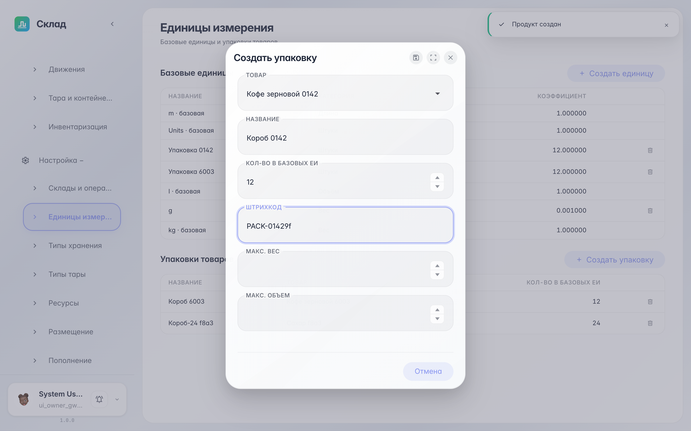

## Шаг 9. Разверните склад на карте локаций

«Локации» — карта склада деревом: пресет «standard» уже создал «Receiving / Stock→Pick / Packing / Shipping». Дальше добавляем рабочие ячейки внутрь зоны «Stock».

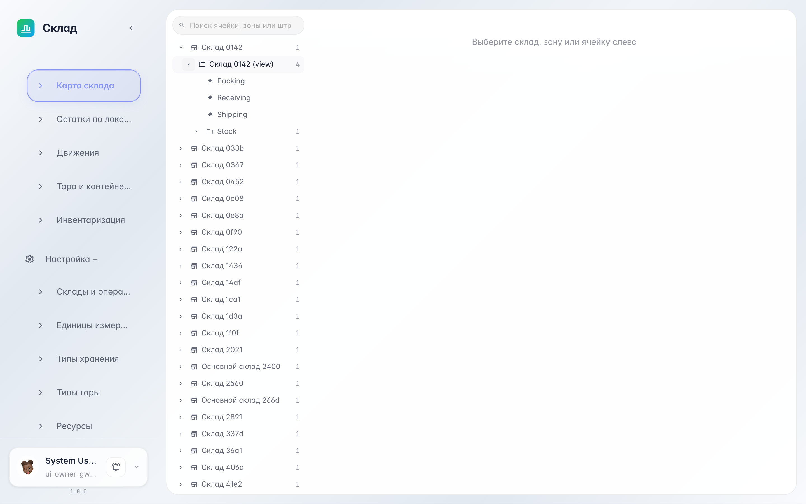

## Шаг 10. Добавьте ячейку хранения

«Создать дочернюю» внутри зоны «Stock»: имя ячейки, её штрихкод (наклейка на стеллаже) и тип хранения — стеллаж, заведённый шагом раньше. Штрихкод — то, что оператор будет сканировать на месте.

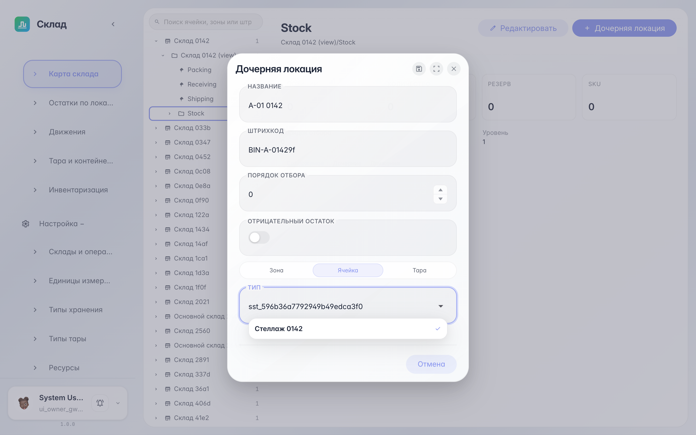

## Шаг 11. Заведите паллету как контейнер-локацию

Та же «дочерняя» локация, но вид «контейнер»: паллета — движимая ячейка, её содержимое едет вместе с ней. Тип — паллета из справочника тары, баркод — бирка на борту.

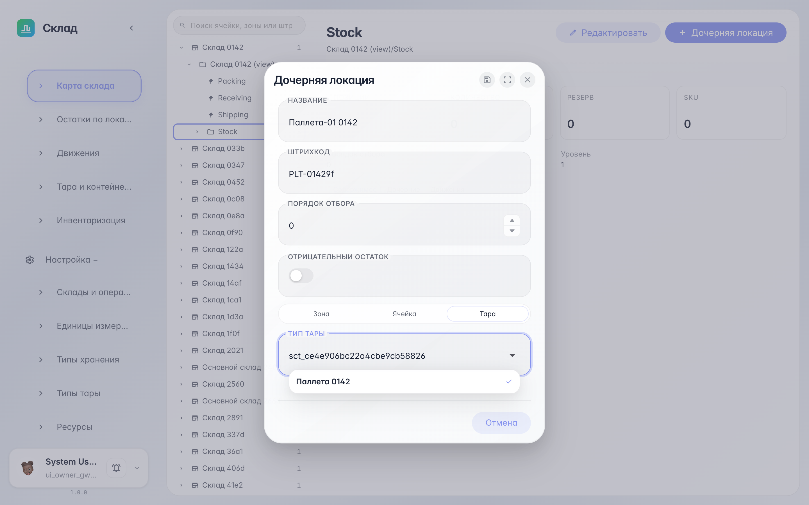

## Шаг 12. Карта готова: зона, ячейки и паллета

**Демонстрация результата.** В дереве под «Stock» — две ячейки стеллажа и паллета. Каждая имеет штрихкод — можно переходить к правилам размещения.

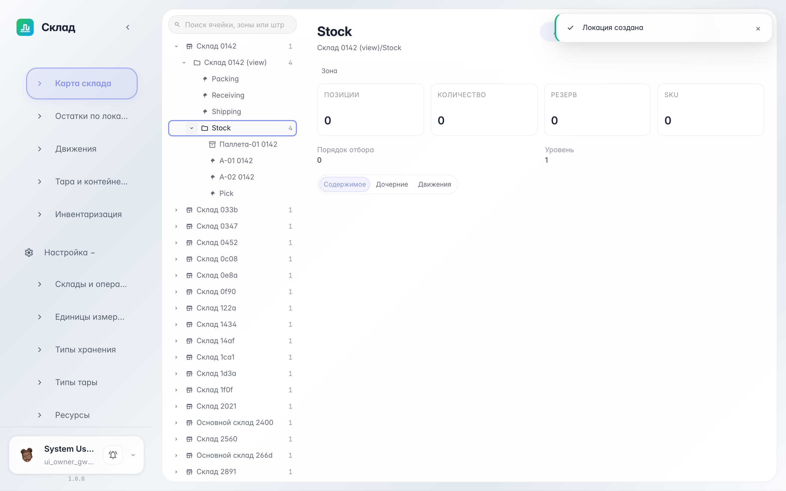

## Шаг 13. Назначьте правило размещения

«Правила размещения» отвечают «куда убрать приехавший товар»: из зоны приёмки — в конкретную ячейку. На ТСД это правило превратится в подсказку «положите в A-01».

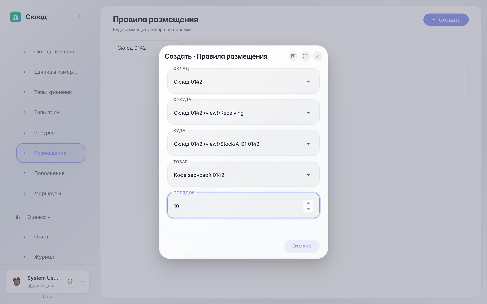

## Шаг 14. Задайте минимум и максимум запаса ячейки

«Правила пополнения» стерегут ячейку: остаток упал ниже минимума — система предложит пополнить до максимума указанным видом документа.

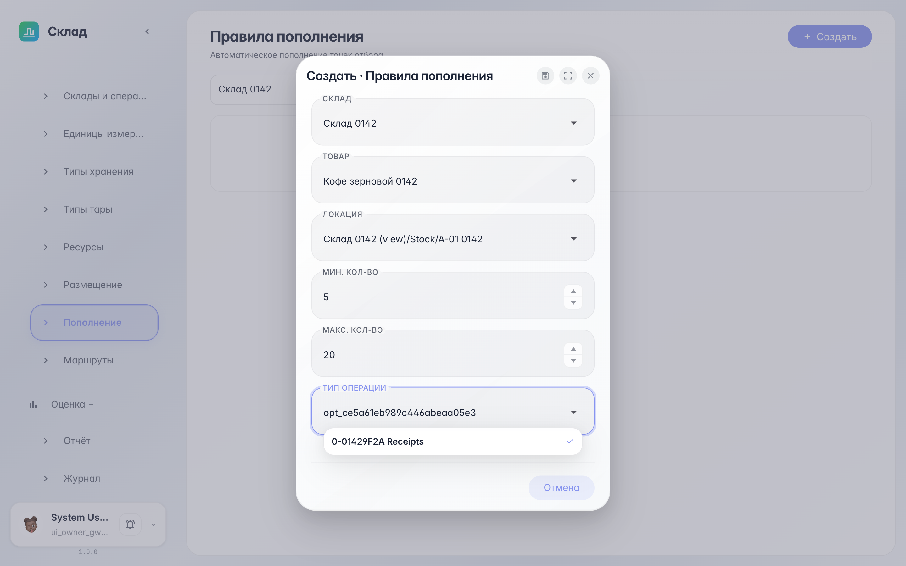

## Шаг 15. Настройка закончена — склад готов к смене

**Демонстрация результата.** Справочники заполнены только UI-формами: склад с топологией, типы хранения и тары, техника с бейджем, единицы и упаковки, товары с штрихкодами, ячейки и паллета, правила размещения и пополнения, маршрут.

**Дальше** — передаём терминал оператору.

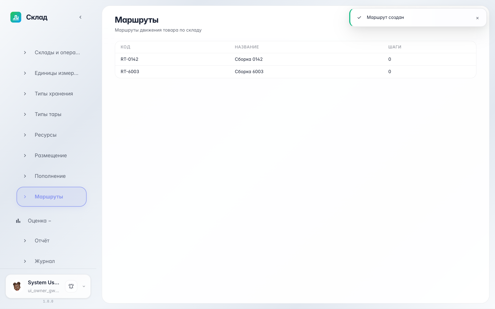

## Шаг 16. Возьмите терминал и выберите склад

ТСД открывается списком складов — оператор выбирает свой раз в смену. Видно только то, что администратор завёл через формы.

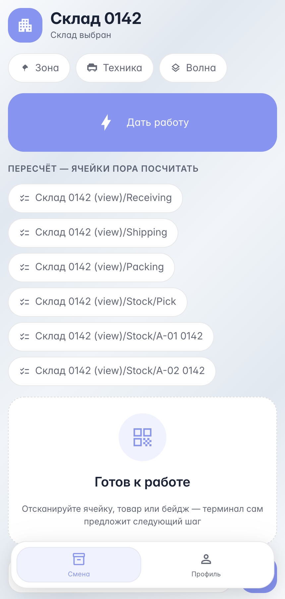

## Шаг 17. Скан бейджа техники — смена привязана

Штрихкод погрузчика открыл карточку ресурса, кнопка «привязать» закрепила его за сменой на сервере — чип техники показывает код. Пароль не нужен: бейдж и есть удостоверение.

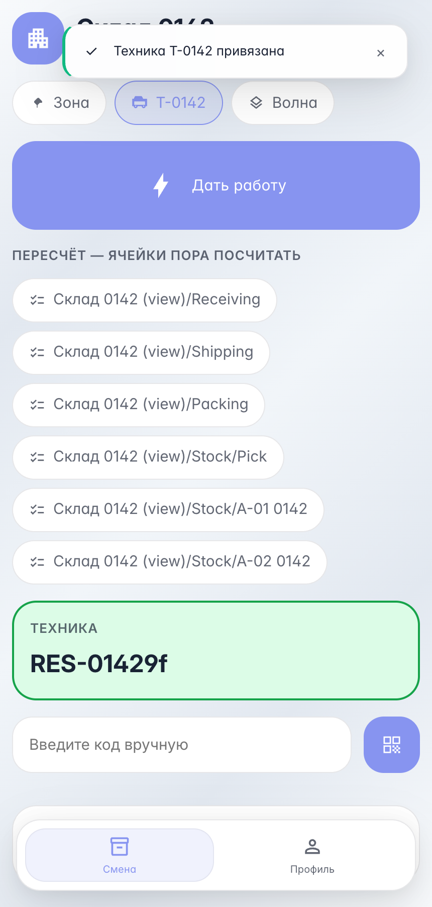

## Шаг 18. Скан товара — карточка с фото и действиями

Скан любого товара с любого экрана — карточка: фото, остатки по ячейкам и действия «переместить / принять / разместить / пересчитать». Оператору не надо помнить, где что лежит.

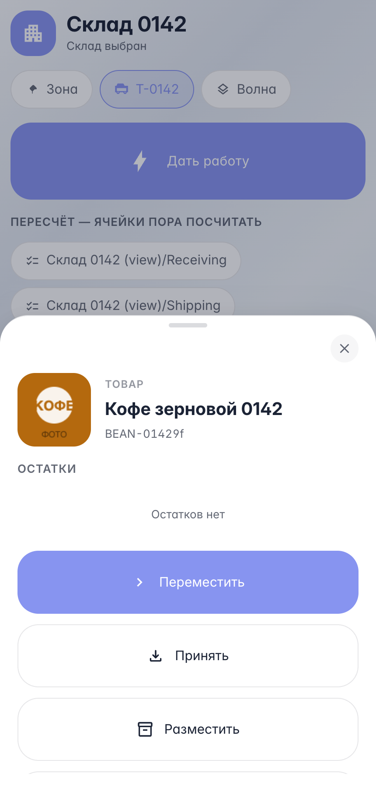

## Шаг 19. Приёмка: товар → ячейка → количество → свайп

Машина приёмки ведёт по сканам: штрихкод товара, штрихкод ячейки-приёмника, количество на крупной клавиатуре — и проводка свайпом «слева направо». Свайп не срабатывает от случайного касания в перчатке.

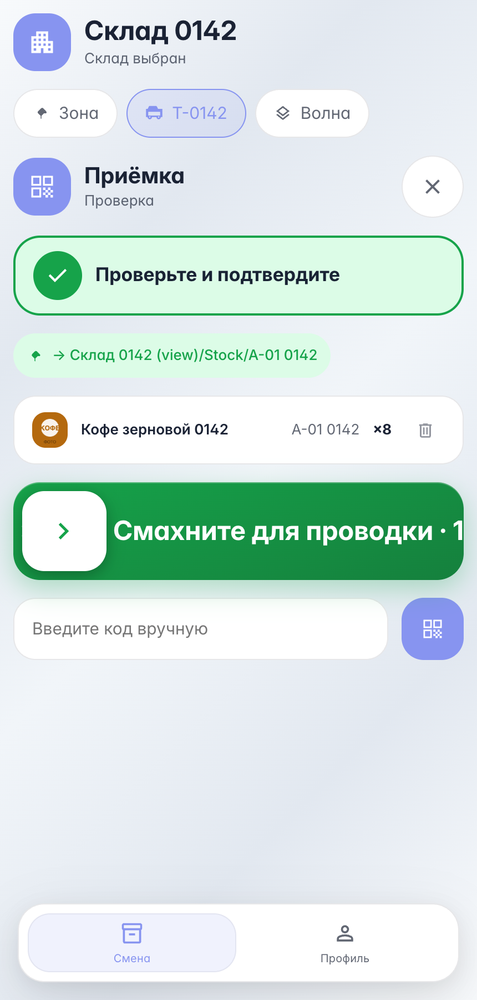

## Шаг 20. Скан ячейки — остаток на месте

**Демонстрация результата.** Штрихкод ячейки A-01 показывает принятый кофе ×8 — приёмка записана леджером. Отсюда же доступны действия по ячейке.

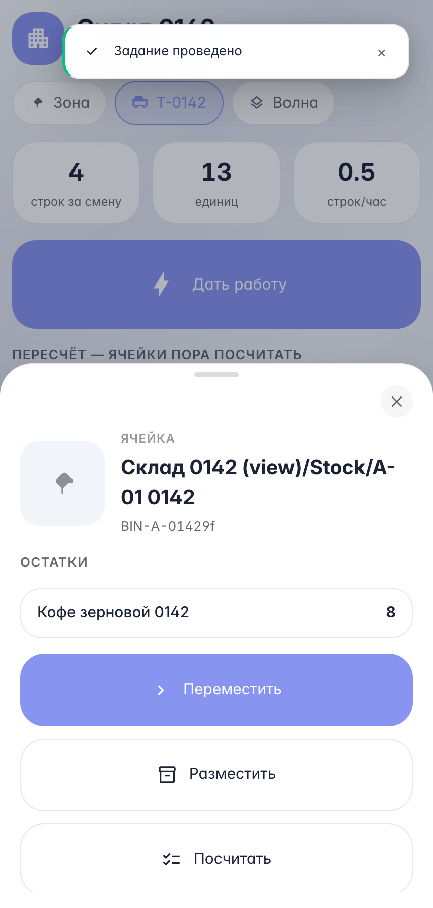

## Шаг 21. Пересчёт прямо на месте

Действие «пересчитать» из карточки ячейки: скан товара → фактическое количество → проводка. Расхождение система зафиксировала бы сама — здесь учёт сошёлся с фактом.

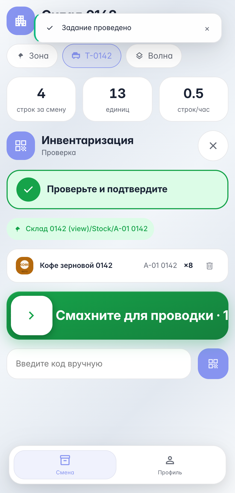

## Шаг 22. Перемещение: откуда → куда → сколько

Поток перемещения повторяет физику: подтвердил ячейку отбора сканом, пришёл к целевой ячейке — сканом её, ввёл количество. Перепутать направление невозможно — источник и приёмник разные сканы.

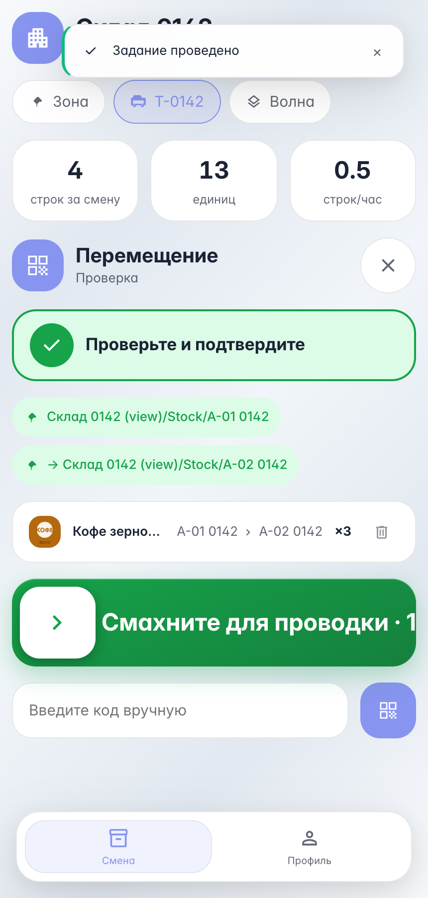

## Шаг 23. Скан накладной — документ в работу

Накладная от ERP резолвится в карточку документа: номер и число позиций. «Начать исполнение» открывает сессию — поток «сборка» backend выбрал сам по типу операции.

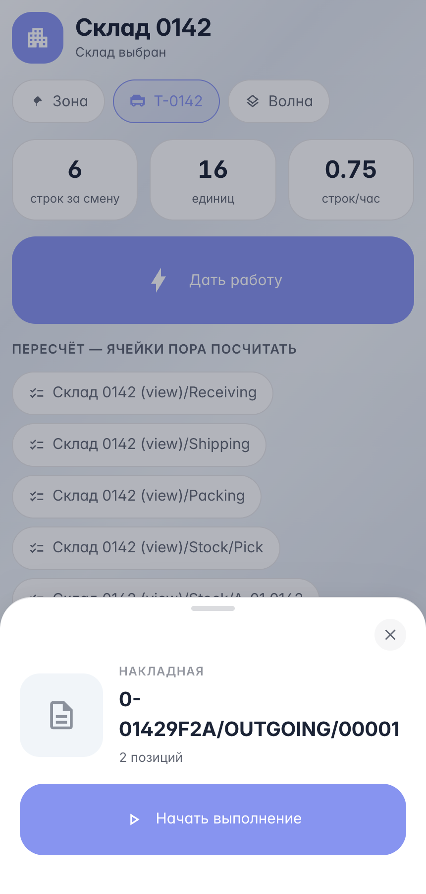

## Шаг 24. Терминал подсказывает, что собирать

Жёлтая полоса — подсказка backend'а из открытой строки накладной: ячейка → товар × количество. Оператор идёт к указанной ячейке — искать заказ руками не нужно.

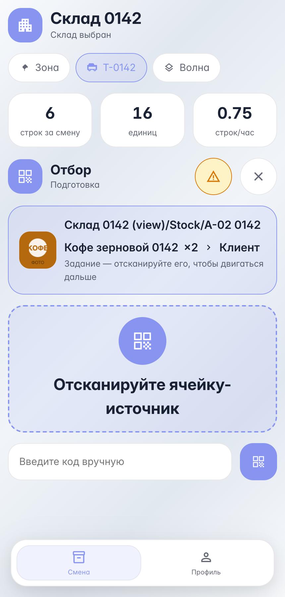

## Шаг 25. Вторая позиция — документ ведёт сам

После проводки первой позиции сессия не закрылась — backend подсказал следующую строку накладной. Оператор не возвращается в очередь между ходками.

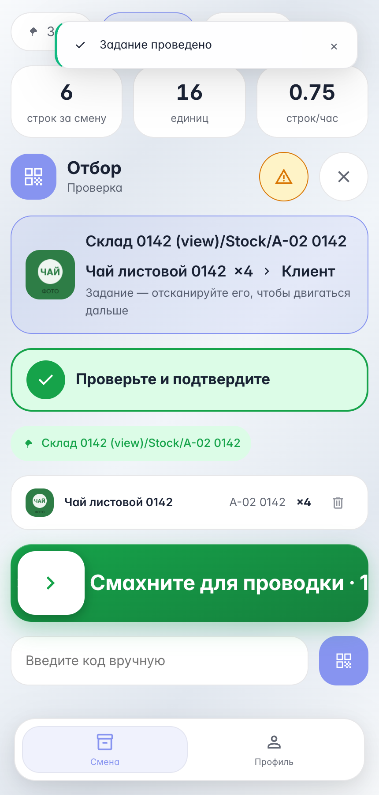

## Шаг 26. Паллета едет целиком — один скан вместо переноски

Скан бирки паллеты → «переместить» → скан ячейки-цели: всё содержимое (кофе ×6) переезжает вместе с тарой одной проводкой. Реальная физика склада — контейнер как единица.

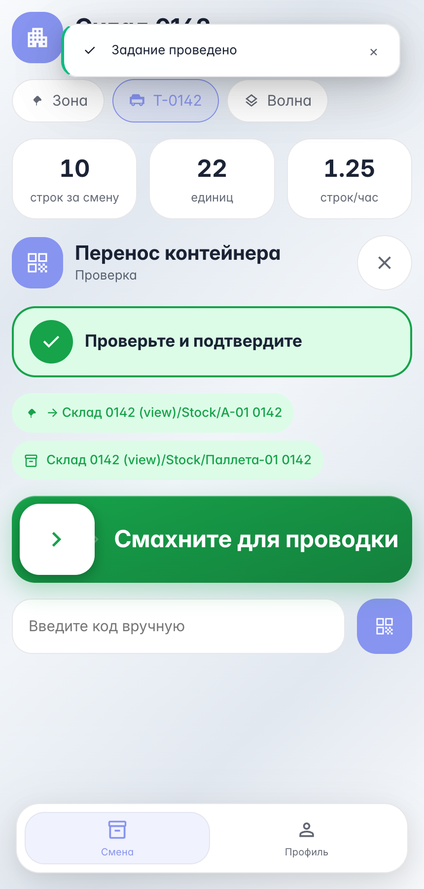

## Шаг 27. Смена прошла полный цикл

**Демонстрация результата.** Принято два товара, проведён пересчёт, перемещение между ячейками, сборка двух позиций накладной и переезд паллеты — всё одними сканами и свайпами, на сущностях, которые администратор создал формами.

**Итог.** «Настроил склад → отдал терминал → склад работает» — от регистрации до леджера без единой строчки кода и без бумажной накладной.

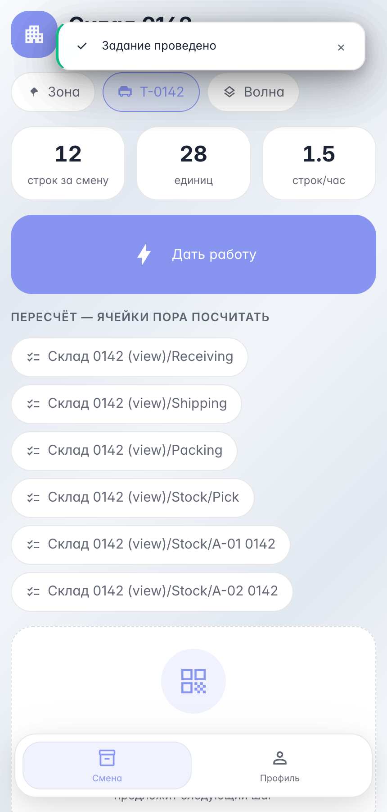
