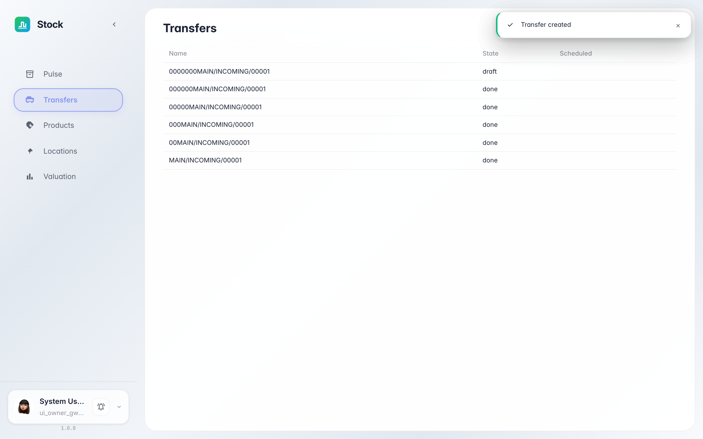
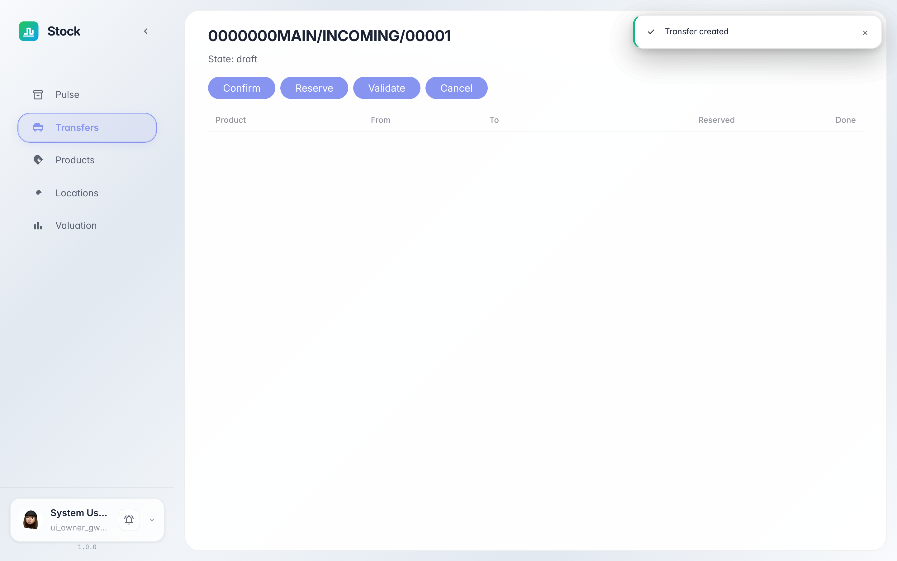
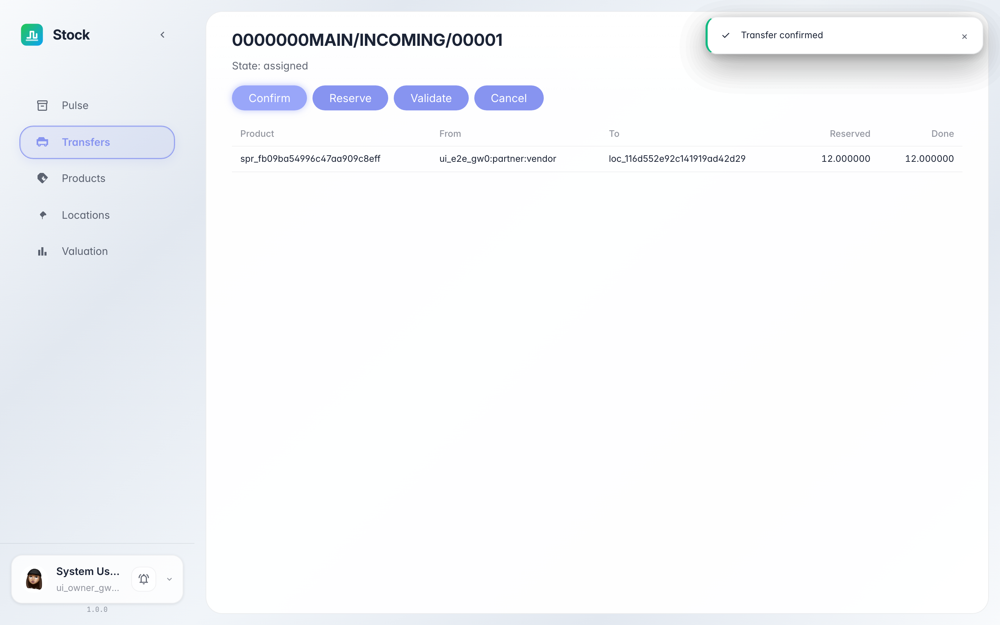
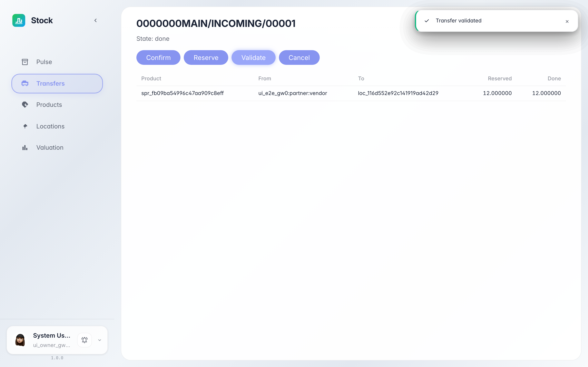
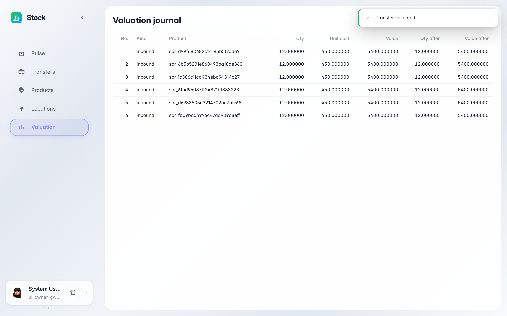

# Process a goods receipt into the warehouse

**Purpose:** this guide helps you receive a delivery: open the receipt document and process it until the stock appears on hand.

**Problems solved:** you will learn where warehouse documents live, what the states «draft → confirmed → reserved → done» mean, and how to verify the goods are counted in stock.

**Result:** the receipt is validated and stock valuation shows the accepted-goods entry.

## Step 1. Open the Transfers section

Choose «Transfers» in the left menu. This is the journal of all warehouse documents: supplier receipts, customer deliveries and internal moves. The new receipt is shown as «draft».

## Step 2. Open the receipt document

Click the document row — the card opens. Check the lines: product, quantity and the receiving zone. The action buttons on top move the document through its states.

## Step 3. Confirm the document

Click «Confirm»: the warehouse agrees the document and the system immediately reserves space for the delivery. The state becomes «reserved» — put-away tasks are ready, only the physical receipt is left.

## Step 4. Validate the receipt

Once the goods are physically received, click «Validate». The state becomes «done»: the quantity is posted to the warehouse and its cost is recorded in stock valuation.

## Step 5. Check the entry in stock valuation

**Result demonstration.** Open «Valuation» in the left menu: the journal now shows an «inbound» entry for the product — 12 units at the document price. That entry is the accepted stock.

**Summary.** Now you can find a receipt in the transfers journal, process it through the states, and verify the result in stock valuation.

