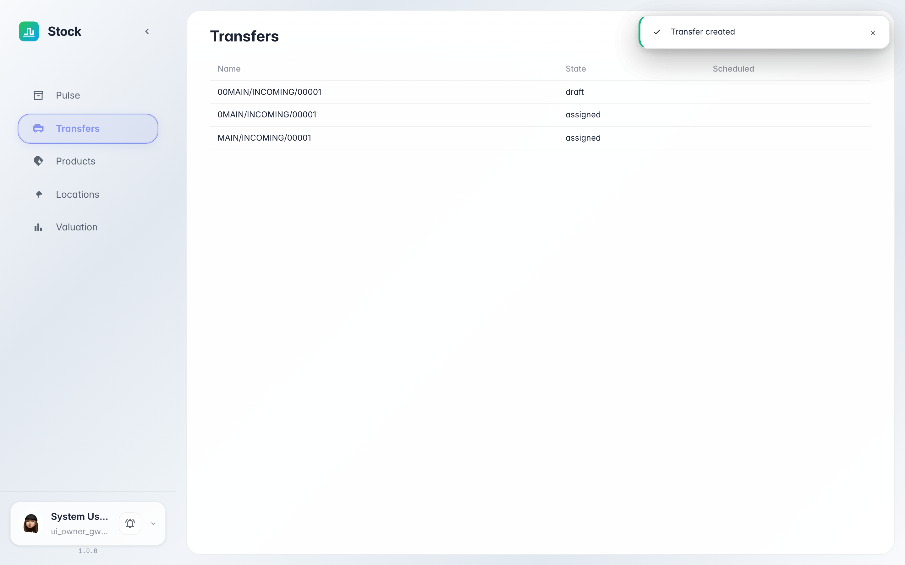
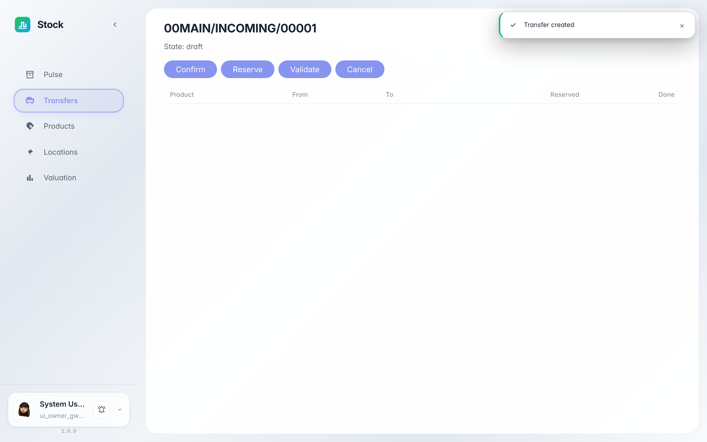
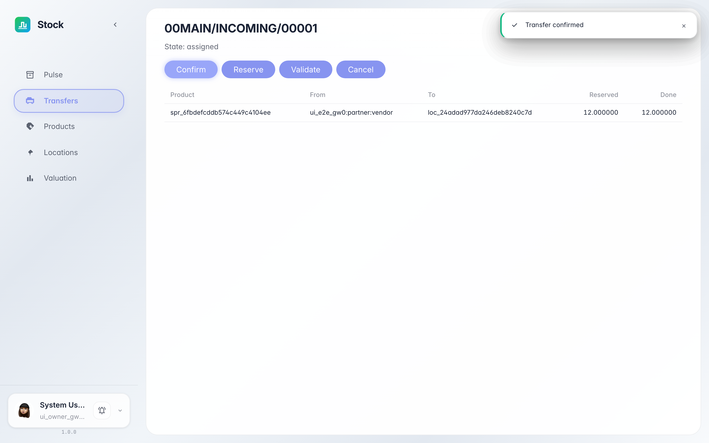
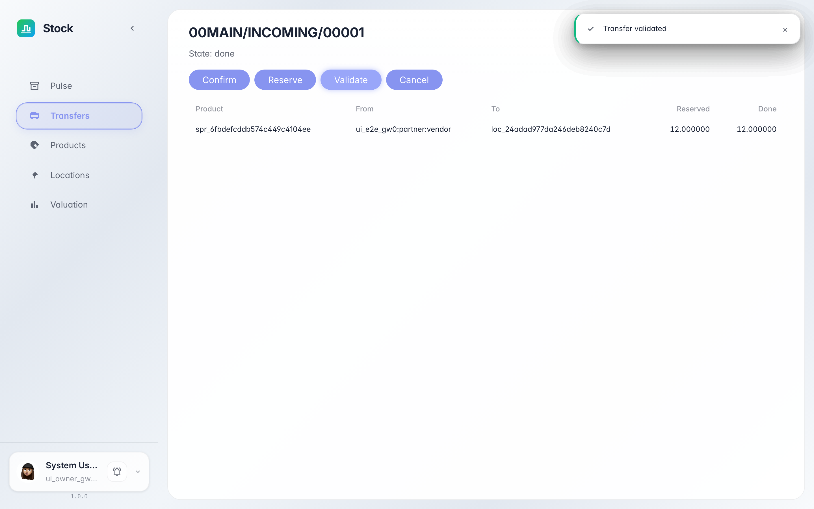

# Проводим поступление товара на склад

**Для чего:** эта инструкция поможет принять поставку: открыть документ поступления и провести его до появления остатка на складе.

**Какие проблемы решает:** вы узнаете, где живут складские документы, что означают статусы «черновик → подтверждён → зарезервирован → проведён» и как убедиться, что товар числится на складе.

**Результат:** поступление проведено, а пульс склада показывает полученное количество.

## Шаг 1. Откройте раздел «Переводы»

В меню слева выберите «Переводы». Здесь журнал всех складских документов: поступления от поставщиков, отгрузки покупателям и внутренние перемещения. Новое поступление видно в статусе «черновик».

## Шаг 2. Откройте документ поступления

Кликните по строке документа — откроется карточка. Проверьте строки: товар, количество и зона приёмки. Сверху — кнопки действий, которые ведут документ по статусам.

## Шаг 3. Подтвердите документ

Нажмите «Подтвердить»: склад согласует документ, а система сразу резервирует место под поставку. Статус становится «зарезервирован» — задания на приёмку готовы, осталось принять товар фактически.

## Шаг 4. Проведите поступление

Когда товар принят фактически, нажмите «Провести». Статус станет «проведён»: количество зачислено на склад, а стоимость записана в оценку запасов по цене из документа.

