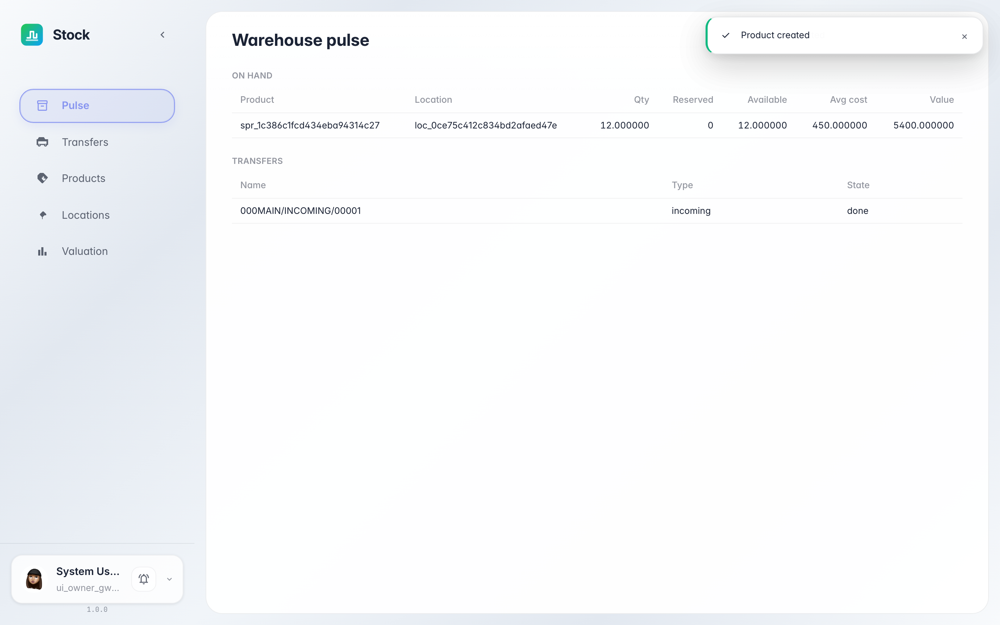
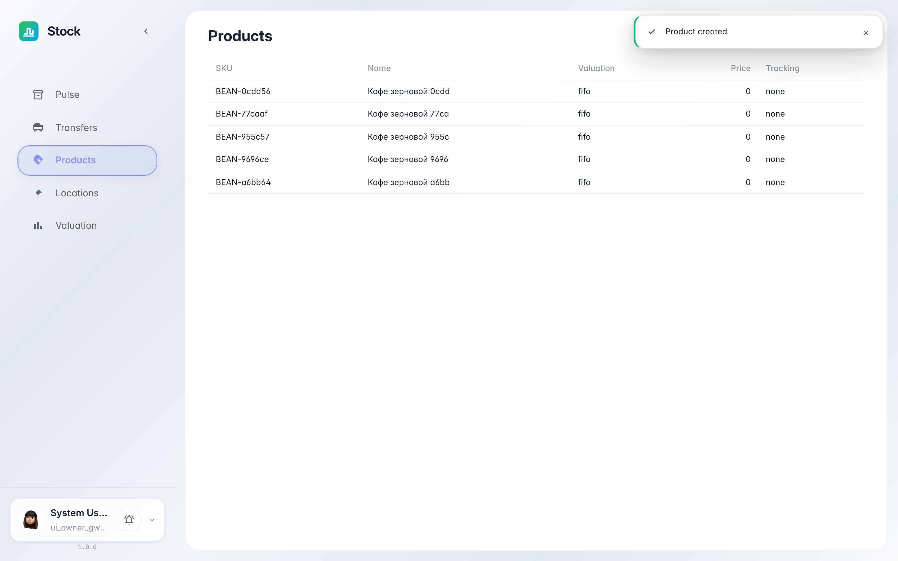
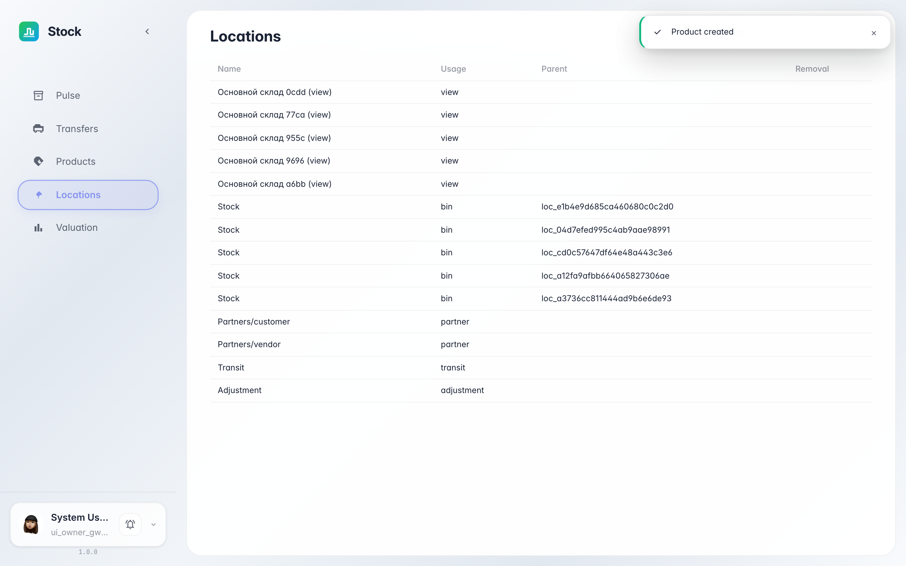
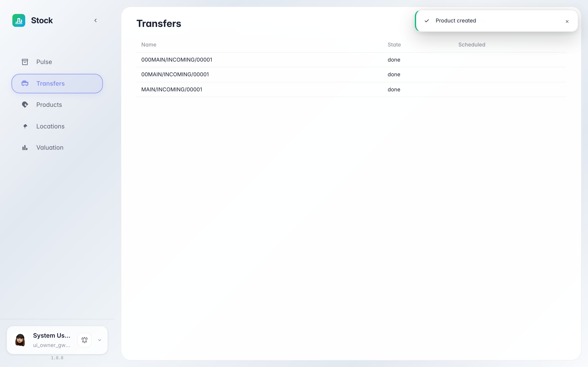
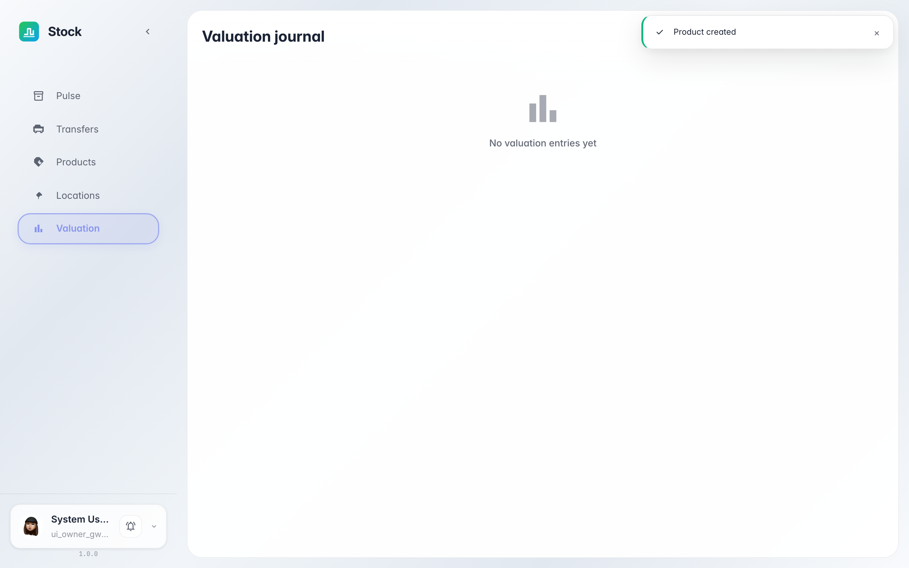

# Meet the warehouse: overview, products, bins, documents

**Purpose:** your first visit to the Warehouse section — learn in five minutes where everything lives.

**Problems solved:** you will know where to see stock and its value, where the product catalog is, where the bin map lives, and where the journal of all warehouse documents is.

**Result:** you can navigate the warehouse menu and know which screen to open for each task.

## Step 1. Open the Warehouse section

Choose «Warehouse» in the app menu. The home page opens — the warehouse «pulse»: how much stock is on hand, how much is reserved, the value held in stock, and what is happening with documents right now.

## Step 2. Browse the product catalog

The «Products» item is the catalog of everything stored: name, SKU, unit of measure and valuation method. Check here whether a product exists before receiving a delivery.

## Step 3. Open the warehouse bin map

The «Locations» item shows the warehouse structure: receiving and shipping zones and storage bins. The location type shows its role — e.g. «receiving» where deliveries go, or a «bin» where goods stay.

## Step 4. Look into the documents journal

The «Transfers» item is the journal of all warehouse documents: receipts, deliveries and internal moves. The state shows the document stage: draft, reserved or done.

## Step 5. Open stock valuation

**Result demonstration.** The «Valuation» item is the stock value journal: every receipt and issue records a layer with quantity, price and total value.

**Summary.** You know the section map: home — pulse and stock, «Products» — catalog, «Locations» — bins, «Transfers» — documents, «Valuation» — money in stock.

