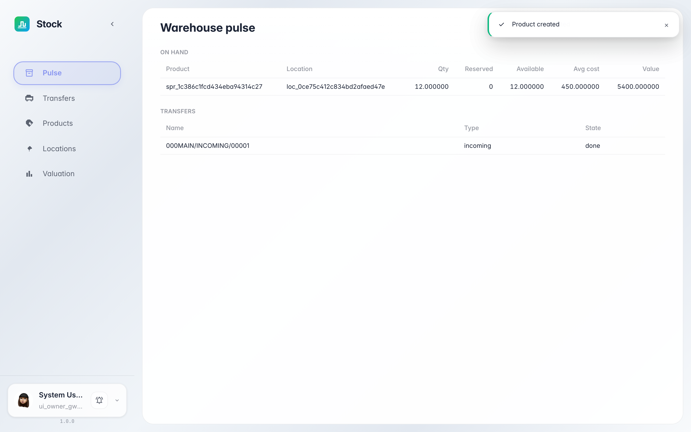
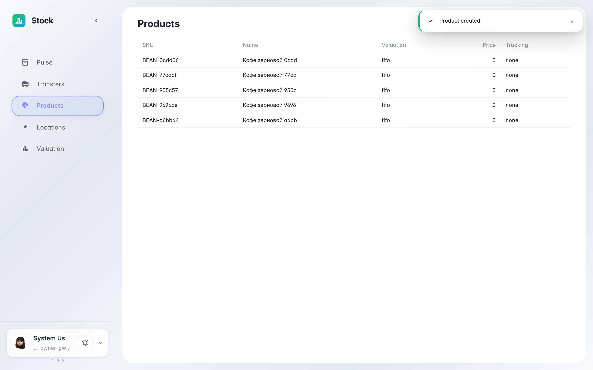
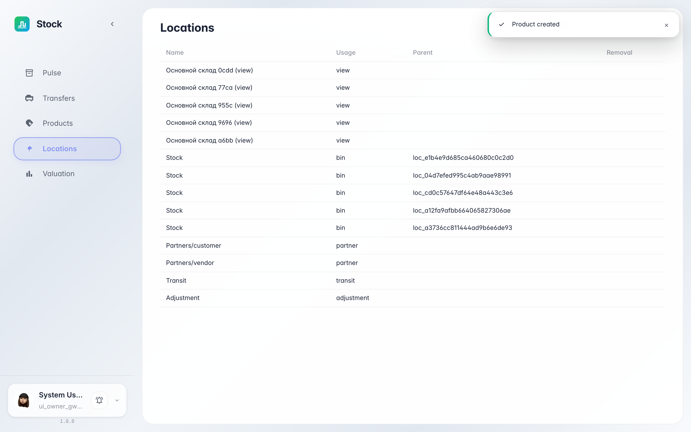
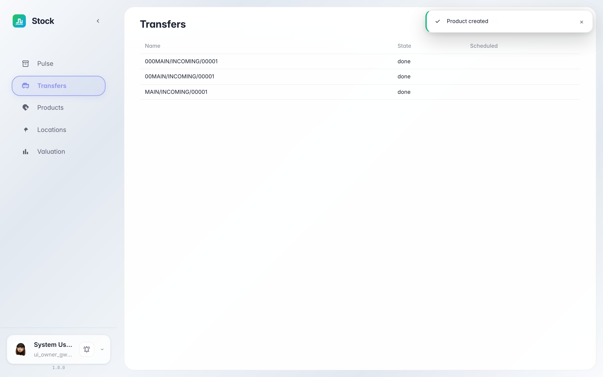
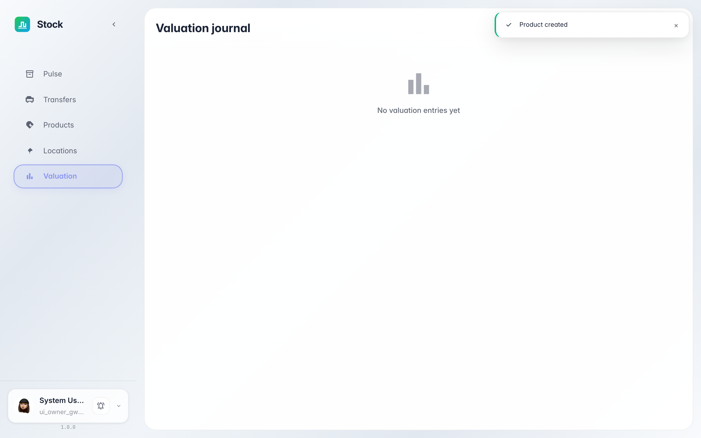

# Знакомимся со складом: обзор, товары, ячейки, документы

**Для чего:** первый визит в раздел «Склад» — за пять минут понять, где что живёт и как устроены основные экраны.

**Какие проблемы решает:** вы узнаете, где смотреть остатки и стоимость запасов, где каталог товаров, где карта ячеек склада и где журнал всех складских документов.

**Результат:** вы ориентируетесь в меню склада и знаете, какой экран открыть для нужной задачи.

## Шаг 1. Откройте раздел «Склад»

В меню приложений выберите «Склад». Открывается главная — «пульс» склада: сколько товара лежит, сколько зарезервировано, какая сумма числится в запасах и что происходит с документами прямо сейчас.

## Шаг 2. Посмотрите каталог товаров

Пункт «Товары» — справочник всего, что хранится на складе: название, артикул, единица измерения и метод оценки. Здесь проверяют, заведён ли товар, прежде чем принимать поставку.

## Шаг 3. Откройте карту ячеек склада

Пункт «Локации» показывает структуру склада: зоны приёмки, отгрузки и ячейки хранения. По типу локации видно её роль — например, «приёмка» куда ставят поставку, или «полка» где товар лежит постоянно.

## Шаг 4. Загляните в журнал документов

Пункт «Переводы» — журнал всех складских документов: поступления, отгрузки и перемещения. По статусу видно, на каком этапе документ: черновик, зарезервирован или проведён.

## Шаг 5. Откройте денежную оценку запасов

**Демонстрация результата.** Пункт «Оценка» — журнал стоимости запасов: каждый приход и расход записывает слой с количеством, ценой и итоговой стоимостью.

**Итог.** Вы знаете карту раздела: главная — пульс и остатки, «Товары» — справочник, «Локации» — ячейки, «Переводы» — документы, «Оценка» — деньги в запасах.

