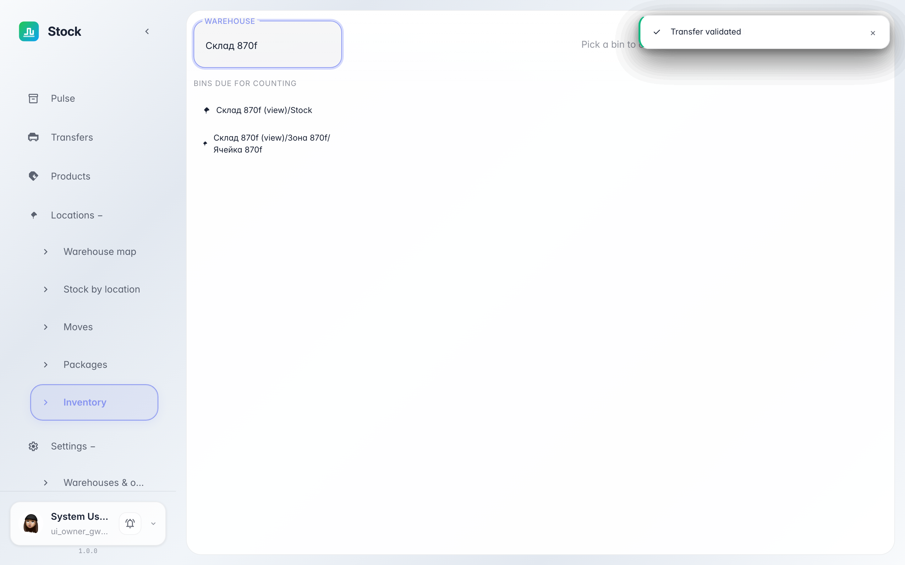

# Inventory count: reconcile actual vs recorded

**Purpose:** periodic bin counts keep stock honest: enter the actual quantity, the system shows the gap and posts an adjustment.

**Problems solved:** goods get lost, broken or mixed up — without counts the records drift from the shelf. The screen shows which bins are due for counting.

**Result:** you entered the actual count, applied it — the recorded stock now matches reality.

## Step 1. Pick a bin from the due list

The list on the left collects bins due for counting: not counted for a while or never at all. Clicking a bin opens the stock inside it.

## Step 2. Enter the actual quantity

In the «Actual» column type what is really on the shelf and press the checkmark — the system records the value and highlights the gap versus the book quantity.

## Step 3. Apply the count

«Apply» posts the adjustment: the recorded quantity is aligned with the actual count, and the difference lands in the moves journal.

**Summary.** Five minutes on the shelf with a mobile — and the records match reality again.

