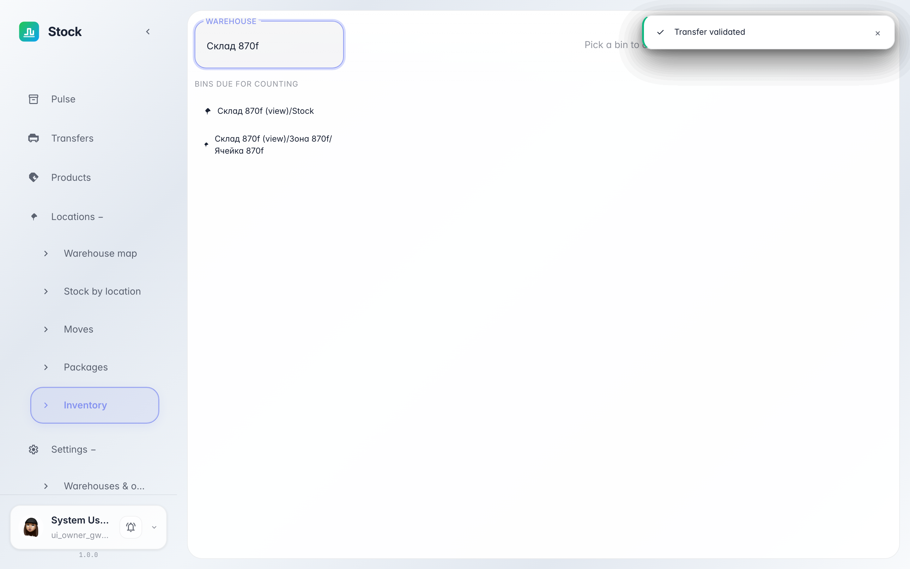

# Инвентаризация: сверить факт с учётом

**Для чего:** периодический пересчёт ячеек держит остатки честными: вводите фактическое количество, система показывает расхождение и проводит корректировку.

**Какие проблемы решает:** товар теряется, бьётся, пересортивается — без пересчёта учёт расходится с полкой. Здесь видно, какие ячейки пора пересчитать.

**Результат:** вы внесли факт, применили пересчёт — остаток подровнялся под реальность.

## Шаг 1. Выберите ячейку из списка «пора считать»

Слева собраны ячейки, которые пора пересчитать: давно не считали или не считали вовсе. Клик по ячейке открывает остатки внутри неё.

## Шаг 2. Введите фактическое количество

В колонке «Факт» впишите, сколько реально лежит на полке, и нажмите галочку — система запомнит значение и подсветит расхождение с учётным количеством.

## Шаг 3. Примените пересчёт

«Применить» проводит корректировку: учётное количество подравнивается под факт, а разница уходит в журнал движений.

**Итог.** Пять минут с мобильным на полке — и учёт снова совпадает с реальностью.

